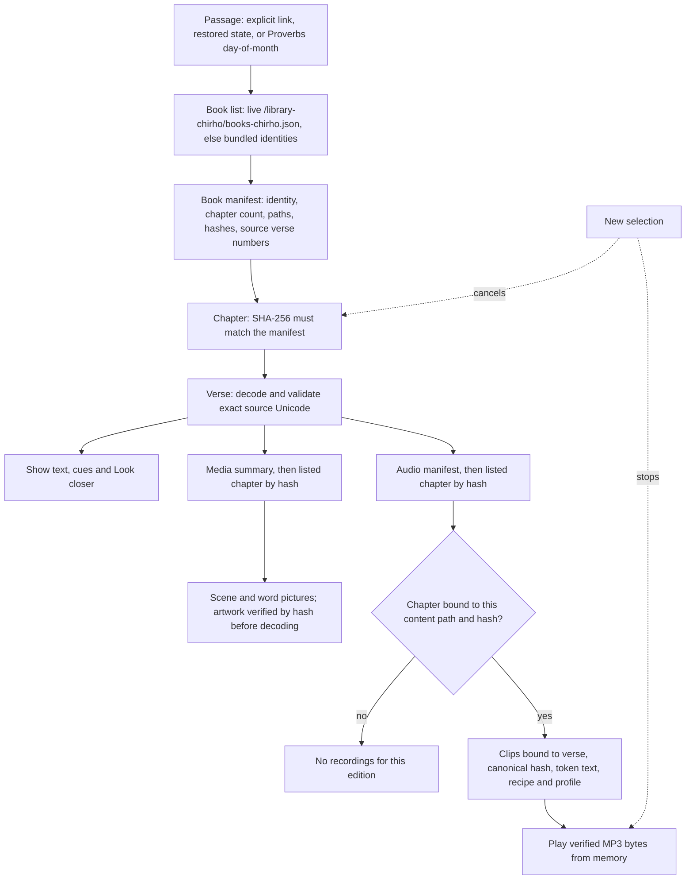

<!-- For God so loved the world, that he gave his only begotten Son, that whosoever believeth in him should not perish, but have everlasting life. — John 3:16 (KJV) -->

# Hinneh for Android

A native Kotlin/Compose reader for https://hinneh.us/. It shows the original Hebrew and Greek text with grammar cues, word pictures, the verse scene and saved word recordings. Native screens load one passage at a time from the website; there is no WebView and no bundled corpus. Only the 66 book identities ship in the app, as a fallback for the live book list. The shared contract is `../README-chirho.md`.

Owner: claude2_chirho (Android lane, `apps-chirho/android-chirho/` only). GPT owns the website, the remote contract, the shared brand files and the progress record.

## Toolchain

| Piece | Version | Why |
| --- | --- | --- |
| Gradle wrapper | 9.8.2 | Fixes the two local daemon deserialization advisories affecting 9.0.0–9.8.0. Distribution and wrapper jar both match Gradle's published SHA-256. |
| Android Gradle Plugin | 9.5.0 | Fixes Gradle 9.8 configuration deprecations; adopted under a recorded exception to the one-week rule (security and compatibility, GPT DM #2710). |
| Kotlin | 2.4.21 | Built-in Kotlin through the root classpath; no compatibility diagnostic with AGP 9.5.0 under `--warning-mode all`. |
| Compose BOM | 2026.09.00 (Compose 1.12.1, Material3 1.4.0) | Published 2026-09-09. |
| Lifecycle | 2.11.0 | Published 2026-06-17. |
| core-ktx | 1.19.1 | Published 2026-09-23; used directly for preference edits. |
| compileSdk / targetSdk / minSdk | 37 / 37 / 26 | Android 17 (platform 37.0). |
| JDK | 17 | AGP 9 requirement. |

Lint runs with every check enabled and treats warnings as errors; Kotlin warnings are errors too. If `ANDROID_HOME` and `ANDROID_SDK_ROOT` are both set they must name the same path, with the same letter case; otherwise unset `ANDROID_SDK_ROOT`. Builds pass `-Pandroid.builder.sdkDownload=false` when the shared SDK must not change.

## Commands

Run from this directory.

```bash
./gradlew :app-chirho:assembleDebug                 # debug APK in app-chirho/build/outputs/apk/debug/
./gradlew :app-chirho:lintDebug                     # zero issues required
./gradlew :app-chirho:testDebugUnitTest             # JVM tests; contract tests read ../../static read-only
./gradlew :app-chirho:testDebugUnitTest -Phinneh.fullCorpusChirho=true \
  --tests 'us.hinneh.readerchirho.contentchirho.PublishedCorpusContractTestChirho'   # every published verse
ANDROID_SERIAL=<device> ./gradlew :app-chirho:connectedDebugAndroidTest   # live device tests against hinneh.us
```

`connectedDebugAndroidTest` installs, runs and then uninstalls the app; reinstall the debug APK afterwards to keep using it. To open a particular passage directly:

```bash
adb shell am start -n us.hinneh.readerchirho/.MainActivityChirho --es us.hinneh.readerchirho.PASSAGE_CHIRHO John.1.1
```

Without that extra, a fresh launch opens Proverbs at the local day of the month, verse 1.

## Layout

Packages under `app-chirho/src/main/kotlin/us/hinneh/readerchirho/`:

| Package | Responsibility |
| --- | --- |
| `remotechirho/` | Trusted origin and path allowlist, bounded cancellable transport, SHA-256 checks, memory and disk caches. |
| `contentchirho/` | Book list, book manifests, hash-bound chapters, verse models and the website's validators. |
| `domainchirho/` | Passages, grammar cues, verb forms, word grouping, spoken text and morphology labels. |
| `mediachirho/` | Scene and word-picture selection, verified image decoding. |
| `audiochirho/` | Recording binding and selection, Greek reading rules, playback from verified bytes. |
| `statechirho/` | Reader state, the ViewModel and preferences. |
| `uichirho/` | Compose screens: passage controls, verse, Look closer, sources and settings. |

JVM tests live in `app-chirho/src/test/`; device tests in `app-chirho/src/androidTest/`. Build output, IDE files, `local.properties` and `evidence-chirho/` are ignored.

## Reading one passage



A newer selection cancels the older passage's requests and stops its audio. A failed or refused picture or recording never removes verified text; it is shown as unavailable.

## Contract behaviour

- HTTPS to `hinneh.us` only, through a per-resource path allowlist; other hosts, traversal, queries, fragments and redirects are refused. No credentials ship in the app.
- Chapters, media chapters, audio chapters, artwork and MP3s are checked by SHA-256 before use. The disk cache re-verifies on every read and stays under 96 MiB; memory caches are bounded by count or bytes.
- Hebrew is laid out right to left and Greek left to right, with exact source text. Punctuation and maqqef-joined words stay with their words. Source words carry Hebrew or Greek locale spans and published English notes an English one, so a screen reader can choose the matching voice.
- Word speakers are small chips centred on each word box's physical upper-right corner. Each is its own button, so playing a word never opens Look closer.
- Greek readings follow the website: Modern with Aspirates by default; a plain Modern recording stands in only when the word has no rough breathing; Erasmian plays only Erasmian recordings.
- Scenes and pictures carry their AI-artwork review labels; recordings carry their AI-audition labels. Missing meanings, pictures and recordings stay visibly unavailable.
- English and Spanish interface, chosen in Settings or from the device language.
- Image reports stay in the website's protected flow: the app links to the verse on hinneh.us.

## Status (2026-11-03)

Executed on this Mac with the toolchain above, against the Android 16 (API 36) arm64 emulator and the live site:

- Lint: no issues with every check enabled. JVM: 34 tests pass, and the opt-in run takes all 31,156 published verses through the app's decoders and validators.
- Device: 6 tests pass. The live book list was used (13,879 bytes, SHA-256 `941fe5fe…c679`, 66 books). Proverbs 26:1, John 1:1 and Psalm 119:176 loaded and validated, a scene decoded, and a verse MP3 verified and parsed as `audio/mpeg`. The reader flow went from today's Proverbs verse to John 1:1, opened and closed Look closer, started and stopped the verse recording, and stepped to John 1:2.
- A speaker tap plays its word without opening Look closer; a tap on the word opens it.

The app targets API 37 but has only run on API 36: no API 37 system image is installed, so Android 17 runtime behaviour is untested.

Not yet done: the Spanish meaning layer (Spanish interface shows the English meanings, marked as English), device-voice fallback for words without a saved recording, word-by-word assembled verse playback, a manual TalkBack walkthrough, a run on an API 26 device, and release signing or store submission.
