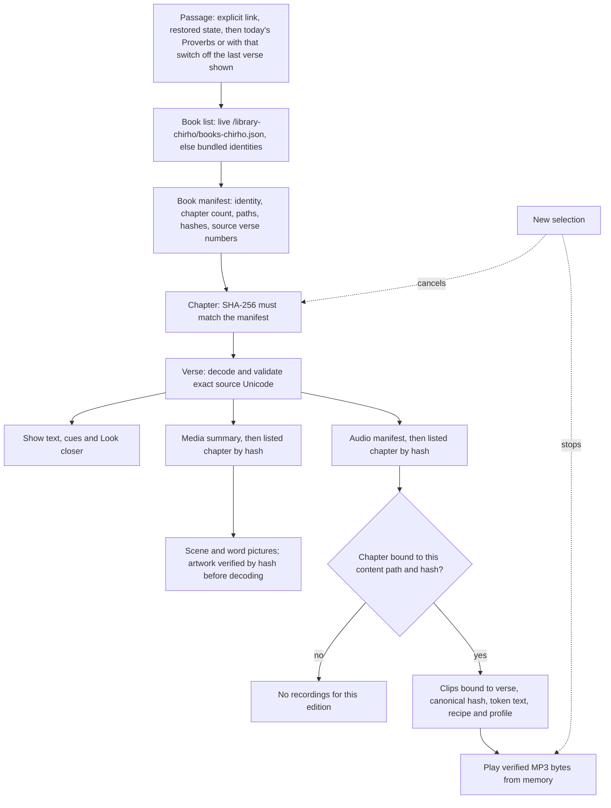

<!-- For God so loved the world, that he gave his only begotten Son, that whosoever believeth in him should not perish, but have everlasting life. — John 3:16 (KJV) -->

# Hinneh for Android

A native Kotlin/Compose reader for https://hinneh.us/. It shows the original Hebrew and Greek text with grammar cues, word pictures, the verse scene and saved word recordings. Native screens load one passage at a time from the website; there is no WebView and no bundled corpus. Only the 66 book identities ship in the app, as a fallback for the live book list. The shared contract is `../README-chirho.md`.

Owner: claude_chirho, since L.J. handed over Android and Google Play on 2026-11-05 (claude2_chirho wrote the first version). Under L.J.'s 2026-11-07 split, GPT owns iOS, the main media, the remote contract, the publisher and the progress record, and Claude2 owns the website.

On Google Play as `us.hinneh.readerchirho`: https://play.google.com/store/apps/details?id=us.hinneh.readerchirho. Releases go through `~/bin-chirho/play-release-chirho.ts` (the shared `play-store-chirho` skill) with this folder's `play-release-chirho.json`.

## Toolchain

| Piece | Version | Why |
| --- | --- | --- |
| Gradle wrapper | 9.9.0 | Released 2026-11-06 and adopted 2026-11-08, a recorded same-week exception (GPT, DM #3486): lint reports a newer Gradle as an error and a release must be lint-clean without suppression. It runs on JVM 17–27, its embedded Kotlin is 2.4.21, and AGP 9.5 needs Gradle 9.6.0 or later. The distribution (`0b00b0ff…177a`) and wrapper jar (`621008af…daf8`) match services.gradle.org's SHA-256. 9.8.2 had fixed the daemon deserialization advisories affecting 9.0.0–9.8.0. |
| Android Gradle Plugin | 9.5.1 | 9.5.0 fixed Gradle 9.8 configuration deprecations (recorded exception to the one-week rule, GPT DM #2710). The 9.5.1 patch was adopted on its release day, 2026-11-05, on L.J.'s explicit word after lint flagged it. |
| Kotlin | 2.4.21 | Built-in Kotlin through the root classpath; no compatibility diagnostic with AGP 9.5.0 under `--warning-mode all`. |
| Compose BOM | 2026.09.00 (Compose 1.12.1, Material3 1.4.0) | Published 2026-09-09. |
| Lifecycle | 2.11.0 | Published 2026-06-17. |
| core-ktx | 1.19.1 | Published 2026-09-23; used directly for preference edits. |
| compileSdk / targetSdk / minSdk | 37 / 37 / 26 | Android 17 (platform 37.0). |
| JDK | 17 | AGP 9 requirement. |

Lint runs with every check enabled and treats warnings as errors; Kotlin warnings are errors too. If `ANDROID_HOME` and `ANDROID_SDK_ROOT` are both set they must name the same path, with the same letter case; otherwise unset `ANDROID_SDK_ROOT`. Builds pass `-Pandroid.builder.sdkDownload=false` when the shared SDK must not change.

## Commands

Run from this directory.

```bash
./gradlew :app-chirho:assembleDebug                 # debug APK in app-chirho/build/outputs/apk/debug/
./gradlew :app-chirho:lintDebug                     # zero issues required
./gradlew :app-chirho:testDebugUnitTest             # JVM tests; contract tests read ../../static read-only
./gradlew :app-chirho:testDebugUnitTest -Phinneh.fullCorpusChirho=true \
  --tests 'us.hinneh.readerchirho.contentchirho.PublishedCorpusContractTestChirho'   # every published verse
ANDROID_SERIAL=<device> ./gradlew :app-chirho:connectedDebugAndroidTest   # live device tests against hinneh.us
```

## Verse video

When a verse has a video, it takes the scene picture's place, and Play plays it with its reading (L.J., 2026-11-06). Play's label says what it will play (L.J., via GPT DM #3653): "Play verse video" ("Reproducir video del versículo") for the verse's playable video, and "Listen to verse" ("Escuchar el versículo") for a recording alone, including after a video failed on this visit. Both follow `ReaderUiStateChirho.versePlayChirho`, the same choice Play makes. Without one, Play plays the verse's best saved reading over the scene. A human reading by Rabbi Dan Be'eri comes first (GPT, DM #3390). Videos and recordings follow the Speed setting, with pitch kept.

The credit of what Play plays, a video's own or a human reading's, is in the verse's folded Sources list: the exact published attribution and a License link, once. L.J., 2026-11-07: "credits etc can just show in like an info screen, not have the main user interface littered with dev notes" (agreed with GPT, DM #3486). The reading key's credits also name the Be'eri readings.

Video records follow GPT's verse-video rules (DM #3399): each video is checked against its verse's exact text and the scene shown in its place, and carries either a Be'eri reading source or nothing (a silent CC0 video). Publication is GPT's; the first 19 Proverbs chapter-opening videos went live on 2026-11-07. Debug builds can also play videos staged on a device, labelled as not published; release builds cannot.

- **A silent video says so.** Both `reading_language_chirho` and `embedded_reading_chirho` must be present; an absent key is not an explicit null, and the record is refused (GPT, DM #3498).
- **Duplicates.** Two rows for one verse withhold its video; the scene and word pictures still show.
- **A failed video.** As on the website, a video that cannot be fetched, verified or played is not tried again on that visit. The still returns, and the next Play reads the verse's recording over it. With no recording to read, Play may try the video again.

Workflow and rules: `spec-chirho/workflows-chirho/native-chirho/verse-video-chirho.md`.

```bash
python3 -I tools-chirho/stage_videos_chirho.py <videos folder> --serial emulator-5556   # debug builds only
```

`connectedDebugAndroidTest` installs, runs and then uninstalls the app; reinstall the debug APK afterwards to keep using it. To open a particular passage directly:

```bash
adb shell am start -n us.hinneh.readerchirho/.MainActivityChirho --es us.hinneh.readerchirho.PASSAGE_CHIRHO John.1.1
```

Without that extra, a fresh launch opens Proverbs at the local day of the month, verse 1. With Settings › Open today's Proverbs off, it opens the last verse shown instead. The extra counts only on a fresh launch: an activity that Android restores keeps the verse it showed.

## Layout

Packages under `app-chirho/src/main/kotlin/us/hinneh/readerchirho/`:

| Package | Responsibility |
| --- | --- |
| `remotechirho/` | Trusted origin and path allowlist, bounded cancellable transport, SHA-256 checks, memory and disk caches. |
| `contentchirho/` | Book list, book manifests, hash-bound chapters, verse models and the website's validators. |
| `domainchirho/` | Passages, grammar cues, verb forms, word grouping, spoken text, morphology labels and the bundled reading key. |
| `mediachirho/` | Scene and word-picture selection, verified image decoding. |
| `audiochirho/` | Recording binding and selection, Greek reading rules, playback from verified bytes. |
| `statechirho/` | Reader state, the launch rules, the ViewModel and preferences. |
| `uichirho/` | Compose screens: the welcome, passage controls, verse, Look closer, Help and the reading key, sources, settings and Info. |

JVM tests live in `app-chirho/src/test/`; device tests in `app-chirho/src/androidTest/`. Build output, IDE files, `local.properties` and `evidence-chirho/` are ignored.

## Reading one passage



A newer selection cancels the older passage's requests and stops its audio. A failed or refused picture or recording never removes verified text; it is shown as unavailable.

## Contract behaviour

- HTTPS to `hinneh.us` only, through a per-resource path allowlist; other hosts, traversal, queries, fragments and redirects are refused. No credentials ship in the app.
- Chapters, media chapters, audio chapters, artwork and MP3s are checked by SHA-256 before use. The disk cache re-verifies on every read and stays under 96 MiB; memory caches are bounded by count or bytes.
- Hebrew is laid out right to left and Greek left to right, with exact source text. Punctuation and maqqef-joined words stay with their words. Source words carry Hebrew or Greek locale spans and published English notes an English one, so a screen reader can choose the matching voice.
- Word speakers are small chips centred on each word box's physical upper-right corner. Each is its own button, so playing a word never opens Look closer.
- Greek readings follow the website.
  - Until a choice is saved in Settings, each verse picks its own: Modern with Aspirates when it has an Aspirates verse reading, otherwise Modern (`ReaderUiStateChirho.renditionChirho`). A saved choice always wins.
  - A plain Modern recording stands in for Aspirates only when the text has no rough breathing (any U+0314, ῥ included). Erasmian plays only Erasmian recordings.
- Speed starts at Normal for Hebrew and Greek, as on the website since L.J.'s 2026-11-03 "let's start at normal". Slow, Gentle and Slightly slower remain in Settings, and a choice is saved.
- Reviewed spoken readings follow the website's reading-continuation table through `assets/teaching-chirho/spoken-overrides-chirho.json`. GPT's exporter writes that asset byte-identically, and Android never edits it (`domainchirho/SpokenOverridesChirho.kt` and `domainchirho/SpokenChirho.kt`).
  - A review applies only to its exact word: id, text, lemma, augment, morphology and qere.
  - A word clip speaks that word's reading. In a verse reading, a reviewed written group (Lam 4:3, כי ענים read as one word) is read once, and only when the whole group and the exact verse text match. Anything changed keeps the source words.
  - A missing or invalid asset gives no reviews.
  - The opt-in corpus walk (`PublishedClipsCorpusTestChirho`) checks that every published clip and reading binds. It reads one audio chapter at a time.
- Pictures and recordings carry no per-item AI or review notes (L.J., 2026-11-05). Info, opened from Settings › About Hinneh and from the welcome, states once that they are AI-generated study aids still awaiting review. Missing meanings, pictures and recordings stay visibly unavailable. Info also holds:
  - links to the quick tour, the privacy policy (Google Play requires it inside the app), About and support, Sources, Contact and the source code;
  - the licenses of Hinneh's code and media, mirroring the website's "Free software and shared media" (the Spanish uses the app's usted);
  - the credits of the texts, grammar and readings, from the same strings as the reading key;
  - the version.
- Word cards carry no per-word source or review notes either (L.J., 2026-11-06): no gloss-source label, root status, importer note or raw OSHB code.
  - Look closer puts the word on Close's row, then shows its lexical form and Strong's number, the recording, the picture, the meaning and one grammar line. The grammar line is the source's English description, or the translated labels in Spanish.
  - A root appears only once one has been reviewed (no published word has one yet). Only a gloss written for Hinneh itself is labelled, so it never blends with the approved Global Bible Tools or Berean glosses.
  - The reading key ends with "About meanings & study aids": how meanings, grammar, roots and pictures are made, then the OSHB or Nestle 1904 credit, and for Hebrew the Be'eri readings' credit.
  - Under the verse are only its English numbering (when it differs), the exact source text, the folded sources list (the recording's or video's credit, the sources and the source-edition notes), and the link to the verse on hinneh.us.
- Previous and next verse appear above the verse and again below it; stepping from below returns to the top of the new verse.
  - The reference stays between the two buttons while its longest word fits there.
  - On a narrow phone or with large text, the whole reference takes its own centered line above the buttons instead of breaking inside a word (GPT, DM #3656).
  - Either way the buttons keep their order, targets and disabled state (`StepRowLayoutChirho`).
- Swiping the page steps the same way (`uichirho/VerseSwipeChirho.kt`). The next verse comes in from the Next button's side: a leftward swipe in English and Spanish, flipped in a mirrored right-to-left layout.
  - A swipe steps after 80dp, or sooner on a quick flick. The page follows the finger and springs back, and a haptic tick marks the threshold.
  - It never steps where the buttons are disabled; both use `ReaderUiStateChirho.canStepChirho`.
  - The buttons remain for TalkBack users, whose swipes navigate.
- The help button (TalkBack: "Help and reading key") opens the quick tour link first, then the reading key for the passage's language: the website's legend in English or Spanish, with the unfoldingWord Hebrew Grammar CC BY-SA 4.0 credit beside the Hebrew explanations. `app-chirho/src/main/assets/teaching-chirho/teaching-chirho.json` and `assets/library-chirho/books-chirho.json` are byte-identical exports of the website's tables; from the repository root, `bun apps-chirho/ios-chirho/scripts-chirho/export_teaching_chirho.ts` rewrites them and `--check` fails on drift.
- English and Spanish interface, chosen in Settings or from the device language.
- Settings › Text size scales all text: Small 80%, Medium 90% (the default since L.J.'s 2026-11-05 request), Large 100% (the original size) and Extra large 115%. It multiplies the device's own font size and is reapplied inside sheets, which have their own window.
- Image reports stay in the website's protected flow: the app links to the verse on hinneh.us.
- **Opening and playing.** L.J. confirmed both switches; root set the defaults (GPT, DM #3642).
  - **Settings › Open today's Proverbs** (on by default). Each fresh launch opens today's Proverbs; off, the last verse that loaded and verified. An explicit link wins either way. Coming back from the background, or a restore by Android, keeps the verse being read (`statechirho/LaunchChirho.kt`).
  - **Settings › Play each verse you move to** (on by default for a new install since 0.1.4; L.J., via GPT DM #3664: "our app should default to audio/video autoplay on for new installs etc"). A choice saved in Settings, on or off, always wins. After Previous/Next, a swipe, or a book, chapter or verse choice, Play is pressed once, as soon as the new verse's pictures and recordings are known. It plays the verse's video with its reading, otherwise its best recording, under the speed and reading in effect.
    - Never for a launch's first verse or behind the welcome, even when saved on.
    - Never over a sound the reader has started.
    - A newer choice cancels it.
    - A verse with nothing to play stays silent; Android has no assembled word-by-word reading yet.
  - Both choices stay on the device; Hinneh has no accounts.
- **Welcome** (GPT, DM #3642 and #3645). A first run, and the first launch after each update (a higher versionCode), shows one short screen.
  - It says what Hinneh is, that it covers Hebrew and Greek now with more languages planned, that its code and study materials are openly licensed, and that the quick tour opens any time from Help.
  - Start reading, or Back, records the version and opens the reader.
  - Watch quick tour opens the website's shared tour, https://hinneh.us/tutorial-chirho/, in the browser and in the interface language (root row 170). Help and Info always link it too.
  - Nothing is fetched or played on the welcome.

## Status (0.1.4 candidate, versionCode 5, 2026-11-08; not released)

Version 0.1.4 combines three units, each its own checkpoint in the isolated copy.

**174: autoplay on when nothing is saved** (L.J., via GPT DM #3664).
- A verse the reader moves to plays by itself. A choice saved in Settings, on or off, always wins. 0.1.3 saved the switch only when the reader flipped it, so an updated install that never touched it becomes on too.
- Unchanged: autoplay presses Play once, only after a move, never for a launch's first verse or behind the welcome; it never plays over a sound the reader started, a newer move cancels it, and it plays under the speed and reading in effect.

**175: Show IPA** (L.J., via GPT DM #3665 and #3669: "the apps should also have the option to show the IPA").
- **Settings › Show IPA**, under the pronunciation choice, is off until the reader turns it on, and is kept. It puts a small IPA line under each word, reading left to right inside a Hebrew line. A dash, heard by TalkBack as "IPA unavailable for this reading", marks a word without one.
- **Hebrew**: only the IPA of the very clip the word's speaker plays (`ReaderUiStateChirho.wordClipChirho`, shared by the speaker, Look closer and the IPA line). It has passed every identity, recipe and IPA check, so Aramaic, held and unbound words have none. Nothing is inferred; the website's in-browser fallback phonetics are not ported.
- **Greek**: root's draft broad teaching guide, the website's `greekWordIpaChirho` values exported unchanged for all 19,448 spoken forms and bundled under `assets/teaching-chirho/greek-ipa-chirho/` (one manifest and eight parts, 4,723,622 bytes; contract `build-chirho/native-greek-ipa-2026-11-08-chirho/contract-chirho.json`). `GreekIpaGuideChirho`:
  - checks the manifest's shape, recipe and fixed bounds, and each part's index, length and SHA-256 when first read;
  - looks a word up by the SHA-256 of its exact UTF-8 spoken bytes (`SpokenChirho.wordChirho` with the bundled reviewed readings), with no normalization;
  - answers only for a row whose own text has the same bytes, with the value for the pronunciation in effect and never another profile's.
  A failure leaves the guide, the part or the value unavailable, quietly. The lookup runs off the main thread only while Show IPA is on, and never touches audio selection, autoplay or holds.
- Settings' hint and one sentence in Info say what the line is; the reading view stays clean. There is no transliteration: no supported per-language table exists, and dictionary headword spellings are not one.

**176: the welcome and the verse's one Play** (L.J., via GPT DM #3673: "the 0.1.3 android welcome text is very uninviting nothing like the polished apps with beautiful onboarding"; "when no video is available the listen to verse button should be in the same place as the view video button").
- **Welcome** (`WelcomeChirho.kt`), still one quick screen and never a wizard:
  - root's watercolor (`res/drawable-nodpi/welcome_hero_chirho.webp`, CC0, pinned in `workspace-chirho/onboarding-chirho/2026-11-08-chirho/hero-manifest-chirho.json`), cropped about the open book and fading into the paper;
  - a small brand line and the headline "Open the Word." / "Abra la Palabra.", with one sentence;
  - a reader-example card with two real words drawn by the reader's own `WordSurfaceChirho`: Genesis 1:1 בְּרֵאשִׁית and John 1:1 Λόγος, with their published English and approved Spanish meanings (`WelcomeSampleTestChirho` checks every field against the static content and gloss files);
  - one quiet line on the free, openly licensed code and materials and the planned languages, and one on Help and the tour.
  - the picture takes about a third of the height above the pinned bar (about 170 dp on a narrow phone, as on iOS) and never more than its 3:2 shape, so the card shows before scrolling.
  Start reading is pinned at the bottom with the quick tour and Info, in ink rather than faint teal, so the art and words scroll above it. Info stays in the bar only when it and the tour fit on one row (measured from their own labels); otherwise it is a quiet link right after the open-materials line (GPT, DM #3702). At an effective text scale of 1.5 or more only Start reading stays pinned and the tour and Info follow the words at full width, so the bar never grows over the screen (root's iOS XXXL lesson, GPT DM #3692). Nothing is fetched or played; Back still starts reading.
- **Very large text** (font scale 2.0, GPT DM #3698): no label breaks inside a word or ends in an ellipsis. Previous/Next widen to their longest word and stack when they no longer fit side by side; Book, Chapter and Verse move to two rows, or one each; the reader's name takes its own line under Help and Settings. Text is never shrunk.
- **One Play below the picture** (`ReaderScreenChirho.kt`): the verse's Play verse video / Listen to verse / Stop control, with its reading and failure notes, sits directly below the scene or video, in the same place for both, and is no longer repeated under the words. The video keeps its own tap-to-play surface. Its label and target still come from `versePlayChirho`, so after a failed video the same control reads the recording over the still.

**Release note:** see `evidence-chirho/` for the exact EN/ES text sent with the candidate.

## Status (0.1.3, versionCode 4, 2026-11-08; committed to Google Play production 02:23Z on 11-09)

Version 0.1.3 adds the welcome, Info, the quick-tour links and the two switches (root unit 169; GPT, DM #3642, #3645 and #3650).
It also names what Play will play: "Play verse video" or "Listen to verse" (L.J., via GPT DM #3653).
- It was made in an isolated copy. The public 0.1.2 and its frozen artifacts are untouched.
- Its release waits for root's review, and for root's proof that the hosted tour and its media work, so the app never links a dead tour.

Checks on this Mac, against the local static tree:
- A clean build. Kotlin has no warnings, and lint finds no issues in release or debug.
- JVM: 78 tests. All pass except the opt-in live test, which is skipped by default. The new ones cover:
  - the launch rules and the welcome (`LaunchTestChirho`);
  - the device-only defaults (`PreferencesTestChirho`);
  - autoplay and resuming through the real ViewModel (`ReaderViewModelTestChirho`).
- The full-corpus walk refuses 0 of 437,587 entries, including the 256 new Greek chapter openings. The corpus contract covers 31,156 verses.
  - Its bound count is distinct pairs. Three published word entries repeat the same token and MP3: one in Prov 1:13 and two in Prov 26:1.
- Mutations, each in a throwaway copy. Each of these makes the new tests fail:
  - autoplay on a launch's first verse;
  - today's Proverbs off being ignored;
  - no welcome after an update;
  - autoplay over a sound the reader started;
  - keeping a verse before it has loaded;
  - a label that reads the raw video record, ignoring the failed-video fallback;
  - a step row that never stacks (a device test).
- Device: 10 connected tests pass on emulator-5556 (API 36), booted headless with `-no-audio` and software rendering. All checks are silent.
  - The 5 live smoke tests.
  - The reader flow, now passing through the welcome.
  - The new launch flow:
    - the welcome, Info's licenses and Start reading;
    - Play verse video on today's chapter opening, which has a video;
    - in Settings, autoplay on and today's Proverbs off;
    - a Next step whose reading starts by itself and stops;
    - a relaunch that opens the verse shown last, with no welcome and nothing playing.
  - The step row (`StepRowLayoutTestChirho`):
    - at 320 dp in Spanish at Extra large, the whole reference sits above the two steps with no word broken;
    - at an ordinary width in English at Medium, it keeps one row;
    - Previous and Next keep their order, targets and disabled state.
    - With the row forced to stay a row (a mutation), the narrow test fails.
- Phone width: screenshots at 320 dp, in English and Spanish, at Medium and Extra large text.
  - Every Play label fits on one line, except "Reproducir video del versículo" at Extra large, which wraps to two lines at a word boundary.
  - The welcome wraps at word boundaries. Its Start reading is white on teal (4.5:1), as is Retry. The theme's ink body color had drawn both labels at 2.6:1.
  - The reference between Previous and Next used to break inside the book name at 320 dp ("Prove/rbs"), and at Extra large one letter per line. It now moves above the buttons when it cannot fit whole (`StepRowLayoutTestChirho`).

## Status (0.1.2, versionCode 3, 2026-11-08)

Version 0.1.2 adds the reviewed spoken readings (`spoken-overrides-chirho.json`, GPT DM #3567).
- Before it, Android withheld 4 of 437,331 published entries: Lam 4:3's Be'eri reading and two words, and one word in Jer 48:44. Now all of them bind.
- Checks on this Mac, against the local static tree, which is identical to the live site:
  - A clean build with every task rerun: Kotlin has no warnings, and lint finds no issues in release or debug.
  - JVM: 64 tests, of which 63 pass and the opt-in live test is skipped by default. The full-corpus walk refuses 0 of 437,331 entries, all 13,470 human readings are accepted and first, and the corpus contract covers 31,156 verses.
  - Live: all 31 videos verify through the app's own network path.
  - Device: 6 connected tests pass on emulator-5556, booted with `-no-audio` (all checks are silent since L.J.'s 2026-11-08 report).
  - On the device, a release-variant build signed only with the local debug key:
    - Lam 4:3 shows speakers on כי and ענים and offers Listen, which plays Be'eri's reading silently. Its credit is in Sources.
    - Jer 48:44 shows its speaker on הניס.
  - In a scratch copy, breaking the group rule or the word path makes the corpus and human-reading tests fail.

Version 0.1.1 (versionCode 2) went public on Google Play on 2026-11-08. Version 0.1.0 (versionCode 1) had been live since 2026-11-06. Version 0.1.1 adds human readings, published verse videos, verse swipes, the cleaner word cards and reading key, Normal speed, the automatic Greek reading and credits in Sources. It was checked on this Mac with the toolchain above, against the Android 16 (API 36) arm64 emulator `Hinneh_Review_Chirho` (emulator-5556) and the live site:

- A clean build with every task rerun: Kotlin compiles with no warnings (warnings are errors), and lint finds no issues in release or debug.
- JVM: 60 tests, of which 59 pass and the opt-in live test is skipped by default. Run with `-Phinneh.liveChirho=true`, it shows and verifies all 19 published Proverbs videos. In a scratch copy, removing the failed-video fallback or decoding absent video keys as null makes the new tests fail.
- Device: 6 connected tests pass.
- On the device, with a release-variant build signed only with the local debug key:
  - A fresh launch opens today's Proverbs verse. Proverbs 8:1's video plays in the scene's place at Normal speed (4.97 s of audio for its 4.958 s video), with its credit and License link only in Sources.
  - A swipe steps to Proverbs 8:2. Its Be'eri reading plays at Normal (5.800 s), and its credit appears in Sources.
  - Matthew 1:16 picks Modern automatically and plays its Chatterbox reading; John 1:1 picks Modern with Aspirates and plays the aspirated reading. A saved Aspirates choice withholds Matthew 1:16's Modern reading and survives a relaunch.
  - The word card, the reading key credits, English and Spanish About, and the Spanish Sources credit read as intended.
  - With the network cut, Proverbs 8:1's video fails, the still returns with Listen, and once the network is back Listen plays Be'eri's 4.96 s reading over it.
  - Screenshots are in `evidence-chirho/release-0.1.1-2026-11-08-chirho/`, which git ignores, with the frozen source manifest.

The app targets API 37 but has only run on API 36: no API 37 system image is installed, so Android 17 runtime behaviour is untested.

Not yet done: the Spanish meaning layer (Spanish interface shows the English meanings, marked as English), device-voice fallback for words without a saved recording, word-by-word assembled verse playback, a separate reading track behind a muted video, a manual TalkBack walkthrough and a run on an API 26 device.
