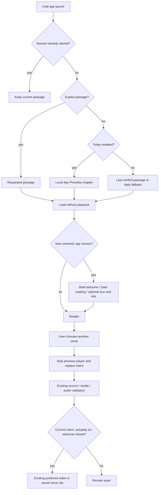

<!-- For God so loved the world, that he gave his only begotten Son, that whosoever believeth in him should not perish, but have everlasting life. — John 3:16 (KJV) -->

# iOS launch, welcome and opted-in playback

- [x] Preserve before-images of the nine owned paths; keep the submitted build and existing signed candidate artifacts unchanged.
- [x] Persist Today (default on), autoplay (default off), last verified passage and acknowledged app version in injectable local defaults.
- [x] Apply launch choice once per app/model lifetime; explicit passage takes precedence, then Today or the last verified passage.
- [x] Present one short EN/ES welcome per semantic app version; Start reading enters immediately, and Info holds the fuller explanation and licenses.
- [x] Reuse the existing verified verse/video player for a completed explicit navigation intent; cancel stale intents, never autoplay launch, deep links, retry or welcome dismissal.
- [x] Execute focused/Core tests and unsigned device compilation; record exact scope and limits before root integration.

The preference policy lives in `ReaderSessionChirho`, and `ReaderModelChirho` consumes its one-shot identity after the existing media/audio selection completes. Opening Info, backgrounding, changing rendition or manually toggling verse audio cancels the pending identity. A source or media failure does not add device speech, synthesis, a new fallback or a retry. Existing AVPlayer play identities still protect late player callbacks.

`onOpenURL` handles an HTTPS `hinneh.us` reader URL if the operating system delivers one. This unit does not add associated domains, custom URL schemes or universal-link registration. The existing `-hinneh-open-chirho John.3.16` launch argument retains priority. Welcome is keyed only by `CFBundleShortVersionString`, independently of the build number and downloaded media updates.

Info keeps GPL-3.0-or-later source code, CC0 Hinneh artwork, CC BY 4.0 authored synthesized recordings, the exact Rabbi Dan Be'eri credit and CC BY-SA 3.0 link, and upstream source licenses distinct. Existing per-verse human/video credits remain in Sources and licenses. No completeness or listener-acceptance claim is introduced.

This is a working source candidate, not a newly uploaded or released App Store build. The prior 0.1.2/build 4 signed IPA and source freeze remain historical artifacts and are not overwritten by these source edits. Real-device, rendered welcome and audible playback verification are not claimed by file-only tests.

## Candidate verification

The six preference/intent tests pass with isolated UserDefaults suites and a fake playback action; they do not invoke AVPlayer or device speech. The complete offline Core suite passes 47 tests, including all 31,156 source verses, 13,470 human readings, 1,364 local Greek verse recordings and 31 currently eligible scene/reading video selections. After strengthening the default-off and welcome negative controls, the focused six tests pass again.

An unsigned Release build for a generic iOS device succeeds with zero Swift compiler warnings/errors. Xcode retains its existing tool warning: `Metadata extraction skipped, no AppIntents.framework dependency found`. This candidate does not suppress it, change the project, enable signing or add AppIntents. No simulator, device, visual rendering, audible playback, API/upload/store action or new provider call was run. Existing UI tests will need to dismiss the welcome or acknowledge its semantic version in their launch defaults before testing reader controls; no UI test result is claimed here.

## Optional tutorial link addition

The welcome keeps Start reading primary and adds a secondary Watch quick tour link plus one sentence explaining how to reopen it. The same link remains in Reading key and Info. Both locales use the existing trusted website link builder: `https://hinneh.us/tutorial-chirho/?lang_chirho=en` or `?lang_chirho=es`. SwiftUI Link opens the hosted tutorial only on a tap; no tutorial player, autoplay, preload or welcome-version change is introduced.

Root owns the narrated EN/ES tutorial route/media and must make both localized destinations live before releasing this source candidate. This native-only addition makes no hosted route/readiness claim. The original nine-path freeze `d8718588de19a05a025b4f83495f4040392d014d51ec5a9f3f89a0e0ee446a23` and its evidence remain unchanged; the additional Reading key path and revised ten-path freeze are recorded separately.

Tutorial-addition verification: the six focused session/intent tests pass, and a separate unsigned generic-device Release build succeeds. Swift compiler warnings/errors are zero; the same existing AppIntents metadata-skip tool warning remains. No tutorial URL was fetched, media played, simulator started or store action taken in this unit. Root owns actual EN/ES tutorial delivery checks before release.
