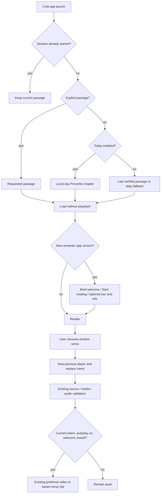
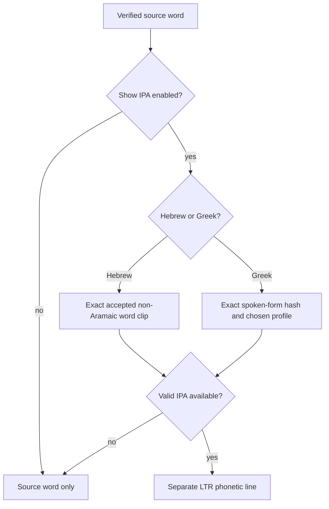

<!-- For God so loved the world, that he gave his only begotten Son, that whosoever believeth in him should not perish, but have everlasting life. — John 3:16 (KJV) -->

# iOS launch, welcome and playback preferences

- [x] Preserve before-images of the nine owned paths; keep the submitted build and existing signed candidate artifacts unchanged.
- [x] Persist Today and autoplay (both default on for a new install), last verified passage and acknowledged app version in injectable local defaults. Explicit saved On and Off choices are preserved.
- [x] Apply launch choice once per app/model lifetime; explicit passage takes precedence, then Today or the last verified passage.
- [x] Present one short EN/ES welcome per semantic app version; Start reading enters immediately, and Info holds the fuller explanation and licenses.
- [x] Reuse the existing verified verse/video player for a completed explicit navigation intent; cancel stale intents, never autoplay launch, deep links, retry or welcome dismissal.
- [x] Execute focused/Core tests and unsigned device compilation; record exact scope and limits before root integration.

The preference policy lives in `ReaderSessionChirho`, and `ReaderModelChirho` consumes its one-shot identity after the existing media/audio selection completes. Opening Info, backgrounding, changing rendition or manually toggling verse audio cancels the pending identity. A source or media failure does not add device speech, synthesis, a new fallback or a retry. Existing AVPlayer play identities still protect late player callbacks.

## Optional word IPA

The device’s Show IPA preference starts off and persists independently of autoplay. Its line sits below the unchanged source word and keeps left-to-right direction, including in Hebrew. Hebrew requires the exact accepted selected word clip, token, spoken text and canonical verse binding; missing, held and Aramaic forms stay without IPA. Greek reads a bounded signed-bundle lookup generated by the existing shared teaching helper, with exact raw UTF-8 keys and the selected rendition only. It does not infer transliteration or certify an acoustic transcription. The English/Spanish explanation appears once in Info.

The guide loader checks the fixed eight-part contract, byte lengths and SHA-256, shard membership, recipe, exact text identity and profile availability. The exporter owns source/corpus freshness checks and writes byte-identical native assets; Swift contains no Greek phonology. Focused IPA/session tests pass 12/12, including all 19,448 generated rows in three profiles and 51 real John 1:1 public-API calls through the actual resource bundle. An incremental host-test cache initially selected a stale nested bundle without the new assets; its failure is preserved. The unchanged generated debug resource-parent override points to the verified fresh bundle. A clean shipping build still verifies its own packaged assets independently.

## Visual welcome and one media control

The welcome uses a bundled authored watercolor hero, a short headline and purpose, and the first three words of the currently verified verse. Its static source/gloss preview has no button traits, speaker or image load. Start reading stays in the bottom safe-area action area; the optional tour and Info have their own accessible targets. Info opens a separate optional detail sheet and retains the precise code, artwork, synthetic-recording and Be'eri license distinctions. The welcome itself does not play or preload media.

At accessibility text sizes only Start reading stays pinned. Tour, Info and the open-materials statement move into the scrolling body with full-size wrapping text. At normal sizes those secondary actions stay in the bottom row. Secondary actions use the existing quiet ink; the primary welcome and media controls use the existing noun teal with white text.

The reader has one primary control immediately below its scene/media. Both an accepted verse recording and a preferred verified video use that same control and position. The existing failure-aware predicate chooses the label and actual playback path; Stop remains there while active, and a failed MP4 can fall back to its accepted standalone reading on the next explicit Play. The duplicate card Play action is removed. No source identity, rendition, admission, player cancellation or fallback rule changes.

The visual candidate has three retained welcome iterations, followed by one media-tint-only correction. Six final English/Spanish normal/AX-XXXL render cases pass, then two affected media cases pass after the tint change. The large-text check requires the secondary actions to move with scrolling while Start remains pinned, with complete action frames reachable above it. Two earlier genuine visual failures remain retained: insufficient secondary-action contrast and a giant fixed footer at AX-XXXL, despite green initial interaction assertions. Read-only screenshot pixel checks measure quiet-on-paper at 5.76:1 and white-on-teal at 4.53:1 in the tested light appearance. These are bounded checks, not a full accessibility or physical-device acceptance claim.

Every render binary deliberately traps the common playback function before asset fetch or audio-session activation. No Play, speaker or tutorial action is used. Preference persistence, actual packaged guide resolution, quiet Start entry, source-bound media labels and geometry are covered; native decoding, clock progress, natural end and audible quality are not established by this render method. The owned temporary simulators are deleted after checks, and all earlier signed candidates remain unchanged. A separate proposed private native mute/volume/external-route guard requires independent approval and an all-zero canary before any real-media playback; it is not a shipping-code change.

`onOpenURL` handles an HTTPS `hinneh.us` reader URL if the operating system delivers one. This unit does not add associated domains, custom URL schemes or universal-link registration. The existing `-hinneh-open-chirho John.3.16` launch argument retains priority. Welcome is keyed only by `CFBundleShortVersionString`, independently of the build number and downloaded media updates.

Info keeps GPL-3.0-or-later source code, CC0 Hinneh artwork, CC BY 4.0 authored synthesized recordings, the exact Rabbi Dan Be'eri credit and CC BY-SA 3.0 link, and upstream source licenses distinct. Existing per-verse human/video credits remain in Sources and licenses. No completeness or listener-acceptance claim is introduced.

This is a working source candidate, not a newly uploaded or released App Store build. The prior 0.1.2/build 4 signed IPA and source freeze remain historical artifacts and are not overwritten by these source edits. Real-device, rendered welcome and audible playback verification are not claimed by file-only tests.

## Initial launch/tutorial verification

The seven current preference/intent tests use isolated UserDefaults suites and a fake playback action; they do not invoke AVPlayer or device speech. They cover the new-install autoplay default ON, preserved explicit Off and On choices, quiet launch/welcome controls and the independent IPA display preference. The earlier complete offline Core suite passed 47 tests before the IPA addition, including all 31,156 source verses, 13,470 human readings, 1,364 local Greek verse recordings and 31 then-eligible scene/reading video selections.

The initial launch/tutorial unit's unsigned Release build for a generic iOS device succeeded with zero Swift compiler warnings/errors. Xcode retained its existing tool warning: `Metadata extraction skipped, no AppIntents.framework dependency found`; no suppression or AppIntents dependency was added. That initial file-only unit made no simulator, device, audible playback, API/upload/store action or provider call. Later trapped visual renders and signed artifacts are recorded in their separate frozen candidate reports. Existing UI tests must dismiss the welcome or acknowledge its semantic version before testing reader controls; these earlier compiler/Core results do not establish a later UI result.

## Optional tutorial link addition

The welcome keeps Start reading primary and adds a secondary Watch quick tour link plus one sentence explaining how to reopen it. The same link remains in Reading key and Info. Both locales use the existing trusted website link builder: `https://hinneh.us/tutorial-chirho/?lang_chirho=en` or `?lang_chirho=es`. SwiftUI Link opens the hosted tutorial only on a tap; no tutorial player, autoplay, preload or welcome-version change is introduced.

Root owns the narrated EN/ES tutorial route/media and must make both localized destinations live before releasing this source candidate. This native-only addition makes no hosted route/readiness claim. The original nine-path freeze `d8718588de19a05a025b4f83495f4040392d014d51ec5a9f3f89a0e0ee446a23` and its evidence remain unchanged; the additional Reading key path and revised ten-path freeze are recorded separately.

Tutorial-addition verification: the six focused session/intent tests pass, and a separate unsigned generic-device Release build succeeds. Swift compiler warnings/errors are zero; the same existing AppIntents metadata-skip tool warning remains. No tutorial URL was fetched, media played, simulator started or store action taken in this unit. Root owns actual EN/ES tutorial delivery checks before release.
