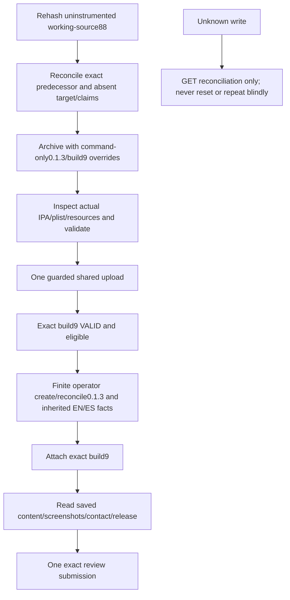

<!-- For God so loved the world, that he gave his only begotten Son, that whosoever believeth in him should not perish, but have everlasting life. — John 3:16 (KJV) -->

# Finite Hinneh 0.1.3/build 9 release Chirho

This finite operator is bound to app `6830790082`, bundle `us.hinneh.readerchirho`, public predecessor `0.1.2` / `6025f10d-bbc2-460d-aa16-21f348d774cf`, and its exact attached build 8 / `70a9da98-82ef-45e0-88c6-36eb03d77d48`. It accepts only intended `0.1.3` and build `9`; the exact processed build ID remains an explicit required argument. All modes retain the existing app/version, eligibility, owner-setting, privacy/contact preservation, journal/reconciliation and exact-review-item guards. An altered predecessor build refuses before any write. The old shared operator and every older journal/artifact stay unchanged.

Measured submission checkpoint, 2026-11-10: the exact signed IPA `198c6a46d365f7991a6d7e1b8f40c8265fd19360023c17a6295863c95f40b725` (4,224,343 bytes) uploaded once. Remote build `1ffbb9a2-997a-4fe9-82ac-0331307aab95` is build 9, `VALID` and eligible. Version `d77d6c4a-dde2-4736-a439-5bf56761acf6` is attached to that build; review `7964a291-1af5-4fd9-9a47-c653da9833a4` entered `WAITING_FOR_REVIEW` after one successful submission at 04:19:33Z. Release remains `AFTER_APPROVAL`. This is submission, not public availability or listener acceptance. No further store mutation is needed for this task; do not replay the commands below.

Independent readiness GETs preserved inherited English/Spanish metadata, all 24 screenshots and their order, private review contact, pricing and 175 territory records. All eight finite operator mutations have received outcomes; no operation is unknown. The separately guarded upload claim retains its original label and is reconciled by the successful receipt and unique exact remote build, without resetting it. Public 0.1.2 remains the observed predecessor; one bounded credential-free observer owns the later availability observation.

Historical preflight: before the upload, private GETs showed the predecessor `READY_FOR_SALE` / `READY_FOR_DISTRIBUTION`, build 8 `VALID` and eligible, and no target version/build or corresponding claims. The default read-only invocation made three GETs with no mutation, journal or lock. Those absence facts describe that preflight only.



Run from the repository root. Replace `OPERATOR_CHIRHO` below with this operator's absolute path. `inspect-chirho` and `readiness-chirho` are read-only; every mutation still requires explicit `--apply-chirho`. Root owns application under L.J.'s existing release authority. Do not invoke the earlier first-release listing operator or reuse old operation keys/journals with changed bodies.

```bash
rtk proxy bun --no-env-file OPERATOR_CHIRHO inspect-chirho --version-chirho 0.1.3
rtk proxy bun --no-env-file OPERATOR_CHIRHO prepare-chirho --version-chirho 0.1.3 --notes-file-chirho /ABS/PRIVATE/FINAL-NOTES-chirho.json
rtk proxy bun --no-env-file OPERATOR_CHIRHO attach-chirho --version-chirho 0.1.3 --build-chirho 9 --build-id-chirho EXACT_VALID_REMOTE_BUILD9_ID --notes-file-chirho /ABS/PRIVATE/FINAL-NOTES-chirho.json
rtk proxy bun --no-env-file OPERATOR_CHIRHO readiness-chirho --version-chirho 0.1.3 --build-chirho 9 --build-id-chirho EXACT_VALID_REMOTE_BUILD9_ID --notes-file-chirho /ABS/PRIVATE/FINAL-NOTES-chirho.json
rtk proxy bun --no-env-file OPERATOR_CHIRHO submit-chirho --version-chirho 0.1.3 --build-chirho 9 --build-id-chirho EXACT_VALID_REMOTE_BUILD9_ID --notes-file-chirho /ABS/PRIVATE/FINAL-NOTES-chirho.json
```

Before any future archive, freeze/recheck the actual untrapped 88 working inputs at source-binding `341f38c6f9149b6e132fe798d1751fb5603599de6d58a2e94565cf3290bed902`, including the five landed synthetic-video bodies from commit `62bdc90f2d92c6032b5e6675de7a64b368c01585`. Use a new immutable output directory and command overrides `MARKETING_VERSION=0.1.3 CURRENT_PROJECT_VERSION=9`; preserve the project file's current0.1.2/build4 values and all old IPAs. No private QuietCanary/fixture/policy, mute trap or resource override may enter the shipping product. Check the actual built plist, encryption/privacy declarations and all nine final Greek-guide resources. The private muted ReaderModel/AVPlayer result `3ef45ade` is separate test-only evidence, not the new distribution artifact or listener acceptance.

Keep signing resources unchanged and reconcile them before/after any separately authorized cloud-managed export. The shared uploader must recheck exact IPA/app/version/build identity and durable claims immediately before applying. Do not resend an unknown upload. The release preserved pricing, availability, privacy, age, DSA/legal declarations, signing resources and project version settings. Inherited owner UI forms were not freshly certified. Saved EN/ES notes and inherited screenshots/contact/release passed the independent readiness readback described above.

Fifteen focused Bun cases /102 expectations pass, including inherited facts, dry zero writes, finite target/predecessor/build identity, unknown-result non-retry/reconciliation, exact review item, foreign pagination and redaction. Removing the new predecessor-build check makes its targeted control fail in a separate FakeApple copy. Production operator strict TypeScript, scoped ESLint and Prettier pass. Bun test typings are not installed, so strict typing of the test file is not claimed. Initial private fixture migration/prose-check errors and the direct-Bun ESLint timeout are retained; the final lint uses the existing installed executable's Node shebang without installing dependencies or weakening rules.

The first local signed archive failed at CodeSign with `errSecInternalComponent`; its exact keychain/ACL cause remains unknown and the failure is preserved. One separately authorized unsigned archive followed by the existing cloud-managed export produced the IPA above; Apple validation passed at 04:03:50Z. Actual recovery archive/export logs contain zero warning lines using the supported unused-AppIntents-task skip `LM_SKIP_METADATA_EXTRACTION=YES`, without warning filtering. Entitlements, profile and full certificate chain equal build 8; existing signing resources and all old IPAs remain exact. The earlier `appintents-warning-chirho.md` is historical preparation evidence.
