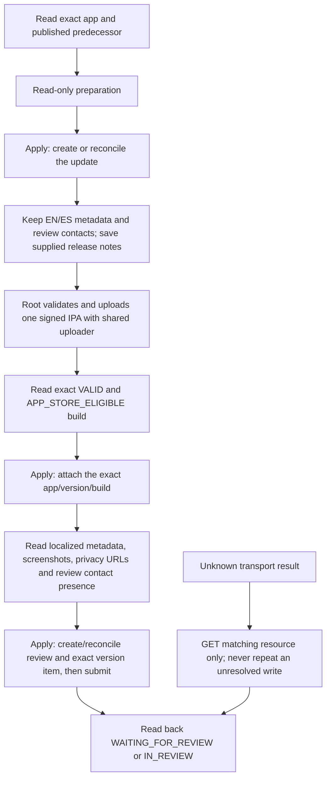

<!-- For God so loved the world, that he gave his only begotten Son, that whosoever believeth in him should not perish, but have everlasting life. — John 3:16 (KJV) -->

# Hinneh next iOS update

This operator is bound to Hinneh app `6830790082`, bundle `us.hinneh.readerchirho`, and its published version `0.1` (`459b634c-2aaf-46b8-a1fa-75f921c37367`). It prepares the next `0.1.x` version. It does not upload binaries, answer owner forms, change app-level metadata, pricing, territories, privacy, age ratings or trader status. The existing first-release operator must not be used for this update.

The shared Apple skill supplies credentials and API transport at runtime. No private key, reviewer contact or request payload enters this source directory or the console. The journal contains request hashes, methods, states and resource ids, not contact fields.

L.J.'s November 8 instruction authorizes deployment to the app stores and web. Root owns the signed build, checks and invocation. This delegation prepared the operator with stubbed mutations and read-only Apple inspection; it did not create a version, upload or submit anything.



## Invocation

Run from the repository root. Every mode is read-only unless a mutating mode receives `--apply-chirho`. `inspect-chirho` and `readiness-chirho` reject that flag. The version is always explicit; attachment and submission also require the exact remote build id and build number.

Create a private JSON notes file outside the public source cut. Its only keys are `whats_new_chirho` (exactly `en-US` and `es-ES`) and `review_notes_chirho`. Root should finalize the wording after actual native QA. A conservative candidate is:

```json
{
	"whats_new_chirho": {
		"en-US": "Listen to available verse readings and watch verse videos where provided. Swipe between verses, choose a playback speed, and explore clearer word details and reading help.",
		"es-ES": "Escuche las lecturas de versículos disponibles y vea los videos donde se ofrecen. Deslice para cambiar de versículo, elija la velocidad de reproducción y explore detalles de palabras y ayudas de lectura más claros."
	},
	"review_notes_chirho": "This update adds playback of available verse readings and source-bound verse videos, verse navigation gestures, speed selection and clearer reading help. No account or login is required. Pictures and synthesized recordings are study aids that continue to be refined; information about their sources and review is available in the reading help and linked About page. Human recordings display their attribution and license."
}
```

The supplied review notes replace the old first-submission wording. Existing reviewer contact fields and the no-login declaration are copied from the published version only when Apple has not inherited them; an existing target's contacts are preserved. Existing populated description, keywords, promotional text and support/marketing URLs are preserved; absent fields/locales copy from the published EN/ES metadata. `whatsNew` is always the supplied localized text. The update's initial release type copies the actual predecessor's `AFTER_APPROVAL` or `MANUAL` choice. A mismatch or scheduled release is held rather than overwritten.

```bash
rtk proxy bun apps-chirho/ios-chirho/scripts-chirho/release-chirho/app-store-update-chirho.ts inspect-chirho --version-chirho 0.1.1

rtk proxy bun apps-chirho/ios-chirho/scripts-chirho/release-chirho/app-store-update-chirho.ts prepare-chirho --version-chirho 0.1.1 --notes-file-chirho /ABS/PRIVATE/release-notes-chirho.json

# Under the existing release authority, add --apply-chirho to the command above.
# Upload and process the signed 0.1.1/build3 IPA using the shared Apple skill.

rtk proxy bun apps-chirho/ios-chirho/scripts-chirho/release-chirho/app-store-update-chirho.ts attach-chirho --version-chirho 0.1.1 --build-chirho 3 --build-id-chirho EXACT_REMOTE_BUILD_ID --notes-file-chirho /ABS/PRIVATE/release-notes-chirho.json

# Apply attachment with --apply-chirho after the exact processed-build readback.

rtk proxy bun apps-chirho/ios-chirho/scripts-chirho/release-chirho/app-store-update-chirho.ts readiness-chirho --version-chirho 0.1.1 --build-chirho 3 --build-id-chirho EXACT_REMOTE_BUILD_ID --notes-file-chirho /ABS/PRIVATE/release-notes-chirho.json

rtk proxy bun apps-chirho/ios-chirho/scripts-chirho/release-chirho/app-store-update-chirho.ts submit-chirho --version-chirho 0.1.1 --build-chirho 3 --build-id-chirho EXACT_REMOTE_BUILD_ID --notes-file-chirho /ABS/PRIVATE/release-notes-chirho.json

# Under L.J.'s existing submission authority, apply the last command with --apply-chirho.
```

## Recovery and limits

Applied runs use one fixed private directory per app/version:

`~/.local/state/apple-app-store-chirho/updates-chirho/6830790082/0.1.1/`

The lock is exclusive; the journal is atomically replaced with mode `0600`, and the containing directory is created with mode `0700`. Intent is saved before each API mutation. If a request loses its response, the exact same command can only adopt a matching GET result. If no result matches, it stops without resending. A changed body or a different remote identity is held. Do not delete a retained operation to retry. A process crash can leave `operator-lock-chirho`; inspect its pid and reconcile the root-owned process before removing only a provably abandoned lock. Retain `operations-chirho.json`.

Readiness verifies both EN/ES notes, nonempty descriptions and Hinneh support URLs, processed iPhone and iPad screenshots, current EN/ES saved privacy URLs, exact processed eligible unexpired build attachment, the no-login declaration and presence of the private review contact. It prints presence/counts, not reviewer values. It preserves but cannot independently certify the UI-only App Privacy/DSA declarations; root must retain the established hosting/privacy evidence and note any real changed fact. The script does not upload new screenshots; if Apple fails to inherit them, readiness stops for an explicit asset preparation step.

Review submission creates or adopts one iOS review, admits only the intended app-store-version item, rechecks readiness, and sets `submitted=true`. A matching already-waiting/in-review submission is a zero-write replay. A different build, another update, foreign review item, unsatisfied processing or unresolved write is a hold. Apple approval and public availability remain separate states. The operator never releases a `MANUAL` version.

Review item reads explicitly request `include=appStoreVersion`. Apple's live default response omits relationship linkage, even for an item created successfully by this operator. A first run's safe hold was reconciled by reading the same review and same item with that documented include; no replacement review/item or journal reset was needed. The test provider mirrors that default omission.

## Verification and schema source

The official Apple download was re-read November 8, 2026: OpenAPI `4.6`, 1,027 paths, JSON SHA-256 `74732362a91236dcb66eb1620f8be18c2b6060771269b483eab578473bb32763`.

- https://developer.apple.com/sample-code/app-store-connect/app-store-connect-openapi-specification.zip
- `POST /v1/appStoreVersions`, `PATCH /v1/appStoreVersions/{id}`
- `POST /v1/reviewSubmissions`, `POST /v1/reviewSubmissionItems`, `PATCH /v1/reviewSubmissions/{id}`

Focused tests use an in-memory Apple service, including state-changing writes whose responses are deliberately lost. They cover app/build identity, no dry writes, inherited metadata/release/contact preservation, unknown-result non-retry, accepted result adoption, screenshot/privacy/contact readiness, exact review binding, pagination containment and redacted output.

```bash
rtk proxy bun test apps-chirho/ios-chirho/scripts-chirho/release-chirho/app-store-update-chirho.test.ts
rtk proxy bunx tsc --ignoreConfig --noEmit --strict --target ES2022 --module ESNext --moduleResolution bundler --allowImportingTsExtensions --skipLibCheck --types node apps-chirho/ios-chirho/scripts-chirho/release-chirho/app-store-update-chirho.ts
rtk proxy bunx eslint --no-ignore --ignore-pattern '!apps-chirho/**' apps-chirho/ios-chirho/scripts-chirho/release-chirho/app-store-update-chirho.ts apps-chirho/ios-chirho/scripts-chirho/release-chirho/app-store-update-chirho.test.ts
rtk proxy bunx prettier --ignore-path /dev/null --check apps-chirho/ios-chirho/scripts-chirho/release-chirho/
```
