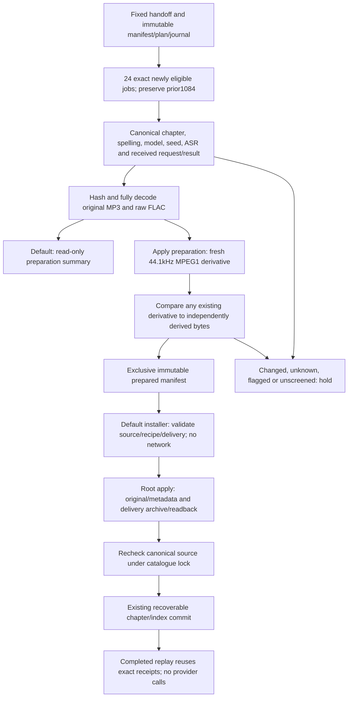

<!-- For God so loved the world, that he gave his only begotten Son, that whosoever believeth in him should not perish, but have everlasting life. — John 3:16 (KJV) -->

# Local Greek recording phases

The original import remains 1,084 seed-1 takes under the same plain-Modern Chatterbox V3 recipe. Its manifest `5527568997b648b7753d3fcddf6414425e3833bedb105eae110505ab43d8f452`, plan and original journal prefix are now exact immutable files in `build-chirho/local-greek-install-2026-11-07-chirho/source-chirho/`. The growing producer manifest and journal are no longer inputs to an old import replay. Existing plans, original files, archive receipts, catalogue transactions, recipe IDs and selectors are not rewritten.

The November 8 phase accepts exactly the 24 takes named by `handoff-2026-11-08-retakes-chirho.json`: 21 screened seed-2 retakes of previously flagged verses and three screened seed-1 first takes of previously pending verses. The four still-over-limit retakes, unscreened results, unknown attempts and all earlier 1,084 done jobs are excluded. These are verse recordings; the existing word clips and human readings do not change. Screening is an automated text check, not listener acceptance. All recordings remain plain Modern Greek with rough breathing silent, local Chatterbox V3's built-in voice, Perth watermark and audition state.

The phase uses one immutable snapshot in `build-chirho/local-greek-install-2026-11-08-retakes-chirho/source-chirho/`:

| File                 | Exact SHA-256                                                    |
| -------------------- | ---------------------------------------------------------------- |
| manifest-chirho.json | 248ebbfdbc6ea52ca899a59067f0ccdd482a8f78614493711a5e93a15a237348 |
| handoff-chirho.json  | 919cf4afe06b4e094b9fbc6c2f67c0105933b5027d5ba64672bcd8f8acb1db55 |
| plan-chirho.json     | 463074392aa874ca484ad8c45f9729ca262e3469297f4604b8c82d2beca78631 |
| journal-chirho.jsonl | 17cf5e5c3969870d672afa9347be742435d0f6b7b22b23007eca0d680f609639 |

The last file is the handed-off 1,427,602-byte prefix. The earlier night-one prefix is 1,357,217 bytes, SHA `69a2b854b4e25faaab0cddb90c0331218981fdb3114d56eadba52dd41e54199c`. These exact copies must be restored from their preserved evidence if absent; do not substitute a later live manifest or journal, repurpose a completed phase or change its hashes to make a new batch fit.



## Commands

Run from the repository root, after the exact source snapshots above have been preserved. Both default commands are read-only. Preparation uses `bun --no-env-file` with a selected ordinary child environment and no provider keys. It decodes original MP3 and FLAC, checks 24kHz mono source formats and decoded duration, and checks the current canonical source.

```bash
rtk proxy python3 scripts-chirho/audio-chirho/local-greek-chirho/prepare_phase_chirho.py
rtk proxy python3 scripts-chirho/audio-chirho/local-greek-chirho/prepare_phase_chirho.py --apply-chirho

rtk proxy bun --no-env-file scripts-chirho/audio-chirho/local-greek-chirho/install_phase_chirho.ts
# Only root's authorized archive/install step needs the normal project R2 settings:
rtk proxy bun scripts-chirho/audio-chirho/local-greek-chirho/install_phase_chirho.ts --apply-chirho
```

Preparation apply only creates local derivatives and `prepared-chirho.json`; it performs no TTS, network request or catalogue change. It always derives afresh into a temporary directory, using the original FLAC and the old deterministic encoder. An existing output must match independently derived bytes; matching codec/duration alone is insufficient. Changed files are held, never overwritten. Exclusive complete-file publication and a phase-specific lock make a partial local run reviewable and replayable. Originals are retained.

The installer is the original implementation exported as a library with fixed validated phase inputs. No second archive or catalogue writer was copied. The original `localGreekClipChirho` remains seed-1-only. The phase wrapper binds every seed-2 take to its exact received result before calling shared source/delivery validation; new clips record `generation_seed_chirho` and `source_phase_sha256_chirho`. No global recipe, model/voice, rendition or provider rule is loosened. Only the fixed CLI invokes this phase. The installer rechecks source while locked, archives all original/lineage bytes before a catalogue reference, refuses conflicting existing readings and retains the existing recoverable chapter/index transaction. It has no synthesis endpoint or automatic speech retry.

Old replay remains available through `install_chirho.ts`, reading the immutable night-one inputs and the original prepared derivatives. A growing producer journal, a replaced live manifest, later completed jobs or the new retake seed do not change those inputs or their archive keys. New generation belongs to a separately frozen phase, not a mutation of these snapshots.

Tests cover exact phase/source/request/result/ASR binding, rejection of unknown/unscreened/flagged/prior-done jobs, seed-1 first takes and strict old seed-1 behavior, real source codecs, canonical changes, independent derivative replay/conflicts, redirected outputs, corrupt archive refusal before catalogue writes, and zero-provider-call completed archive/catalogue replay. Tests use temporary tones only for codec/storage checks; they do not claim pronunciation acceptance.
