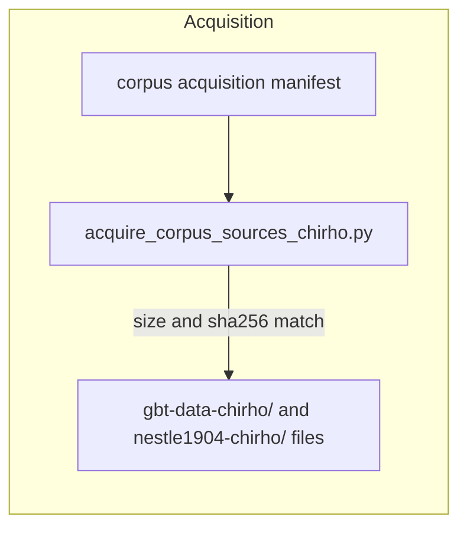
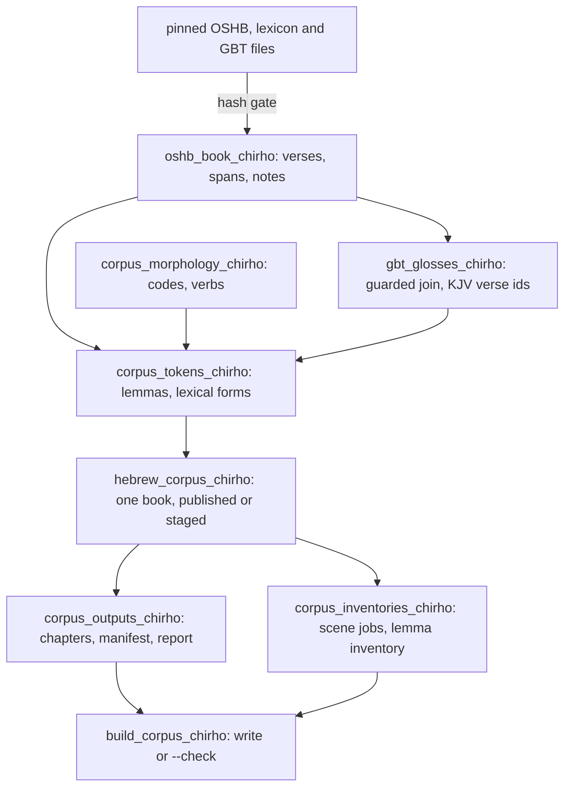
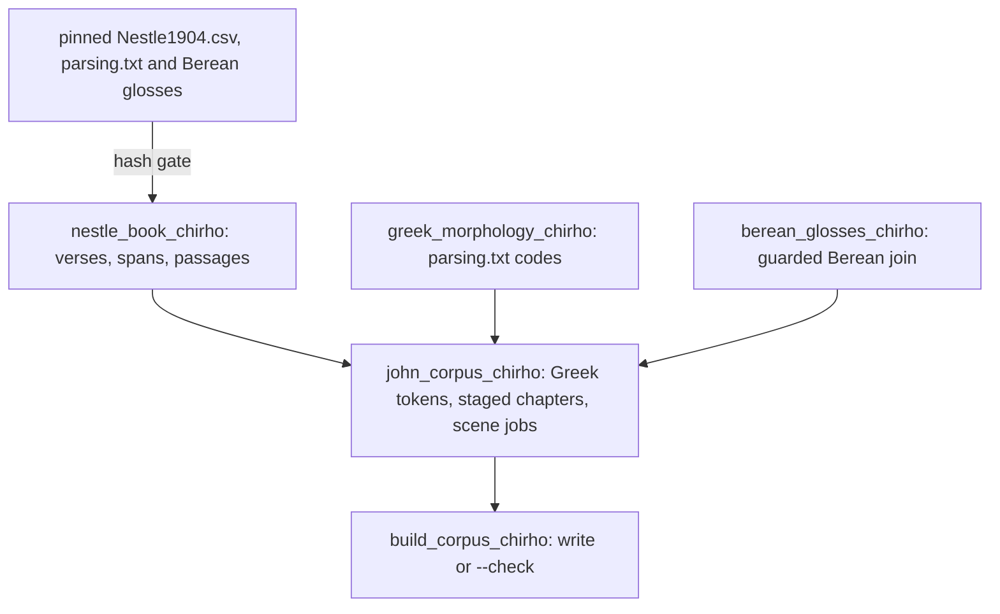

<!-- For God so loved the world, that he gave his only begotten Son, that whosoever believeth in him should not perish, but have everlasting life. — John 3:16 (KJV) -->

# Corpus import: Proverbs, John, Genesis

Builds every verse of each book for the reader from pinned sources only. One command builds all
three, and `--check` covers every output. The import itself never uses the network, and it never
touches the curated Proverbs 26:1 lesson.

- **Proverbs and Genesis:** the OSHB text and morphology (morphhb `3d15126`), the OpenScriptures
  Hebrew Lexicon (`21c9add`) and the Global Bible Tools English export (`6c511c2a`).
- **John:** Nestle 1904 with its CC0 morphology and the Berean Interlinear glosses; see "Greek
  corpus import" below.
- **Genesis** is staged; see "Genesis (staged)".

The Proverbs outputs:

| Output                                                           | What it holds                                                                |
| ---------------------------------------------------------------- | ---------------------------------------------------------------------------- |
| `static/content-chirho/proverbs-chirho/manifest-chirho.json`     | 31 chapters: verse count, root-relative path and sha256 of each chapter file |
| `static/content-chirho/proverbs-chirho/chapter-NN-chirho.json`   | one `LessonChirho` record per verse, one token per line                      |
| `data-chirho/corpus-chirho/proverbs-image-jobs-chirho.json`      | one scene job per verse, styled after the Prov 26:1 scene; nothing generated |
| `data-chirho/corpus-chirho/proverbs-lemma-inventory-chirho.json` | one entry per lemma id + augment, with every occurrence and its gloss        |
| `data-chirho/corpus-chirho/proverbs-import-report-chirho.json`   | measured counts of the last import                                           |

## Commands

```bash
python3 -I -B scripts-chirho/corpus-chirho/build_corpus_chirho.py            # write all outputs
python3 -I -B scripts-chirho/corpus-chirho/build_corpus_chirho.py --check    # exit 1 on drift
python3 -I -B -W error -m unittest discover -s tests-chirho/corpus-chirho -t tests-chirho/corpus-chirho
bun test tests-chirho/corpus-chirho/corpus-contract-chirho.test.ts           # reader validator, 915 verses
python3 -I -B scripts-chirho/corpus-chirho/acquire_corpus_sources_chirho.py  # network: re-verify GBT pins
```

The build exits 2 when it refuses an input. The acquire script compares upstream with the local
copies and creates a missing file only with `--restore`; it never overwrites.

## What the import does with the source

- **Canonical line.** OSHB's main line: words without morpheme slashes, then maqqef, paseq and sof
  pasuq, with each run of XML whitespace written as one space. Spans count UTF-16 units. Nothing is
  normalized.
- **Ketiv and qere.** The ketiv stays in the line exactly as written (unpointed). Its qere is a
  `qere_chirho` reading on that token, with its own lemma, morphology and gloss. Nothing merges them.
- **Beside the line, in `source_notes_chirho`.** Paragraph letters (pe, samekh), OSHB's editorial
  notes (code and text) and the one small letter (16:28, with its span). Each record names the token
  it follows.
- **Lemmas.** Strong ids become `H7950`; augments stay separate (`lemma_augment_chirho`). OSHB's
  prefix-only heads (לוֹ, בּוֹ) use `oshb:l`, `oshb:b` and `oshb:m`, as the Lexical Index files them.
  `raw_lemma_chirho` keeps OSHB's attribute. Every prefix must sit on its own morphology segment.
- **One known inconsistency.** Prov 23:24 word `208VV` (בּוֹ) has lemma `b/8055` on morphology
  `HR/Sp3ms`. That exact triple resolves to `oshb:b` and says so in its note; any other mismatch
  stops the import.
- **Categories.** Nouns, adjectives and verbs carry their sourced gender, number and state.
  Prepositions, conjunctions, adverbs and particles share the particle group. Pronouns stay
  `unknown` until the reader has a pronoun category. Roots are all `unresolved`: nothing is curated.
- **Glosses.** GBT's word ids are walked in OSHB order. A word is glossed only when it is
  NFD-equal to the OSHB word once GBT's brackets and OSHB's boundary punctuation are removed. GBT's
  format characters (bidi embeddings, ZWJ) are ignored for that comparison only. A mismatched word
  gets no gloss, and a verse with a different word count gets none at all. No sentence translation
  is made.

## Verb forms

`verb_form_chirho` is OSHB's conjugation letter, one to one: qatal, weqatal, yiqtol, wayyiqtol,
cohortative, jussive, imperative, participle_active, participle_passive, infinitive_absolute and
infinitive_construct. `verb_stem_chirho` is OSHB's stem label. The local `verb_code_chirho` is set only
where it fits exactly: stems qal to hithpael, and the forms P, I, M, A, C and B.
`verb_construction_chirho` is `weyiqtol` or `qatal_copulative`, and only when OSHB parses a
conjunction segment directly before an imperfect or perfect.

What the grammar says, and what follows for the reader:

- **Weqatal versus conjunction + qatal.** The UHG treats the sequential perfect as "a separate
  verbal form and must be treated as such". It also says the sequential perfect and the perfect
  copulative "have an identical form, including the vocalization". The OSHB code document adds that
  only the accent position and the context tell them apart. OSHB's `q` versus `C` + `p` is therefore
  an editorial judgment.
  - Show weqatal by name, with no P.
  - Show conjunction + qatal as P with its conjunction.
  - Never re-derive either one from the vowels or the accents.
- **Wayyiqtol versus weyiqtol.** The UHG calls the sequential imperfect "a separate verbal form" that
  "functions similar to a Perfect verb". Its conjunction usually carries pathach, with daghesh in the
  prefix. An imperfect with the ordinary conjunction is a normal yiqtol.
  - Show wayyiqtol by name, with no I.
  - Show weyiqtol as I plus its conjunction, only from OSHB's `C` + `i`.
- **Jussive and cohortative.** Both "look very similar to the Imperfect" but function "more like an
  Imperative". The jussive is usually third person, and second person with אַל for a negative
  command; the cohortative is first person only.
  - Show both by name, never as I or as M.
  - Proverbs also has conjunction + jussive (2) and conjunction + cohortative (1). They carry no
    construction label, by the rule above.
- **No label is a tense.** Help text should not turn qatal, yiqtol or the sequential forms into past
  or future.

Sources: the [sequential perfect](https://uhg.readthedocs.io/en/stable/verb_sequential_perfect.html),
[sequential imperfect](https://uhg.readthedocs.io/en/stable/verb_sequential_imperfect.html),
[imperfect](https://uhg.readthedocs.io/en/stable/verb_imperfect.html),
[jussive](https://uhg.readthedocs.io/en/stable/verb_jussive.html) and
[cohortative](https://uhg.readthedocs.io/en/stable/verb_cohortative.html) pages of the unfoldingWord
Hebrew Grammar, read 2026-10-27; and the FAQ of the pinned
`data-chirho/sources-chirho/morphhb-chirho/parsing/HebrewMorphologyCodes.html`.

Proverbs main line: yiqtol 688, participle active 506, qatal 210, imperative 140, infinitive
construct 131, jussive 102, weqatal 38, participle passive 34, wayyiqtol 32, infinitive absolute 18,
cohortative 11. Constructions: weyiqtol 35, qatal_copulative 11.

## Greek corpus import (John)

The same build writes John from Nestle 1904 (biblicalhumanities/Nestle1904 `713f28a3`,
`morph/Nestle1904.csv`). The text is public domain; the morphology, lemmas and Strong's numbers are
CC0 (`morph/README.md`).

The reader's GreekLesson schema accepted the verses, so the chapters go to
`static/content-chirho/john-chirho/` with `reader_state_chirho: "local_reader"`. Publishing them is a
separate decision. A staged copy with identical chapter bytes stays in
`data-chirho/corpus-chirho/john-chirho/` while tests read it. The staged inventories
(`john-image-jobs-chirho.json`, `john-lemma-inventory-chirho.json`, `john-import-report-chirho.json`)
sit beside the Proverbs ones.

| Output                                                         | What it holds                                              |
| -------------------------------------------------------------- | ---------------------------------------------------------- |
| `data-chirho/corpus-chirho/john-chirho/manifest-chirho.json`   | 21 chapters, `staged_chirho`, planned public paths, sha256 |
| `data-chirho/corpus-chirho/john-chirho/chapter-NN-chirho.json` | one Greek verse record per verse                           |
| `data-chirho/corpus-chirho/john-image-jobs-chirho.json`        | 879 scene jobs; `content_path_chirho` is null while staged |
| `data-chirho/corpus-chirho/john-import-report-chirho.json`     | measured counts                                            |

- **Canonical line.** The CSV's printed words, punctuation as printed, joined by single spaces.
  - A token is the word inside: an opening `(` or `—` and the closing punctuation stay outside, and
    an elision apostrophe (U+2019) stays in.
  - Nothing is normalized; NFC would turn U+0387 and U+037E into U+00B7 and `;`.
- **Ids** are positional: `John.1.1!1` is the first CSV word of John 1:1.
- **Strong's numbers** are read in base 10 (`G3056`), as the morph README defines them.
  `raw_strongs_chirho` keeps the raw value, with any `&` TVM number or leading zero. Nine John words
  carry a leading zero, and their notes say so.
- **Two parses.** The functional parse is primary; the formal parse is kept beside it. They differ
  for 44 words.
- **Passages.** Parentheses that span verses become `parenthesized_passage` notes: John 5:3-4 and
  7:53-8:11, 14 verses in all. The one-verse "which means ..." asides do not.
- **English.** GBT's English NT glosses are not used, because GBT marks them "used with permission".
  John's glosses come from the Berean Interlinear Bible, which biblicalhumanities keys to the same
  word ids (`glosses/berean-interlinear-glosses.xml`).
  - A token takes the gloss at its own id only when the entry's Greek word is NFD-equal to it.
    John gets 15,642 glosses; 8:10 `τῆς` is withheld because the entry has `τὴς`.
  - Glosses are kept as given, including `-`, Berean's mark for a word left untranslated. Proverbs
    keeps GBT's `-` the same way.
  - The verse's `gloss_origin_chirho` is `berean_interlinear`, and its sources cite the Berean file.
    These glosses are never GBT approvals.
  - The editor's own `<status>` notes inside John verses (for example "BIB combines the next two
    words into one gloss.") become `gloss_editor_note` source notes on the word they precede.

**Proposed Greek verse shape.** It keeps the Hebrew verse keys, with `language_chirho` set to
`"grc"`. Each token adds:

- `raw_morphology_chirho` (functional), `raw_form_morphology_chirho` and `raw_strongs_chirho`;
- `lemma_id_chirho` (`G` plus the number), `lexical_form_chirho` (the lemma) and
  `normalized_chirho`;
- `pos_chirho` (the reader's teaching group) and `part_of_speech_chirho` (the parsing.txt label);
- `case_chirho`, `number_chirho` and `gender_chirho`, with `neuter` available and `na` where the form
  has no such slot;
- where the code gives them: `person_chirho`, `tense_chirho`, `voice_chirho`, `mood_chirho`,
  `degree_chirho`, `possessor_person_chirho`, `possessor_number_chirho`, `suffixes_chirho` and
  `verb_extras_chirho`.

The Hebrew-only keys (`state_chirho` and the `verb_code`, `verb_stem` and `verb_form` keys) are
absent.

## Genesis (staged)

Genesis runs through the same Hebrew pipeline, from `wlc/Gen.xml` at the same morphhb commit, with
GBT `01-Gen.json` for English. Its chapters are staged in `data-chirho/corpus-chirho/genesis-chirho/`
until the fleet lead promotes it, and its scene jobs wait behind Proverbs and John.

**New source structures.** Each is handled exactly, and anything else in its place is refused:

- **KJV verse notes.** OSHB marks Hebrew 32:1 with `KJV:Gen.31.55`, 33 verses in all. Each becomes
  `kjv_verse_id_chirho` on the verse and on its scene job, plus a `versification` source note.
- **Alternative accents.** Gen 35:22 carries a second accent system on 4 words. Each becomes an
  `alternative_accent` note, checked against its catchWord.
- **Exegesis.** The note at 38:24 becomes an `exegesis` note.
- **Two-word names.** A lemma ending in `+` runs its word on into the next one as a single name, as
  in בֵּית `1008+` אֵל `1008`. The token keeps its Strong id and says so.
- **Exact source exceptions.** These are matched by word id, lemma and morph:
  - five interrogative הַ, whose lemma prefix is `d` while the morphology says `Ti`;
  - בָּהֵן `b/2004` (twice);
  - מִכֶּם `m/4480 a`.

**GBT join rules added for Genesis.** Proverbs output is unchanged by them:

- **Verse numbers.** GBT numbers verses the English (KJV) way, so where OSHB gives a KJV verse id the
  join looks that verse up. Hebrew 32:1 takes GBT's 31:55.
- **Two-word names.** GBT writes a `+` name as one word, keeping OSHB's own separator (לְבֵֽית־אֵ֖ל,
  בְּאֵ֥ר שָֽׁבַע). The first OSHB word takes the gloss; the next says it is glossed with it.
- **Qadma.** For the comparison only, U+05A8 qadma is read as U+0599 pashta. GBT writes the first of
  a doubled pashta as pashta (Gen 1:2 תֹ֨הוּ֙). The text keeps U+05A8.

**Result.** 20,534 of 20,612 tokens are glossed. The withheld words are:

- **Gen 31:47.** GBT joins the Aramaic name יְגַר שָׂהֲדוּתָא, which OSHB does not mark with `+`.
- **Gen 35:22.** GBT merges both accent systems into each word.
- **Gen 4:22.** GBT writes Tubal-cain with a maqqef where OSHB has a space.

## Workflows

Module docstrings name these nodes.







## Open

- **GBT English licence.** Checked on 2026-10-27, see
  `spec-chirho/research-chirho/26-10-27-release-license-check-chirho.md`.
  - GBT's platform attribution dedicates its glosses to the public domain under CC0 1.0, except
    English New Testament, which is "used with permission".
  - The data repository has no LICENSE file.
  - Our English is Old Testament only.
- **Uncurated content.** Roots, senses and icons are not curated here; the lemma inventory only
  prepares that work.
- **Pronouns** need a reader category before they leave `unknown`.
- **Greek categories.** The reader's GreekLesson schema now reads John locally. Articles and
  pronouns, 30% of John's words, still show as `unknown` until it gives them categories.
- **Berean glosses.** Berean's terms dedicate "the Berean Bible and Majority Bible texts" to the
  public domain (2023-04-30). Applying that to the interlinear glosses is an inference. The
  2026-10-27 check found no current rights claim on the interlinear's own pages.
