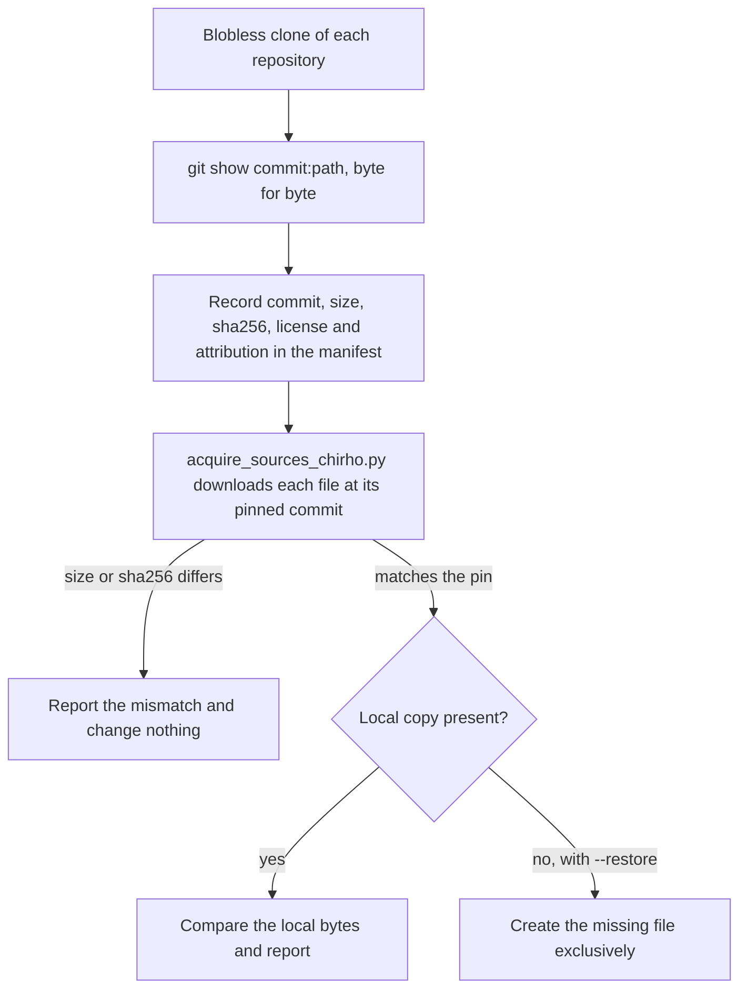
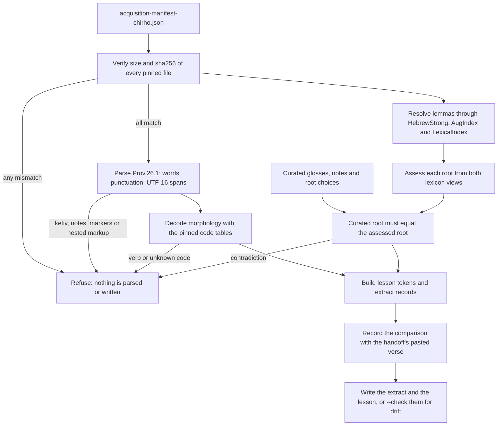

<!-- For God so loved the world, that he gave his only begotten Son, that whosoever believeth in him should not perish, but have everlasting life. — John 3:16 (KJV) -->

# Offline lesson import

This builds the Proverbs 26:1 lesson from pinned Open Scriptures Hebrew Bible files. It runs offline, uses only the Python standard library (3.9 or newer) and never runs in the request path.

## Commands

Run these from the repository root:

```bash
python3 -I scripts-chirho/import-chirho/import_lesson_chirho.py           # write the extract and the lesson
python3 -I scripts-chirho/import-chirho/import_lesson_chirho.py --check   # exit 1 if either file drifted
python3 -I -B -m unittest discover -s scripts-chirho/import-chirho/tests-chirho -t scripts-chirho/import-chirho/tests-chirho
python3 -I scripts-chirho/import-chirho/acquire_sources_chirho.py          # network: compare the pins with upstream
```

`-I` keeps the environment and the current folder off the import path; each script adds only its own folder. `-B` keeps bytecode out of the tree.

## Inputs and outputs

| Path                                                                            | Kind                                                          |
| ------------------------------------------------------------------------------- | ------------------------------------------------------------- |
| `data-chirho/sources-chirho/acquisition-manifest-chirho.json`                   | Hand-written pins: commit, size, sha256, license, attribution |
| `data-chirho/sources-chirho/morphhb-chirho/` and `hebrew-lexicon-chirho/`       | Pinned upstream bytes, never edited                           |
| `data-chirho/lessons-chirho/curation-chirho/proverbs-26-1-curation-chirho.json` | Hand-written glosses, notes and root choices                  |
| `data-chirho/sources-chirho/extracts-chirho/prov-26-1-extract-chirho.json`      | Generated evidence                                            |
| `data-chirho/lessons-chirho/proverbs-26-1-chirho.json`                          | Generated lesson                                              |

Edit the manifest or the curation, never a generated file, and then run the import again.

## Rules the importer enforces

- Nothing is parsed until every pinned file matches its manifest size and sha256. XML with a DTD is refused.
- The canonical text keeps the source's code points and mark order and is never normalized. The OSHB README warns against NFC, and the handoff's pasted verse turned out to be the NFC form; the extract records that comparison.
- Word text drops only the `/` morpheme dividers. Spans count UTF-16 code units, as JavaScript does.
- Morphology is decoded only with the tables of the pinned code document. Unknown codes, verbs, suffix-headed words, ketiv/qere, notes and paragraph markers are refused rather than guessed, because the scope is this one lesson.
- A root is `traditional` only when Strong's names one derivation and the Lexical Index files the word in that derivation's root family. Alternatives or disagreement make it `unresolved`, and no root in either source makes it `not_applicable`. The curated choice must match, or the import stops.

## Workflows

### Acquisition



### Offline import


