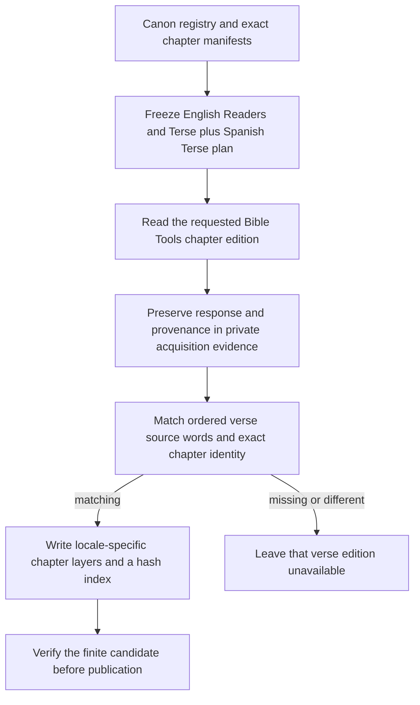

<!-- For God so loved the world, that he gave his only begotten Son, that whosoever believeth in him should not perish, but have everlasting life. — John 3:16 (KJV) -->

# Bible Tools reading editions



Run the importer with an isolated evidence directory. The default only writes the plan. The explicit run acquires a finite set of chapter responses with at most two concurrent GETs, a 30-second socket timeout, and one transient retry per response. Offline mode requires retained responses. Completed receipts are reused. The importer writes to the evidence directory, which holds raw responses, counters, and generated static layers.

```sh
python3 -B scripts-chirho/translations-chirho/build_bible_tools_editions_chirho.py --evidence-chirho build-chirho/bible-tools-editions-chirho
python3 -B scripts-chirho/translations-chirho/build_bible_tools_editions_chirho.py --evidence-chirho build-chirho/bible-tools-editions-chirho --run-chirho
```

The source is the Love Jesus Project Bible Tools reader. Its declared language, chapter and effective edition must match the request. The importer compares the whole ordered sequence of NFD letters and marks against the canonical verse and retains exact Hinneh token text in its binding. An empty gloss supplied by the source is preserved. A missing phrase, conflicting record or mismatching sequence leaves the verse edition unavailable. Each output carries source response SHA-256 and original word review state. These imported editions are distinct from the approved GBT export used elsewhere in word cards. The published projection omits the private candidate status field and rehashes the delivery manifest without altering verse values.

The site serves the reviewed layers under `/glosses-chirho/editions-chirho/`. It loads the chosen chapter on demand and verifies its hash and word bindings. See `spec-chirho/workflows-chirho/local-reader-chirho.md` for the reader flow.
