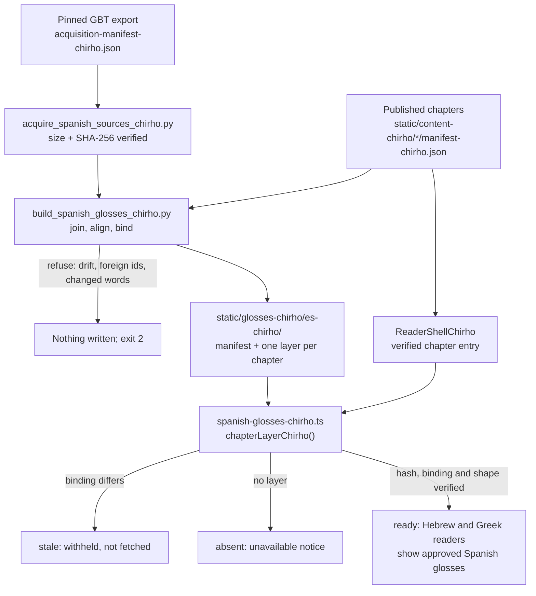

<!-- For God so loved the world, that he gave his only begotten Son, that whosoever believeth in him should not perish, but have everlasting life. — John 3:16 (KJV) -->

# Spanish glosses

The Spanish reader shows word glosses that Global Bible Tools (GBT) approved in its Spanish export.
This folder pins that export, builds one static layer per chapter, and checks the layers offline.
Nothing here runs in the request path. At runtime the reader fetches one hash-listed chapter file
and never asks a provider, database or model.

## Commands

```bash
python3 -I -B scripts-chirho/translations-chirho/acquire_spanish_sources_chirho.py       # re-download (public GitHub, read-only) and verify the pins
python3 -I -B scripts-chirho/translations-chirho/build_spanish_glosses_chirho.py         # write the layers
python3 -I -B scripts-chirho/translations-chirho/build_spanish_glosses_chirho.py --check # exit 1 on drift
python3 -I -B -W error -m unittest discover -s tests-chirho/domain-chirho/spanish-chirho -t tests-chirho/domain-chirho/spanish-chirho
bun test tests-chirho/domain-chirho/i18n-chirho.test.ts
```

A refused build exits 2 and writes nothing.

## Sources

`data-chirho/translations-chirho/sources-chirho/acquisition-manifest-chirho.json` pins
`globalbibletools/data` at commit `6c511c2a`. It records the Spanish files for Proverbs, Genesis and
John, and GBT's Greek source words for John, with their sizes and SHA-256.

GBT dedicates the glosses of every language except the English New Testament under CC0 1.0. The
basis is its own AttributionDialog; the data repository has no LICENSE file. See
`spec-chirho/research-chirho/26-10-27-release-license-check-chirho.md`.

The machine Spanish in the sister platform (`LJMTIntSpaChirho`) is a machine translation. It is not
used here.

## Rules

- **Approved only.** A gloss is shown only where the pinned export has an approved Spanish gloss.
  Anything else stays `null`, and the reader says the word has no approved Spanish gloss.
- **Hebrew.** Proverbs and Genesis reuse the corpus's guarded GBT join. That join provides the NFD
  guard, KJV verse mapping, joined names and qadma.
- **John.** Words are aligned in order against GBT's Greek source words. A gloss is taken only from
  words with identical NFD letters and marks. GBT's unexplained sub-entries (`…NN-MM`) are dropped
  and counted, never merged.
- **Bound to the chapter.** Each layer and its manifest entry carry `content_path_chirho` and
  `content_sha256_chirho`, the exact published chapter the glosses belong to. The build refuses in
  three cases:
  - that chapter's bytes differ from its content manifest;
  - its word ids or texts differ from the words the glosses were joined to;
  - the books' chapter lists differ.
- **Withheld on drift.** The reader compares the binding with the verified chapter on screen. It
  withholds a stale layer without fetching it, and shows the withholding notice. After a corpus
  change, rebuild here. An old Spanish meaning is never reused for a changed word.
- **Bounded.** Only the selected chapter is fetched. It is checked against a 2 MB limit, its SHA-256
  and its shape. At most four chapters stay cached.

## Coverage, measured 2026-10-30

| Book     | Chapters | Words with an approved gloss | Without |
| -------- | -------- | ---------------------------- | ------- |
| Proverbs | 31       | 6,984                        | 0       |
| Genesis  | 50       | 20,496                       | 133     |
| John     | 21       | 6,659                        | 8,984   |

John's gap reflects GBT's approval state: the export approves about 43% of John's words. It is not
an alignment loss, because 98.9% of John's approved glosses are matched. These are availability
counts. They do not show that every sense has been reviewed.

## Workflow


