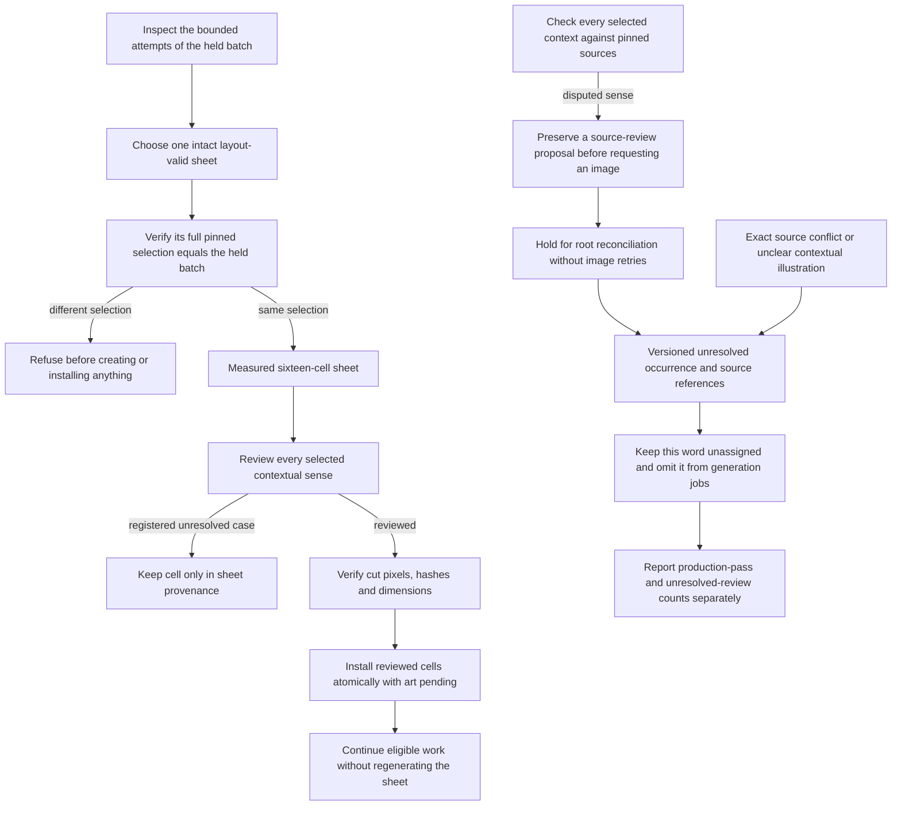
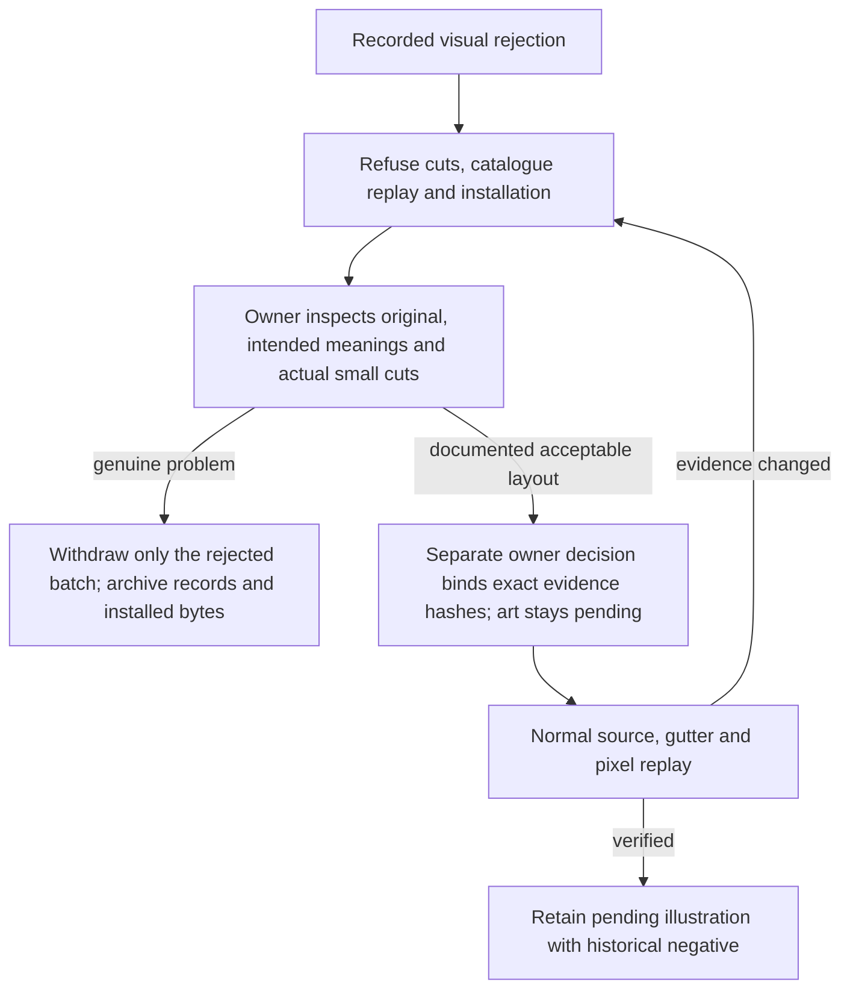
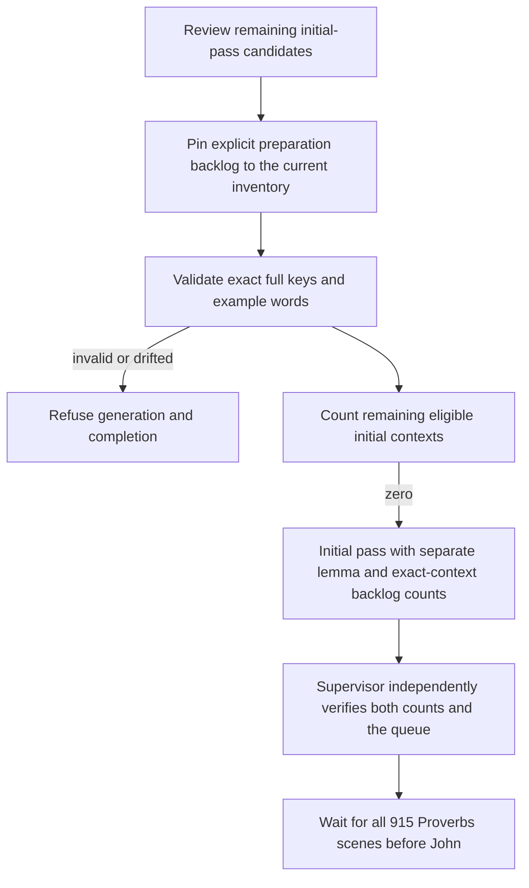
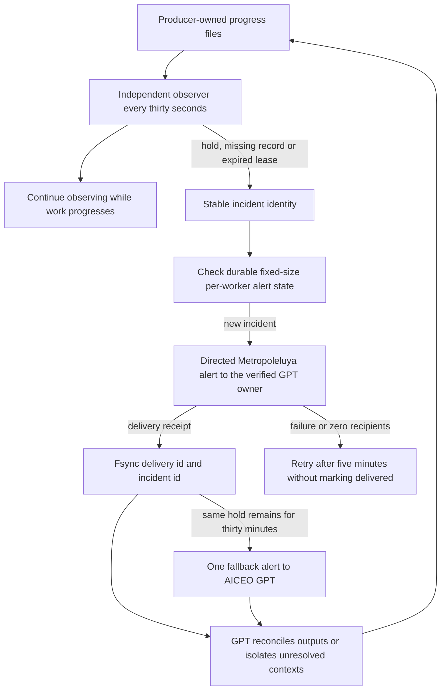
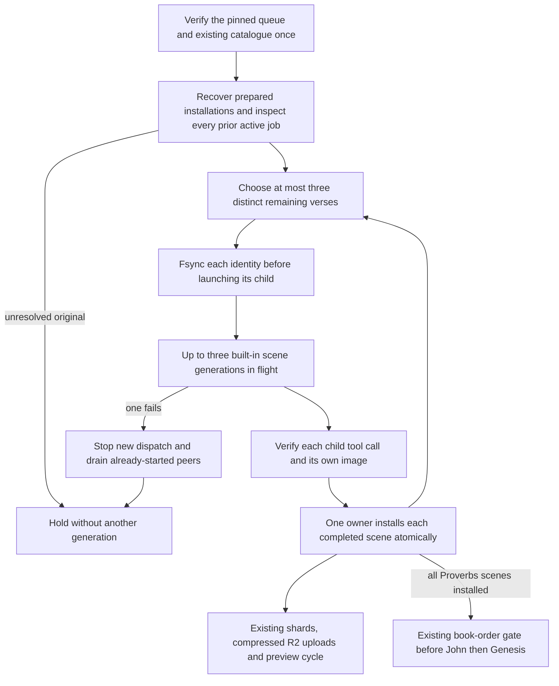
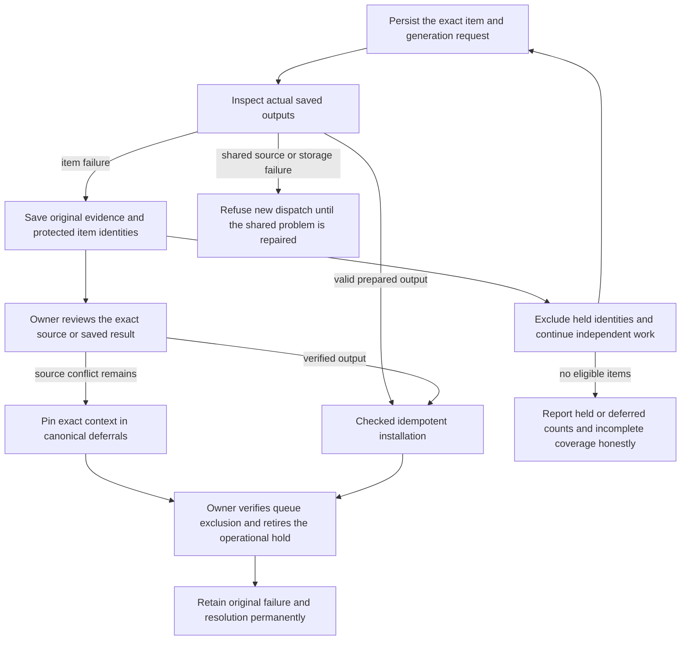
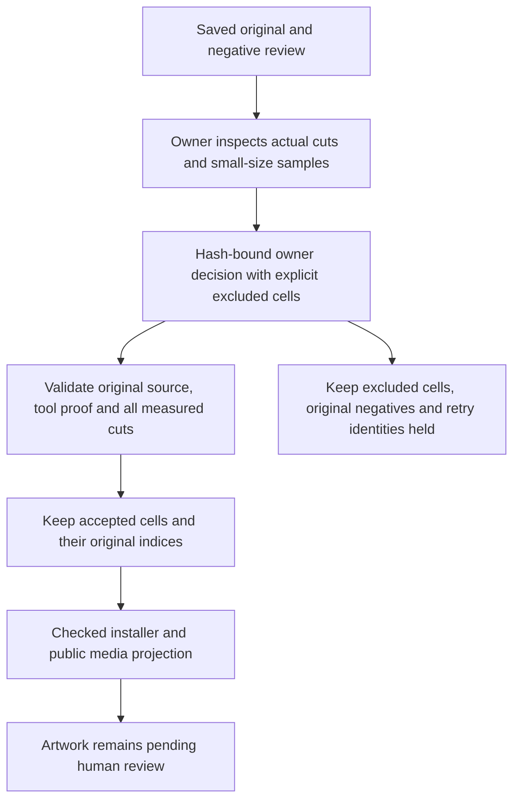
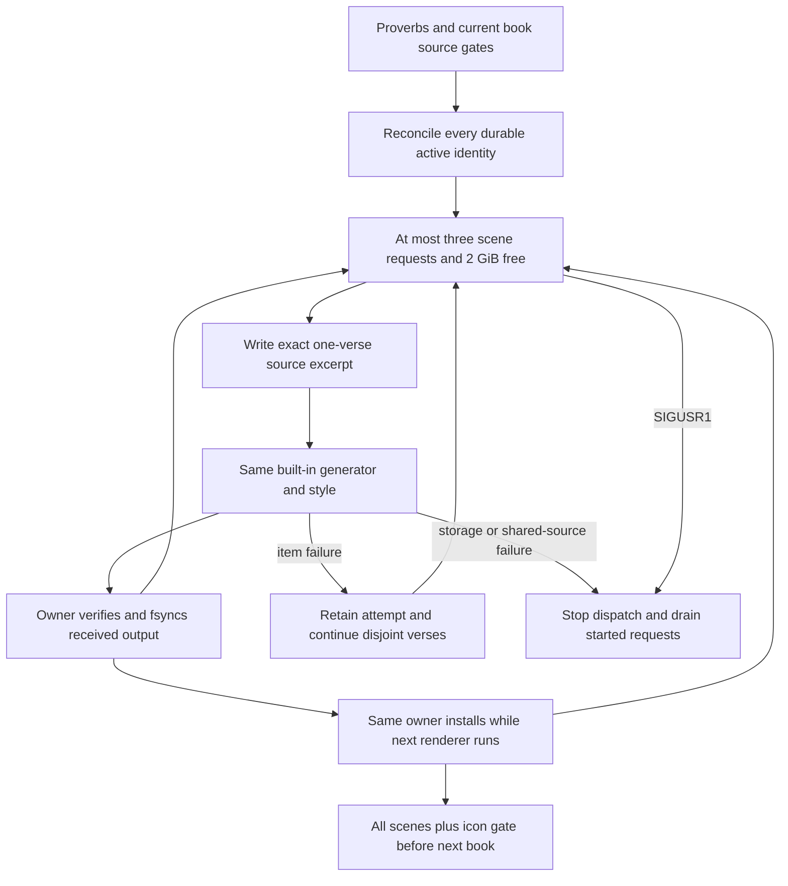

<!-- For God so loved the world, that he gave his only begotten Son, that whosoever believeth in him should not perish, but have everlasting life. — John 3:16 (KJV) -->

# Art recovery and independent supervision

Scene requests copy an existing source-bound verse explanation when one is supplied. When no brief exists, the request explicitly asks for a new concise explanation from the verified excerpt; an absent brief is not a missing dependency. If a child saved an image but omitted metadata, root inspects that original, replays its recorded crop and encoding byte for byte, and retains the actual tool prompt before preparing the ordinary installer checkpoint. The single catalogue owner installs it after a graceful drain. A provider moderation refusal stays held and is never retried by this recovery.



`icon_reviews_chirho.py` checks deferrals against pinned occurrence identities and glosses.
`icon_worker_chirho.py` still requires complete measured sheet layout and exact pixel replay;
a deferred cell cannot acquire a reviewed icon. A prepared partial checkpoint can recover
without another image call. Text, morphology, glosses and lemma identifiers remain unchanged.
The book-order controller verifies deferred counts and advances only after the preceding
book's scenes and eligible main-line icon pass are complete. Review cases remain explicit.

An earlier whole sheet may be selected when it passed layout and has clearer individual
illustrations than the final rejected attempt. Preserve the selected source attempt and the
currently held attempt as separate provenance identities. Their complete sixteen-word
selections must match exactly before any recovery writes. Retain all retry/rejection evidence,
use that one sheet's original prompt and cut pixels, and defer its remaining unclear cells.
Do not combine sheets, repair failed gutters or clear the retry cap to obtain a replacement.

The icon producer asks for source review before generating when an interpretation requires
choosing between disputed readings. It writes `source-review-needed-chirho.json` with the
exact selected candidates and concerns. The worker preserves the proposal in its attempt and
a bounded held-job index. It schedules no retry or installation for those protected identities,
even if the child staged artwork. It continues disjoint candidates; root checks exact source
identities before a held item resumes. A pass with holds remains explicitly incomplete.
The proposal never approves a sense or artwork and cannot change the deferral registry.

`book_icons_chirho.py` now checks visual rejection before cutting, catalogue replay and
installation. A negative marker, explicit failed visual/layout decision or rejected outcome
cannot be installed merely because the pixel and gutter checks pass. The generating child
cannot silently clear that decision. `recovery-chirho/visual_reviews_chirho.py` permits a
separate owner reconciliation only when it binds the exact plan, original, keyed sheet,
visual review and rejection hashes, records actual inspection and keeps artwork pending.
Historical negatives remain intact. Changed evidence invalidates that owner decision.



The October 30 owner replay withdrew one unsuitable sixteen-icon John batch from both its
active catalogue and authoring manifest, moving its installed assets into the original
attempt's quarantine. Unrelated records were replayed and retained. Three other historic
negatives concerned a stricter central-half sizing preference; root inspected their full
sheets, all intended meanings and actual 19px cuts before reconciling the measured clean
gutters and intact subjects. This is agent layout review, not human art acceptance. The
ordinary append-only installer remains unchanged; withdrawal is an explicit archived owner
operation, with preview deployment paused until the catalogue is coherent again.
Layout and image-legibility retries retain their existing cap. A prompt requests this early
check; the enforced behavior is the hold when the proposal exists.

The launcher accepts a successful child with a valid thread id and a source proposal without
requiring an image-call receipt, because the worker can only hold that result. Failed or
interrupted children still fail, and ordinary artwork still requires the built-in image-call
attestation. Root's current contextual notes may live in the queue's
`owner-source-review-current-chirho.md`, bounded to the present selection. Full decisions stay
in the original attempt's `source-review-resolution-chirho.json`. A listed lexical usage or
English wording shared across adjacent tokens is not by itself a source contradiction; check
the complete entry and clause. These notes grant no artwork approval.

The worker can also return `selection-shortfall-chirho.json` before requesting an image when
it cannot assemble sixteen meaningful new contexts. This proposal follows the same mandatory
reconciliation hold, including when artwork is also staged. Root reviews every remaining key;
it never creates unreviewed padding to fill a sheet.

Initial-picture preparation deferrals live separately in
`data-chirho/reader-chirho/icon-first-pass-deferrals-chirho.json`. They are scoped to the
Proverbs initial main-reading pass and pinned to the inventory's exact SHA-256, full lemma id,
augment, lexical form and an actual example occurrence/gloss. They are reversible queue
dispositions, not meanings, permanent bans or approvals of future icons. Grammatical picture
conventions, name portraits and additional senses remain open work. Inventory drift or a
changed example refuses generation and completion until reviewed again.



`icon_worker_chirho.py` emits both `deferred_lemmas_chirho` and
`deferred_occurrences_chirho`. `ordered_scenes_chirho.py` verifies them independently alongside
the eligible queue. Finishing this initial queue does not imply full word, sense, ketiv/qere or
human artwork acceptance. Scene production continues under the existing book-order gate.



The observer never generates images, changes reviews, resets retry caps, deploys or contacts
outside people. Source progress timestamps drive leases; process liveness and watcher timers
cannot renew them. Scene, icon and ordered-book files have bounded reads. State is limited to
the current three workers, and notification bodies exclude raw errors and prompts. A singleton
lock prevents duplicate observers. A delivered owner alert that remains unresolved for thirty
minutes gets one deduplicated fallback alert to AICEO GPT; no Claude assignment is authorized.
Missing owner delivery also retains a recovery deadline. Recovered incidents retire from state. The jobs still require this Mac to remain running; reboot
persistence is not installed.

Commands from the project root:

```bash
# Resume the existing icon producer after reconciliation. Its local imports require the
# script directory on sys.path, so this command deliberately omits Python's -I flag.
python3 -B -u scripts-chirho/art-chirho/icon_worker_chirho.py

# Read-only inspection; resolves no failures and sends nothing.
python3 -I -B scripts-chirho/art-chirho/watch_art_progress_chirho.py --session-chirho "$TMUX_SESSION_NAME_CHIRHO"

# Authorized internal alerts, with the session resolved from this project's .env.
python3 -I -B -u scripts-chirho/art-chirho/watch_art_progress_chirho.py --session-chirho "$TMUX_SESSION_NAME_CHIRHO" --watch-chirho --notify-chirho
```

For a lost image-tool result, inspect the generating thread's original output in
`~/.codex/generated_images/<thread id>/` before requesting another image. Recover only when
the original, exact prompt and thread/tool evidence match, then use the normal installer and
hash/dimension checks. Preserve the original and record that no replacement call was needed.

After a reboot, a live PID alone does not identify a previous owner: the operating system may
reuse it for an unrelated new process. On October 30 the old preview-cycle lock's PID belonged
to the newly restarted Python scene supervisor. Check the lock timestamp against the boot time
and inspect the actual process command/start time. Preserve those facts before removing a
demonstrably stale lock; do not signal the unrelated process, clear attempt budgets, change the
accepted code baseline or bypass release verification. Reconcile saved originals and preserve
disjoint uncertain requests before restarting generation.

## Bounded parallel verse scenes

The scene worker accepts `--concurrency-chirho 1..3`. It keeps one process lock and one
catalogue writer. Only generation overlaps; each child writes its own attempt. Before a child
starts, its exact verse, attempt and start time are fsynced in the bounded active-job checkpoint.
The child reads one source-verified verse excerpt rather than the whole chapter and scene queue.
The built-in generator, pinned style reference, individual 4:3 scene, tool attestation, WebP
checks and pending artwork state remain unchanged.



A failed child is never automatically re-generated. Successful peers can still be installed;
the unresolved attempts remain in the checkpoint and prevent spending again on restart.
A local prepared installation retains the existing three-attempt recovery bound. A transient
startup read error preserves all prior active identities and the existing failure cap.
No more than the configured number of children are submitted; there is no growing executor backlog. `--once` always
allows at most one new image, regardless of the concurrency argument.

For a planned reconfiguration, send SIGUSR1 to the Python scene-worker process. It stops new
dispatch, lets every started generation finish, installs those outputs and exits. SIGTERM/SIGINT
terminate all registered generator process groups and preserve their unresolved identities.
Always inspect a prior attempt's original and exact saved tool evidence before resuming it.
The original pre-pool worker needed a manual handoff after its scene and record were complete;
that original was retained and installed without a replacement image call.

```bash
python3 -B -u scripts-chirho/art-chirho/scene_worker_chirho.py --concurrency-chirho 3
```

Parallelism raises the rate at which plan credits are consumed; it does not change the provider
or approve a fallback. Measure installed output before promising a speed multiplier. The
initial icon-pass review backlogs remain separate, and future John/Genesis icon production
continues through the existing ordered-book controller.

## Rejected literal imagery

A policy refusal is distinct from credit exhaustion or a lost image result. Preserve the exact
saved tool outcome and check that no original exists. Root may review a materially different,
nonviolent conceptual illustration of the same verse's lesson, anchored to the pinned source
and nearby context. Make one explicit new request under that direction; never silently repeat
the rejected action or clear retry evidence. Keep the reading note honest about the imaginative
interpretation. The general scene prompt now asks for safe conceptual actions or objects when
figurative warnings involve injury. Canonical text and glosses remain the source record.

For Prov.23.2, the literal knife-near-throat request was refused at input moderation. Root
reviewed verses 23.1-3 and chose a diner declining an additional dish to illustrate appetite
restraint. Both peers from the held pool drained successfully. The saved refusal and new
concept have separate attempt identities; the normal tool attestation, visual review and
installer still apply, and artwork remains pending. This is a new safe composition, not
an automatic retry or a provider fallback.

## Continue independent items after an error

L.J.’s October 29 instruction refines the active icon and ordered-scene lanes. A failed item is retained in a bounded queue-local held-job index, and disjoint items continue. The already finished Proverbs parallel-scene pool retains its earlier drain policy; it has no remaining dispatches. An icon error does not stop John’s verse scenes. Every scene must still be installed before the next book advances, and an incomplete icon pass is never treated as complete.



`recovery-chirho/failures_chirho.py` limits the active index to 2 MiB and 2,048 holds. Exact Greek code points stay distinct. Held identity sets and their retry evidence cannot change on restart. An unidentified in-flight request is never assumed finished; known process-launch failure is recorded as finished without inventing a tool result. Four rejected layouts exhaust that selection’s retry budget. Three consecutive failed batches wait for generator recovery; storage permission/full-disk/read-only errors prevent further paid work. No fallback is authorized by a failure.

The source-conflict resolution for Proverbs 31:4 H176b illustrates the owner path: pinned OSHB calls the written form a conjunction, the augmented Lexical Index calls it a noun, and Strong’s specifically suggests desire there. The exact ketiv remains unillustrated in the canonical registry. Retiring its queue hold after verifying exclusion neither selects a meaning nor approves artwork.

## Saved book sheets after disjoint holds

Prepared-sheet reconciliation compares the original selection with the eligible candidates
excluding other held batches. It includes the recovering batch itself and refuses a changed
source snapshot. Only the normal validated install retires that attempt's operational hold.
The original plan, tool proof, source reviews, cuts and pending art state remain intact.

An owner may recover individual good cells from a measured sheet whose negative review concerns
other cells. This is a partial recovery, not a reversal of the original whole-sheet rejection.
`recovery-chirho/visual_reviews_chirho.py` binds the separate owner decision to the exact plan,
original, keyed sheet, original visual review, rejection and contextual reviews. Each excluded
cell has a reason. Only the book installer opts into partial recovery; other consumers refuse it.
All sixteen cuts still undergo the original layout checks. Excluded primaries and their alternates
cannot enter the prepared records, installed assets or public catalogue. The original operational
hold remains protected, so a later worker cannot regenerate excluded cells or reset their budget.



For the book boundary, full picture coverage and reconciled processing readiness are separate
proofs. `completion_chirho` still requires every eligible lemma to be pictured. An explicit
`<book>-first-picture-deferrals-chirho.json` may establish processing readiness for a terminal
pass with holds only when every missing full lemma has a root-authored disposition pinned to
the current inventory and source snapshot, original request and negative/source evidence.
The exact hold must still protect that identity. Art deferrals require the owner's precise
partial-review exclusion; source deferrals require the prior decision to leave that disagreement
unillustrated. Missing, duplicate, changed, approved or unprotected dispositions refuse readiness.
This applies L.J.'s instruction to log an item failure and continue independent work: John remains
1,019/1,027 pictured with eight deferrals, while disjoint Genesis work can proceed after all
John scenes are verified. It does not turn the eight cases into completed pictures, reset a
retry cap, remove a hold, or approve artwork. The supervisor rechecks this proof at the boundary.

A missing optional white-background preview is not proof that the image generator failed.
Inspect the saved original or keyed sheet, record the actual inspection and its limitations,
and run the measured sheet checks. A source mismatch must instead be recorded in
`source-review-needed-chirho.json` before any image request. The worker holds that batch and
continues disjoint candidates without consuming a layout retry. A no-match search exit or a
punctuation-bearing source column alone is not a lexical disagreement.

On the October 30 ENOSPC recovery, the owner checked available space before restoring workers,
recovered John 6:44 and sixteen icons without regeneration, and published a compressed coherent
snapshot before restarting production. One known John 5:39 output with lettering-like marks
was visually rejected; its retained owner decision allows exactly one additional generation,
with a maximum of two total. A further failure requires reconciliation, not another automatic
replacement. The monitor may initially report an old lease while startup source checks run;
verify the current process and fresh checkpoint rather than resetting that checkpoint.

## Ordered John and Genesis pool

The ordered supervisor now accepts `--concurrency-chirho 1..3` (default three), carrying the
Proverbs concurrency limit into John and then Genesis. One Python owner holds the existing
supervisor lease and writes the catalogue. Generator threads write only their own attempt
files; each identity and a dispatching marker are fsync'd before launch. Unknown requests are
held on restart, and an active or ambiguous request prevents opening an additional pool.
Prepared results recover through the normal installer without another image request.



`SIGUSR1` drains the ordered scene pool without cancelling its active requests or stopping the
independent icon lane. `SIGINT`/`SIGTERM` retain their emergency interruption behavior. Every
new request receives only the owner-checked verse, token glosses and provenance, so it need
not reread an entire chapter. Text is never normalized. The source line is checked against
the pinned job hash immediately before the image worker is launched. Artwork stays pending.

The October 30 handoff paused only the old serial Python owner, let its current generator
finish, inspected and installed John 6:69 through the normal tool-attested path, then replaced
the paused owner. The icon child was retained. Its checkpoint and original source were saved
under `build-chirho/30-10-ordered-pool-checkpoint-chirho/`; no image call was repeated.

The shared ordered pool uses one-slot lookahead after a verified, fsynced prepared output. It refills only through the existing pending iterator and dispatch gates, checking already-completed peer failures before spending again. The installer stays on its original owner thread. The in-flight checkpoint still contains at most three requests; a separate saved output recovers before them. Drain prevents the refill. If installation fails after a replacement started, the saved result and at most three disjoint started requests remain bounded; unknown requests are never replayed and exact prepared outputs recover without regeneration.

On recovery, the HQ owner exposes the exact incomplete catalogue record without changing its frontier. The matching chapter requires exactly one fully equal prepared record and installs it first, ahead of random attempt-folder order. Missing, changed or duplicate pending artifacts refuse before further installation or dispatch. Completed earlier scopes remain read-only; a different incomplete scope waits for that pending archive. Existing archive/source/checkpoint verification still runs for every recovered image.
