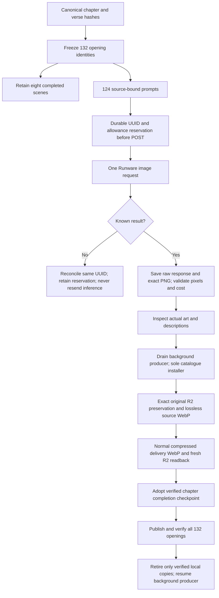

<!-- For God so loved the world, that he gave his only begotten Son, that whosoever believeth in him should not perish, but have everlasting life. — John 3:16 (KJV) -->

# High-quality book openings

`scripts-chirho/art-chirho/book-openers-chirho/` handles L.J.'s finite request for chapter 1 verses 1–2 of all 66 books. The eight existing high-quality scenes remain. The 124 new jobs use Runware GPT Image 2.6 Flare, medium rendering, high planning and a fixed $35 accounting allowance. Each uncertain request continues to reserve $1. Reported lower costs release only the unused reservation; a cost above $1 stops new dispatch. This is a conservative local dispatch guard, not a provider-side billing limit. No inference request is automatically resent, including when task details temporarily say `taskNotFound`. Existing background source/unknown holds and immutable historical plans are unchanged.

The published primary records use the same high-quality catalogue and asset paths as the background queue. Adoption occurs only after the raw provider task, exact source, original raster and verified R2 delivery agree; it does not fabricate an internal image-tool request. The background producer then skips these completed opening verses. Pending human artwork review stays pending. The separate Genesis 3:1–6 replacement and video scopes have their own provenance and are not charged to this opening batch.
