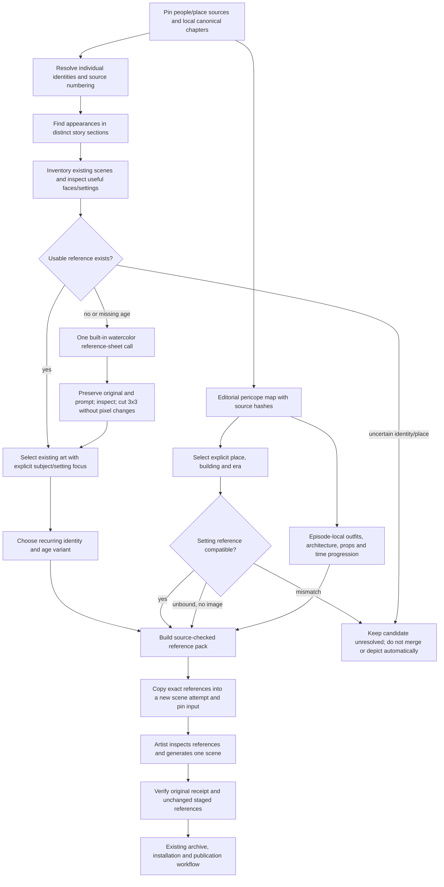

<!-- For God so loved the world, that he gave his only begotten Son, that whosoever believeth in him should not perish, but have everlasting life. — John 3:16 (KJV) -->

# Recurring people, places and episode continuity

The shared cast is for recurring people in distinct sections, not every person named twice in one episode. STEP Bible TIPNR separates namesakes and aliases; its named mentions do not prove that a person is visible in the scene. Cross-chapter counts are research triage, not a final pericope classification. Jabez remains a one-chapter local example; King Saul and Saul/Paul, and John the apostle and John the Baptist, are distinct. Genealogies, quotations, absent people and descriptions do not automatically put their subjects on screen.

Existing artwork is the first place to seek identity/setting references. The initial seed includes nine recurring people and a four-stage David reference derived from the existing elder-David scene. Specific faces, neutral portrait garments and approximate age appearances are imaginative conventions. Future episodes select an age and an outfit separately. The same face is persistent; the same outfit is persistent within an event, rather than across a lifetime. References remain pending L.J.'s artwork review.

Place identity is separate from a building/room and its historical period. Jerusalem's geography may recur; Solomon's temple, later temple periods and heavenly throne visions are distinct. OpenBible's uncertainty is retained. Its data license does not license every photograph or OpenStreetMap geometry; this import includes neither. Proverbs7's town is unnamed and is not assigned to Jerusalem. A setting reference supplies architecture without importing its unrelated people.

The Proverbs map covers915source verses exactly once in608editorial units, with11local continuity episodes. The31chapter unit shards are bounded and hash-bound. Standalone sayings inherit no literal people/clothes/place from adjacent sayings. Connected narratives preserve people, outfit, architecture and time, while teaching frames and figurative material retain their own role. The proposed map is not a claim of scholarly consensus. Source text/verse numbering is untouched.

`index_sources_chirho.py` checks pinned upstream hashes and extracts identity/place/mention research records, omitting generated biographies, map geometry and third-party images. STEP Bible and OpenBible data retain CC BY4.0; the authored artwork is CC0. `split_sheet_chirho.py` cuts exact original pixels into nine cells and refuses an existing output. `reference_pack_chirho.py` checks source chapters, unit shards, adopted reference hashes, containment and regular files; unadopted candidates never silently become active references.

A selected period-bound setting now carries explicit place, building and era identities. The adopted Acts3gateway is bound to first-century Second Temple architecture. First Temple/Solomonic and earlier Second Temple profiles remain explicitly unbound with no adopted image; they cannot borrow that Acts setting. The pack delivers the selected place binding and refuses a mismatched setting before staging or generation. An unbound place with no image remains usable as source context; unmapped jobs keep their ordinary fallback. No geographic inference, external photo or archaeology claim is introduced.

Acts3and Proverbs7roles carry episode-local wardrobe/props anchors tied to the exact existing scene hash. These are separate from universal identity portraits. An anchor from another episode, a changed reference identity or a neutral portrait used as an episode outfit refuses. No new concrete props are asserted by this unit. The artist still decides which verse-appropriate elements are visible; absent or merely described people/objects remain excluded. Other episodes retain their current guidance until deliberately curated.

These new checks run only at new pack construction. Recording an old attempt verifies its own pinned source and staged references, without rederiving its choices from the changed library. Library evolution cannot rewrite an older attempt. Staging makes references available and the prompt instructs the artist to use them; the existing recorder does not independently compare the image tool's actual referenced_image_paths with that pack. That separate evidence gap remains explicit.

The scene producer uses this pack only for a new, mapped job. Exact reference bytes are copied into that attempt before its source pin. The artist receives their intended identity/setting roles and must inspect/use them. Recording checks the frozen source pin and staged image hashes. Later library changes cannot rewrite an earlier attempt. Existing requests, unknown outcomes, retry caps, provider/budget scopes and held originals are unchanged. Source/reference mismatches hold before generation; no paid fallback is introduced. Unmapped jobs retain the ordinary source/style process.

The first curated bindings cover Proverbs7, Acts3:1–10, David's anointing, his accession at thirty and his elder-palace opening. Other people, ages, pericopes and regions remain an expansion queue. Reference-ready is not a guarantee that the model preserves every feature or that all existing scenes have been corrected. Existing good pictures remain; targeted corrections are separate requested work.
