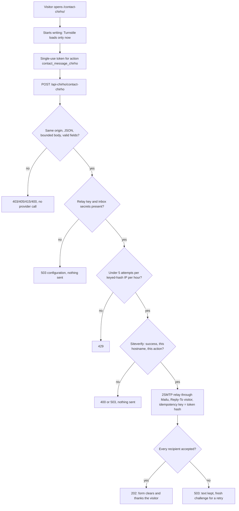

<!-- For God so loved the world, that he gave his only begotten Son, that whosoever believeth in him should not perish, but have everlasting life. — John 3:16 (KJV) -->

# Hinneh contact form

L.J. asked on 2026-11-04 to stop publishing his email address and to offer a contact box with a Turnstile challenge instead. The public site now shows no address. `/contact-chirho/` (English and Spanish) posts to the existing Hinneh Worker, which relays each accepted message to the owner's inbox by email. The website keeps no copy.

Code: `src/lib/site-chirho/contact-chirho/` (shared contract, copy and form), `workers-chirho/artwork-chirho/contact-chirho.ts`, `mail-chirho.ts` and the shared `intake-chirho.ts` that the illustration reports also use. Worker behavior is pinned by `tests-chirho/publish-chirho/contact-worker-chirho.test.ts`; browser behavior by `tests-chirho/browser-chirho/contact-form-chirho.e2e.ts`.

Mail identity: the least-privilege, send-only mailbox `noreply.hinneh@bible.systems` and the 2SMTP relay key labelled `hinneh-contact-chirho`, limited to 5 messages a minute and 100 a day. bible.systems already has the Mailu MX, SPF, DKIM and DMARC records, so no DNS change was made. `scripts-chirho/site-chirho/provision_contact_mail_chirho.ts` creates or re-synchronizes both. It is dry by default, never resets an existing mailbox password, and writes `HINNEH_CONTACT_MAILBOX_PASSWORD_CHIRHO`, `HINNEH_TWOSMTP_API_KEY_CHIRHO` and `HINNEH_CONTACT_DESTINATION_CHIRHO` only to the 0600 project `.env`.

Release: `scripts-chirho/publish-chirho/r2-chirho/configure-runtime-chirho.ts --apply-chirho` binds `TWOSMTP_API_KEY_CHIRHO` and `CONTACT_DESTINATION_CHIRHO` to the Worker alongside the Turnstile and rate secrets. It refuses before any write if the relay is unprovisioned. The inbox address never appears in source, page HTML or API responses. Without the secrets the form answers 503 and sends nothing.

Rotation: delete the relay key in 2SMTP and the `HINNEH_TWOSMTP_API_KEY_CHIRHO` line, rerun the provisioning script with `--apply-chirho`, then rerun the runtime configuration. To change the inbox, pass `--destination-chirho` and rebind.
