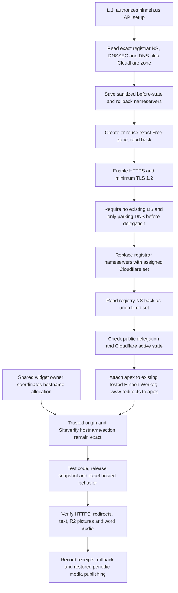
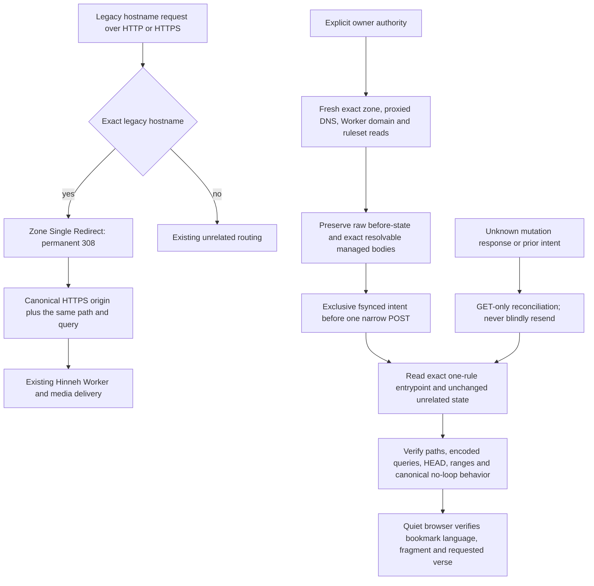

<!-- For God so loved the world, that he gave his only begotten Son, that whosoever believeth in him should not perish, but have everlasting life. — John 3:16 (KJV) -->

# Hinneh domain and managed hosting

The domain operation is specific to hinneh.us in L.J.'s existing main Cloudflare account and existing Porkbun account. The purchased registration and the active reader hosting are separate facts. GitHub Pages remains an evaluated alternative, not an authorized migration or public-repository push.

`scripts-chirho/domain-chirho/setup_domain_chirho.ts` reads by default. Its mutation phases require `--apply-chirho --confirm-chirho hinneh.us` plus `--prepare-zone-chirho`, `--delegate-chirho` or `--web-chirho`. The last phase requires an active Free zone, creates only the exact www redirect and proxied CNAME, and refuses unexpected existing rules/DNS instead of replacing them. Provider object-key order is immaterial to its structural readback. It performs no purchase, plan upgrade, credential change, contact edit or operation on another domain. An ambiguous zone, unexpected nameservers, non-parking DNS or existing DNSSEC refuses migration until the existing data is explicitly preserved. Unknown write results are reconciled by reads before any retry. Credentials remain only in the ignored environment and request headers.

The deployment configs retain the legacy hostname attachment and hinneh.us on the same Worker. The canonical public origin is hinneh.us; the legacy hostname now redirects at the zone edge as described below. Published artwork URLs are root-relative. Local development and adapter previews must read media from the canonical origin while preserving exact-path validation and redirect refusal; a proxy that still requests the redirecting legacy origin returns 503 by design. HTML prerender crawling is disabled, so remote artwork is not downloaded into static build dependencies. The public release still excludes SvelteKit server output and enforces zero local artwork rasters.

The artifact-report catalogue lists both exact reader hosts. The server selects its expected hostname from the request URL, requires that origin, and compares Siteverify's hostname to that exact host and the fixed flag action. A known alias cannot answer the other alias's challenge. AICEO DM2677 owns shared-widget allocation; domain/TLS checks and protected form acceptance are separate evidence.

The existing Cloudflare deployment is managed hosting; it keeps serving after the Mac and generation workers stop. R2 stores media persistently. Local generation and scheduled updates are a separate operational dependency, not a requirement for visitor playback. Source code can be public independently of which provider hosts the reader; public publication needs the project's secrets/private-material and attribution review.

## Legacy hostname canonical redirect

hinneh.bible.systems remains attached to the existing Worker with its proxied DNS record. A zone-level Single Redirect in `http_request_dynamic_redirect` now matches only `(http.host eq "hinneh.bible.systems")`. Its target is `concat("https://hinneh.us", http.request.uri.path)`, with status 308 and `preserve_query_string: true`. HTTP and HTTPS requests therefore retain the path and query on the canonical HTTPS origin. This edge configuration is separate from a Worker code release; it changes neither the DNS record nor another hostname's route. Canonical hinneh.us requests do not match this rule.

The private one-shot operator reads by default. `--apply-chirho` is required for the single approved create request. It uses `POST /zones/{zone_id}/rulesets` only when the dynamic redirect entrypoint is absent; it never overwrites an existing list of rules. If an entrypoint exists, reconcile its identity and use a separately reviewed single-rule operation rather than replacing the whole ruleset. Existing equivalent or conflicting exact-host rules must be reconciled before another request. A durable intent forbids another POST; `--reconcile-chirho` performs reads only, including after a lost response. A confirmed result records the ruleset/rule IDs, versions, payload hash and unchanged DNS/custom-domain state without credentials.

Four originally resolvable provider-managed catalogue entries retain their exact metadata, versions and complete bodies. Cloudflare may transiently list an unavailable provider-managed entry. Membership may vary only when its kind is `managed`, its phase is `http_response_firewall_custom`, and a fresh GET returns 404/code 10001 with no result body. Each exact raw error and membership delta is preserved privately. A zone-kind entry, a new dynamic redirect phase before creation, another phase, a successful added body, or a change to any original resolvable entry remains drift. This narrow observational exception grants no permission to modify provider-managed rulesets.

The serving proof uses manual redirects first: HTTP/HTTPS roots and information/tutorial paths preserve encoded and repeated query values exactly; HEAD redirects; a video Range request redirects before the canonical response returns the matching 206 prefix; and an old image alias still resolves to its unchanged canonical bytes. A harmless unknown-path POST can verify method-preserving 308 without following it. Canonical HTTPS requests return normally, without a loop. Fragments never reach the HTTP server, so bookmark language/fragment and final requested-verse restoration require a separate quiet browser check. The browser guard runs first and performs no playback.

Cloudflare references: https://developers.cloudflare.com/rules/url-forwarding/single-redirects/create-api/ , https://developers.cloudflare.com/rules/url-forwarding/single-redirects/settings/ and https://developers.cloudflare.com/ruleset-engine/rulesets-api/add-rule/ .
