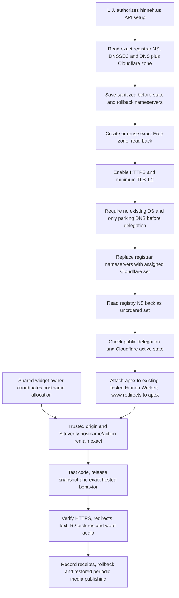

<!-- For God so loved the world, that he gave his only begotten Son, that whosoever believeth in him should not perish, but have everlasting life. — John 3:16 (KJV) -->

# Hinneh domain and managed hosting

The domain operation is specific to hinneh.us in L.J.'s existing main Cloudflare account and existing Porkbun account. The purchased registration and the active reader hosting are separate facts. GitHub Pages remains an evaluated alternative, not an authorized migration or public-repository push.

`scripts-chirho/domain-chirho/setup_domain_chirho.ts` reads by default. Its mutation phases require `--apply-chirho --confirm-chirho hinneh.us` plus `--prepare-zone-chirho`, `--delegate-chirho` or `--web-chirho`. The last phase requires an active Free zone, creates only the exact www redirect and proxied CNAME, and refuses unexpected existing rules/DNS instead of replacing them. Provider object-key order is immaterial to its structural readback. It performs no purchase, plan upgrade, credential change, contact edit or operation on another domain. An ambiguous zone, unexpected nameservers, non-parking DNS or existing DNSSEC refuses migration until the existing data is explicitly preserved. Unknown write results are reconciled by reads before any retry. Credentials remain only in the ignored environment and request headers.

The deployment configs retain the legacy origin and add hinneh.us to the same Worker. Published artwork URLs are root-relative. Only local Vite development streams the legacy public image origin; local adapter previews proxy the exact image path without forwarding headers/query or following redirects. HTML prerender crawling is disabled, so remote artwork is not downloaded into static build dependencies. The public release still excludes SvelteKit server output and enforces zero local artwork rasters.

The artifact-report catalogue lists both exact reader hosts. The server selects its expected hostname from the request URL, requires that origin, and compares Siteverify's hostname to that exact host and the fixed flag action. A known alias cannot answer the other alias's challenge. AICEO DM2677 owns shared-widget allocation; domain/TLS checks and protected form acceptance are separate evidence.

The existing Cloudflare deployment is managed hosting; it keeps serving after the Mac and generation workers stop. R2 stores media persistently. Local generation and scheduled updates are a separate operational dependency, not a requirement for visitor playback. Source code can be public independently of which provider hosts the reader; public publication needs the project's secrets/private-material and attribution review.
