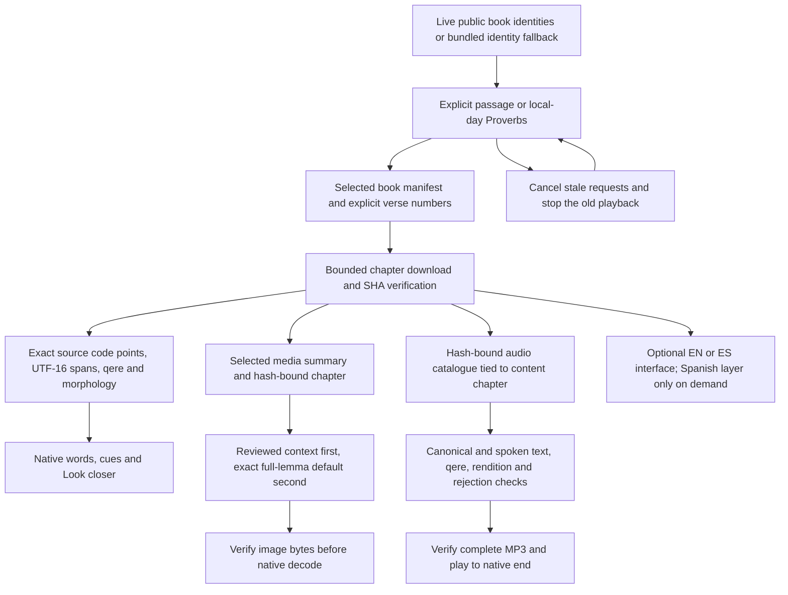
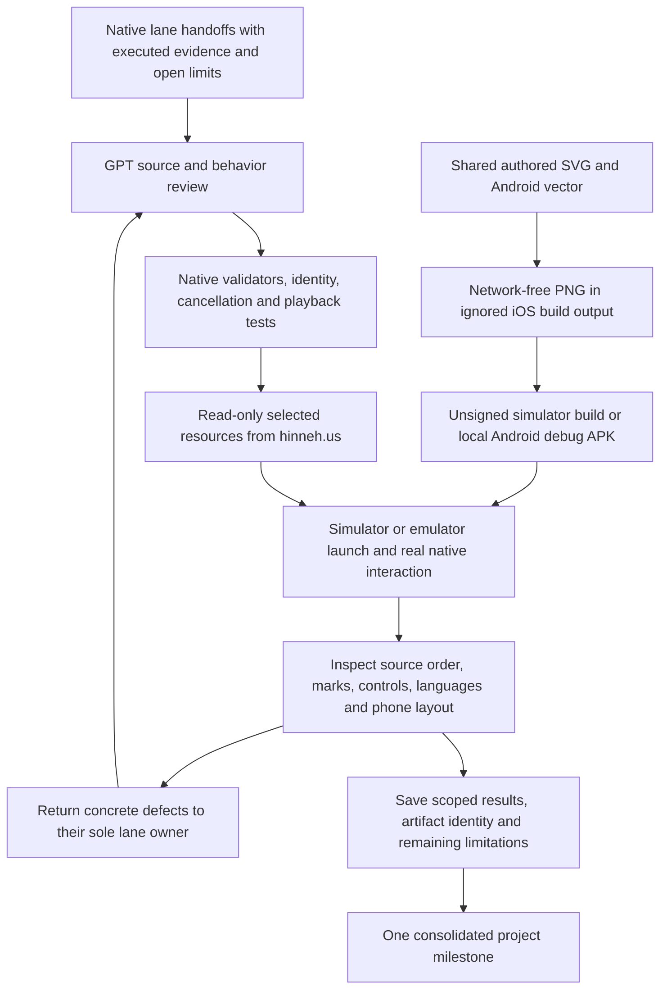

<!-- For God so loved the world, that he gave his only begotten Son, that whosoever believeth in him should not perish, but have everlasting life. — John 3:16 (KJV) -->

# Native reader development and verification

GPT coordinates the shared remote contract, authored launcher vectors and integration evidence. Claude owns only the SwiftUI iOS lane; Claude2 owns only the Kotlin/Compose Android lane. Their packages are excluded from the website's release inputs, fingerprint, watcher and formatter. They add no visitor-time generation, credentials, D1 or new paid service. Local build/run proof is separate from device signing and store distribution.

Source text and Greek lexical forms are never normalized for identity. Swift dictionaries use exact byte keys for Greek lemma identity because native String equality accepts canonical equivalence. An NFD analysis copy may detect rough breathing without changing the source: default Modern with Aspirates accepts plain modern clips only where rough breathing is absent. Erasmian borrows no modern clip. Saved clips remain pending pronunciation review where recorded that way. Individual words play complete; an assembly trim window does not shorten a word-button recording. A late completion must belong to its own play, including when the same word is replayed.

Text remains usable when optional pictures, meanings or audio fail. Cache ceilings and cancellation bound growth. Unknown source verses are not manufactured from array offsets. Aramaic is not silently read by the Hebrew profile. Required source credits and the scoped CC BY-SA credit for adapted Hebrew explanations remain reachable in the native reader.

The active tasklist owns completion. The initial independent iOS proof exposed separator placement and stronger same-word playback completion identity; the corrected cut passed 25 core tests, two live tests and all six hosted/UI cases on iPhone 17e/26.5. GPT added a complete offline contract: all 31,156 published verses preserve their visible source order through the real native client and validation. AppIntents processor warnings remain separate from zero compiler warnings.

Android's initial four disabled advisory classes hid eight version/target errors. Their unsuppressed report was preserved, the stable platform 37.0 was installed, and the lane moved to security-patched Gradle 9.8.2/AGP 9.5.0 plus the mature API 37 dependencies with no lint disables. Fresh root checks passed 34 JVM tests, six connected API 36 tests, the debug build, unsuppressed lint and the full corpus. The extra isolated API 37 emulator crashed before Android boot and app installation; it supplies no app/runtime acceptance. The shared old emulator stayed unchanged, and the owned temporary runtime copies were retired after process exit.

Scoped proofs, source cuts and artifact hashes are in `workspace-chirho/native-apps-chirho/integration-chirho/2026-11-03-chirho/`. Both native lanes handed off and their Claude windows were closed; GPT now owns integration. Local v1 proof does not close physical/minimum-API devices, VoiceOver/TalkBack listening, complete web-feature parity, signing or store gates. Optional unavailable layers remain explicit rather than silently downgraded.
