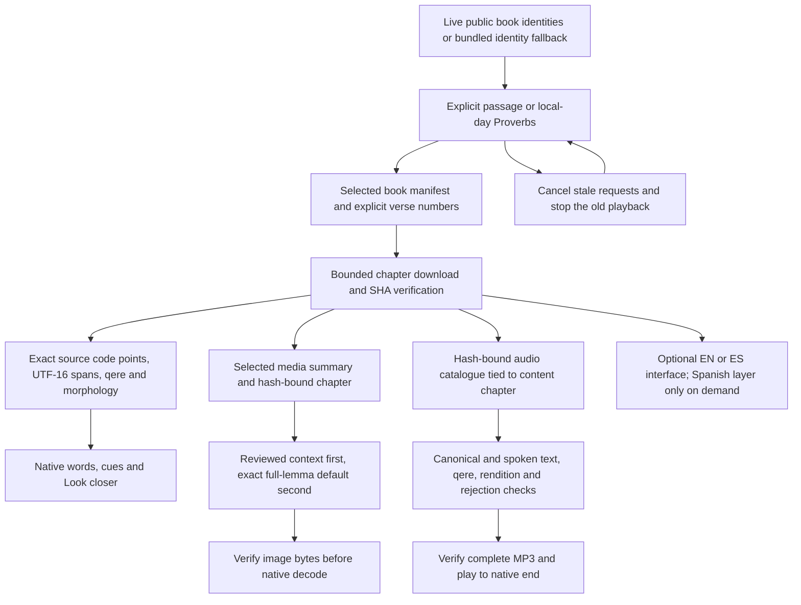
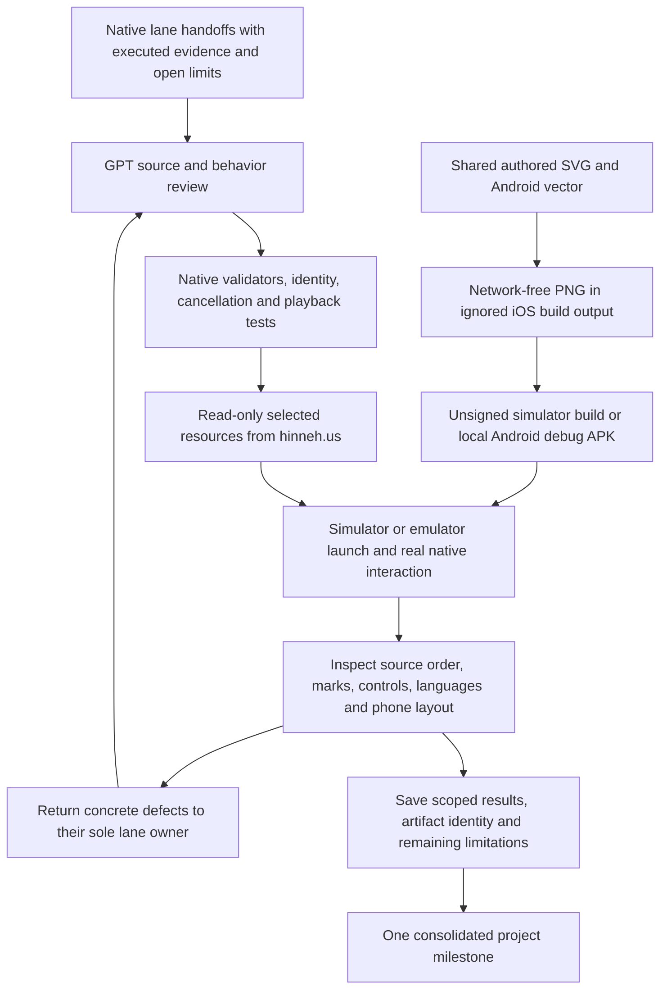
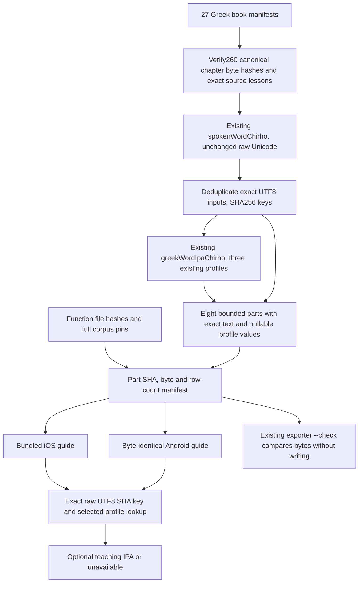

<!-- For God so loved the world, that he gave his only begotten Son, that whosoever believeth in him should not perish, but have everlasting life. — John 3:16 (KJV) -->

# Native reader development and verification

Root coordinates the shared remote contract, authored launcher vectors and integration evidence. The active handoffs assign one implementation owner to each SwiftUI iOS and Kotlin/Compose Android lane. Their packages are excluded from the website's release inputs, fingerprint, watcher and formatter. They add no visitor-time generation, credentials, D1 or new paid service. Local build/run proof is separate from device signing and store distribution.

Source text and Greek lexical forms are never normalized for identity. Swift dictionaries use exact byte keys for Greek lemma identity because native String equality accepts canonical equivalence. An NFD analysis copy may detect rough breathing without changing the source: default Modern with Aspirates accepts plain modern clips only where rough breathing is absent. Erasmian borrows no modern clip. Saved clips remain pending pronunciation review where recorded that way. Individual words play complete; an assembly trim window does not shorten a word-button recording. A late completion must belong to its own play, including when the same word is replayed.

Text remains usable when optional pictures, meanings or audio fail. Cache ceilings and cancellation bound growth. Unknown source verses are not manufactured from array offsets. Aramaic is not silently read by the Hebrew profile. Required source credits and the scoped CC BY-SA credit for adapted Hebrew explanations remain reachable in the native reader.

The active tasklist owns completion. The initial independent iOS proof exposed separator placement and stronger same-word playback completion identity; the corrected cut passed 25 core tests, two live tests and all six hosted/UI cases on iPhone 17e/26.5. GPT added a complete offline contract: all 31,156 published verses preserve their visible source order through the real native client and validation. AppIntents processor warnings remain separate from zero compiler warnings.

Android's initial four disabled advisory classes hid eight version/target errors. Their unsuppressed report was preserved, the stable platform 37.0 was installed, and the lane moved to security-patched Gradle 9.8.2/AGP 9.5.0 plus the mature API 37 dependencies with no lint disables. Fresh root checks passed 34 JVM tests, six connected API 36 tests, the debug build, unsuppressed lint and the full corpus. The extra isolated API 37 emulator crashed before Android boot and app installation; it supplies no app/runtime acceptance. The shared old emulator stayed unchanged, and the owned temporary runtime copies were retired after process exit.

Scoped proofs, source cuts and artifact hashes are in `workspace-chirho/native-apps-chirho/integration-chirho/2026-11-03-chirho/`. Both native lanes handed off and their Claude windows were closed; GPT now owns integration. Local v1 proof does not close physical/minimum-API devices, VoiceOver/TalkBack listening, complete web-feature parity, signing or store gates. Optional unavailable layers remain explicit rather than silently downgraded.

## Shared bundled Greek IPA teaching guide

`apps-chirho/ios-chirho/scripts-chirho/export_teaching_chirho.ts` remains the one shared native export entrypoint. Its `export_greek_ipa_chirho.ts` helper verifies every Greek canonical chapter before calling the existing `spokenWordChirho` and `greekWordIpaChirho` functions. It exports those helper results unchanged; it neither implements native phonology nor calls a speech/provider service. The data is a broad word-level teaching guide, not recorded or acoustic IPA, reconstructed pitch or listener acceptance. The recorded clip IPA, chiefly Hebrew, is a separate existing source and is not generated, altered or inferred by this export. No transliteration is exported.

The resource group is `greek-ipa-chirho/`, under iOS `ResourcesChirho/` and Android `assets/teaching-chirho/`. Both groups contain the same nine files: `greek-ipa-manifest-chirho.json` and `greek-ipa-part-00-chirho.json` through `greek-ipa-part-07-chirho.json`. Names are globally Greek-prefixed to avoid resource-name collisions; native loaders must resolve the actual packaged bundle layout. Existing teaching, book and reviewed-spoken assets remain unchanged.

A key is lowercase SHA256 of the original spoken-text UTF8 bytes, without trimming, case conversion or Unicode normalization. The part index is the first raw digest byte bitwise AND 7. Each row retains `text_chirho` and `ipa_chirho` values for exactly `modern`, `modern_aspirates` and `erasmian`. Native lookup checks exact row-text UTF8 equality before returning the selected profile. Hash dictionaries use ASCII keys, avoiding Swift String's canonical-equivalence identity behavior. A null helper result, missing form, invalid bundle or unsupported profile remains unavailable; another profile is never substituted. Any NFD/lowercase analysis remains entirely inside the existing shared helper.

The manifest binds the recipe, helper/exporter function-file SHA256s, the book-registry hash, all 27 book manifests and 260 chapter paths/hashes, aggregate corpus/input identities and per-part SHA256/bytes/counts. Fixed ceilings are 25,000 forms, 4,096 forms per part, 1 MiB per part, 128 KiB manifest and 9 MiB total, with 1,024 UTF8 bytes per input and 2,048 per IPA value. A native reader can validate/load this finite bundle once and use constant-time hash dictionary lookup thereafter; visitor-time synthesis and independent phonological inference are unnecessary.

The existing export command writes only changed bundled files; `--check` rederives the expected bytes and exits nonzero on drift without regenerating output. Actual-corpus tests compare every exact form/profile with the same shared helper and both bundled copies. Negative controls cover composed/decomposed identities, helper-null and invalid-profile results, stale canonical bytes, altered part identity/length/hash, unknown schema and a cold real-exporter `--check` run over deliberately changed scratch data. Scratch copies, not shared content or recordings, own mutations in these tests.
