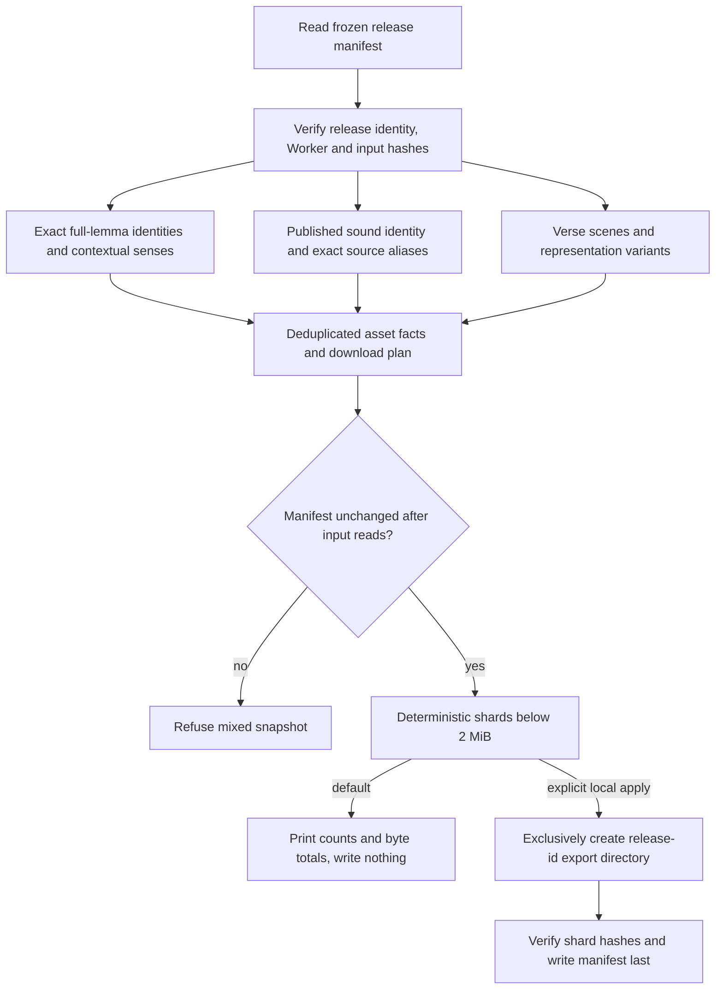
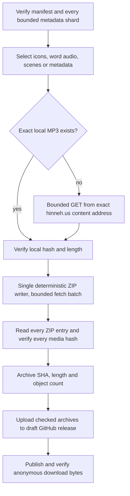

<!-- For God so loved the world, that he gave his only begotten Son, that whosoever believeth in him should not perish, but have everlasting life. — John 3:16 (KJV) -->

# Public reusable media catalogue

This exporter makes a standalone, deterministic catalogue of the frozen website release. It reads only `build-chirho/preview-chirho/release-manifest-chirho.json`, its verified Worker, and the public JSON files named by that release. It never reads the changing authoring catalogue or private production receipts, downloads media, calls a provider, uploads an archive, commits files, or changes the live site. R2 remains the persistent binary store.



## Commands and output boundary

From the repository root:

```sh
bun scripts-chirho/bible-chirho/export_media_library_chirho.ts
bun scripts-chirho/bible-chirho/export_media_library_chirho.ts --apply-chirho
```

The first command is a read-only plan. The second writes only `build-chirho/public-media-library-chirho/<release-id>-chirho/`. It refuses an occupied target, a symlinked input/output parent, unlisted or changed files, unsafe paths, unknown assets, contradictory media facts, invalid content/audio bindings and oversized records. It never deletes or replaces an export. An interrupted export stays inspectable; a missing final manifest identifies an incomplete write. A subsequent apply refuses that directory rather than silently repairing it.

The output root has one README, one manifest and six shallow shard directories. Each JSON shard is strictly below 2 MiB. Numeric shard files are asset-like collections; their growing membership does not create a deep directory hierarchy. The manifest binds every shard's path, SHA-256, byte count and record count. Only the metadata is written locally.

## Reuse contract

- `icons-chirho`: exact Hebrew lemma plus augment and exact Greek lemma plus lexical form, without Unicode normalization. A single Strong number can identify several full lemmas. Each record retains its sense, reviews, source lesson/token, evidence references and the roles `contextual` and/or `lemma_default`. Repeated chapter defaults are deduplicated. A default remains a general illustration, not a contextual sense selection for every occurrence.
- `word-audio-chirho`: published IPA/synthesis digest, language, profile, voice, provider and model, with a recording id that also includes the MP3 hash. Exact source spelling and recipe bindings are retained in each recording's `aliases_chirho`. Different cantillation spellings can therefore reuse one sound. Text is the synthesis identity only when no IPA or explicit synthesis input was published. The `catalogue_synthesis_key_chirho` describes these public fields; private provider settings and the production cache key are not inferred. Different MP3 hashes are always retained even when those public fields agree.
- `audio-occurrences-chirho`: verse id, exact canonical-text hash and the verified content/audio catalogue paths. `words_chirho` is an array of `[token_id, recording_id, zero_based_alias_index]` triples. This separates reusable sound from source-specific qere, spelling, stress policy and lookup binding. Saved natural verse recordings are untouched and excluded from this word-only library.
- `scenes-chirho`: one record per verse and variant, retaining Standard and Reduced representation where present. A Reduced scene must have its distinct Standard scene.
- `assets-chirho`: deduplicated SHA-256, bytes, public content-addressed URL and dimensions or duration. The word/icon/scene records refer to this table. A consumer selects its kinds, downloads the declared URLs and verifies bytes and SHA-256. The exporter itself never fetches those binaries.
- `source-catalogues-chirho`: public input paths, URLs, byte counts and SHA-256. These preserve exact provenance without copying the large original chapter records into every library entry.

Counts distinguish exact lemma identities, picture records, sound identities, source lookup aliases, unique word occurrences, recording-occurrence references and unique binary assets. Availability and review status are separate; this is not a pronunciation or artwork acceptance report. The source release id identifies a local verified snapshot, not proof that it is still the currently hosted release.

## Rights and distribution

Hinneh-created artwork is CC0 1.0 Universal. Project-held recording rights are CC BY 4.0, with credit to Hinneh / Love Jesus Software and the license link. Voice/identity terms and upstream text/data licenses remain separate. No generated-media license claims ownership of upstream source data. See the project's `LICENSES-chirho/` notices and the public Sources page.

Download totals are sums of declared unique binary lengths, not estimated Git pack sizes or archive sizes. The chosen initial distribution keeps catalogues under `data-chirho/media-library-chirho/` in Git and puts compressed icons, word MP3s and verse scenes in separate GitHub Release downloads. This preserves a complete downloadable collection without adding binary revisions to source history. R2 remains the website's persistent delivery store.



`package_media_library_chirho.py <catalogue-directory>` is dry by default. Add `--apply-chirho --kind-chirho icons_chirho|word_audio_chirho|scenes_chirho|catalogue_chirho` to create one package under `build-chirho/public-media-archives-chirho/<release-id>-chirho/`. It allows 1–16 simultaneous bounded GETs, refuses redirects and foreign URLs, verifies every length/hash, and reuses existing exact MP3 bytes. Artwork moves directly from memory into ZIP entries; there is no extracted local raster mirror. Compressed WebP and MP3 bytes are stored unchanged, with only metadata ZIP entries deflated. A failed package retains an explicit partial file and never becomes a final download. Existing archives are never overwritten. Each final archive must remain below GitHub's 2 GiB per-asset limit.

The temporary ZIP packages are retired only after exact anonymous GitHub readback, retaining small archive receipts. Catalogue availability alone is not an archival guarantee. No release download includes private sheets, original generator outputs, prompts, provider requests, secrets or operational receipts. Publication does not approve artwork or pronunciation.

## Checks

Run the focused hermetic suite with `bunx vitest run --project server tests-chirho/bible-chirho/media-library-chirho.test.ts`. It uses synthetic JSON and declared remote objects only; it needs no credentials, corpus workspace, media files or network. It exercises exact Unicode/augment identities, sound reuse across source aliases, distinct IPA input, qere, both scene variants, deterministic output, integrity refusals, source/Worker changes, privacy projection, unsafe paths/symlinks, exclusive output and bounded shard hashing.
