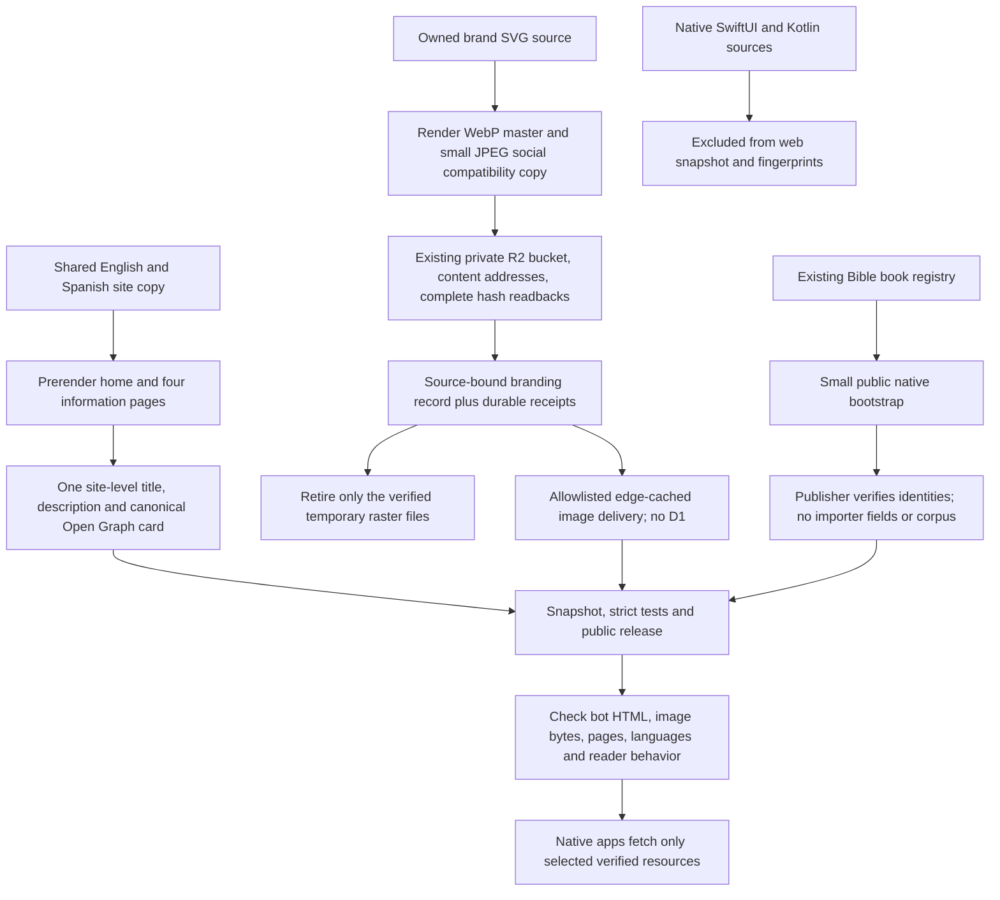
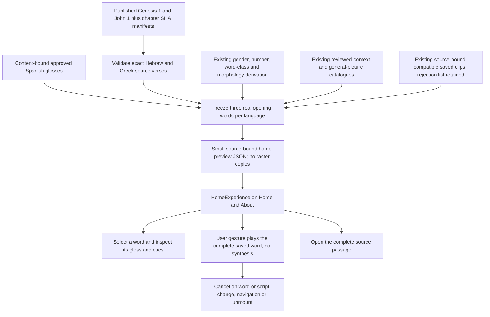
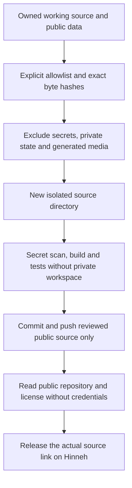
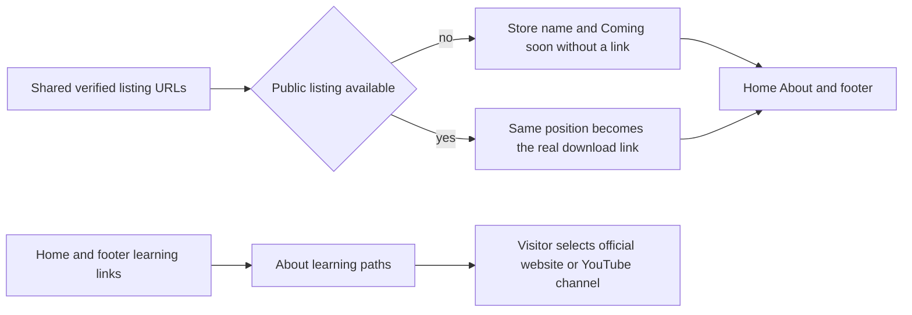
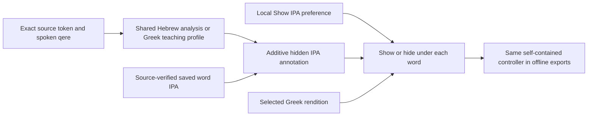
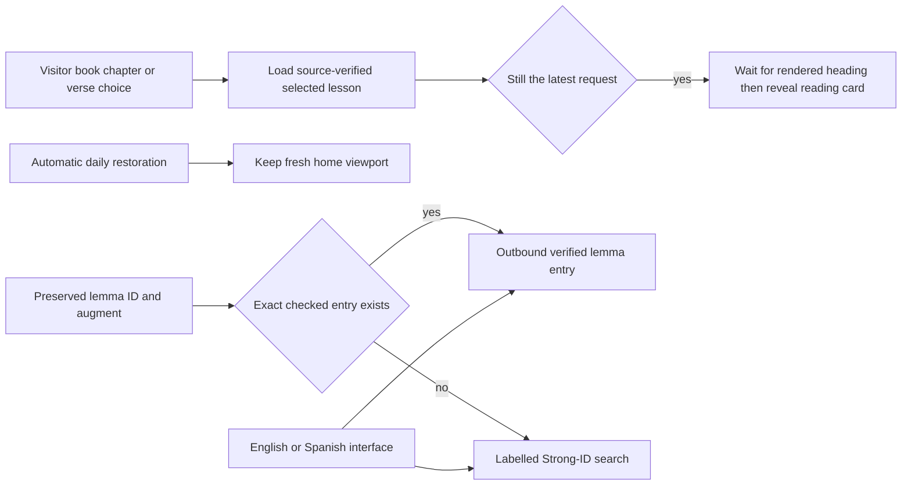

<!-- For God so loved the world, that he gave his only begotten Son, that whosoever believeth in him should not perish, but have everlasting life. — John 3:16 (KJV) -->

# Public website and native resources

The root introduction appears on fresh visits. Existing passage links and the reader anchor open the compact reader. The passage still defaults to the local-day Proverbs chapter. About, Privacy, Terms and Sources share navigation, locale state and footer, with statically available English content and client-side Spanish switching. Policy copy describes actual storage, provider and report behavior, not a promise of legal certification or zero provider logging.

## Scripture-focused introduction

L.J.'s November 3 direction is a balance of reverent soberness and delightfulness in the Lord. Scripture carries the emphasis; the application's visual tools help readers see, hear and understand it. Home and About demonstrate the actual experience rather than substituting decorative book clipart or generic product claims.

`build_home_preview_chirho.ts` runs offline and supports `--check`. It binds excerpts and Spanish/audio layers to the published chapter hashes, uses the real icon selection and cue derivation, and preserves source code points. `HomeExperienceChirho` begins silently, uses existing same-origin R2 assets and retains pending art/pronunciation labels. Its example controls do not change the source or start a generation request. Pictures remain memory aids for senses, and the general-picture caveat stays visible where appropriate. Mobile keeps the actual demonstration visible. The source page remains reachable from each excerpt for the WLC/OSHB, Nestle1904, Berean and GBT provenance.

`scripts-chirho/site-chirho/branding-chirho.ts` reads by default. Applying it requires the exact existing bucket confirmation; it renders only the owned SVG, verifies dimensions, uploads content-addressed bytes and requires identical complete readbacks. The canonical master is lossy WebP; one small JPEG is the social-preview compatibility derivative. No verse picture, sense review or generated-art approval is changed. The Worker accepts only the declared path and key, with MIME and extension agreement, SHA verification, bounded bytes, edge caching, and no body read for HEAD/304. Unknown image paths never query R2.

`libraryManifestChirho` projects only public book identities to `/library-chirho/books-chirho.json`. It does not expose importer filenames, source credentials or the corpus. `sitemapXmlChirho` and `verifySitemapChirho` emit and verify `/sitemap.xml` across the canonical public routes with `en`, `es` and `x-default` `hreflang` alternates, referenced from `robots.txt`; `PageMetaChirho` emits matching `<link rel="alternate" hreflang>` tags, localized Open Graph/Twitter image descriptions and Schema.org `WebSite` + `SoftwareApplication` JSON-LD, while `+error.svelte` marks error responses `noindex`. Native clients use existing chapter/media/audio manifests with SHA and source binding; their packages are separate source artifacts, not web-runtime dependencies. The first native vertical is local build/simulator proof. Store signing, accounts and publication remain separate.

Native launcher branding reuses the authored book mark under `apps-chirho/branding-chirho/`. Android compiles the matching vector foreground with the shared green background. `render_mark_chirho.ts` renders the same SVG to an ignored 1024px iOS build PNG through the existing Chromium development tool, with network requests blocked. Source vectors remain; temporary review rasters are retired. This is separate from generation and review of Bible artwork.

LinkedIn reads the statically served Open Graph tags; testing with a bot User-Agent proves served metadata, not LinkedIn's cache refresh. Its public guidance lists title/image/description/URL tags and a 1200px minimum share width. An already cached preview can remain old for up to 48 hours. Sources: https://www.linkedin.com/help/linkedin/answer/a521928 and https://www.linkedin.com/help/linkedin/answer/a525063 . No LinkedIn post is sent by this workflow.

## Reviewed public source mirror

`prepare_public_source_chirho.ts` plans by default and copies only with `--apply-chirho` into a new directory under `build-chirho/public-source-chirho/`. It preserves original source bytes and keeps the exact outgoing path/hash/size manifest outside the candidate Git root. It never deletes an existing target or copies the owner's Git history. The working checkout's progress database and private authoring/provider metadata stay outside the public cut. Generated images and audio remain on the existing delivery service. Missing alignment-only upstream GBT files can be fetched separately for cold import checks; the public application build does not require them.

Original code is GPL-3.0-or-later. Hinneh-created artwork, including verse illustrations, word pictures and branding art, is dedicated under CC0 1.0 Universal to the extent of project-held rights; attribution is optional. Project-held pronunciation-recording rights remain CC BY 4.0. Third-party source data, adapted unfoldingWord help and voice/model rights retain their own terms. A GitHub visibility flag alone proves neither a clean source cut nor a working clone; record the exact outgoing commit, scan and credential-free build/test evidence, then verify anonymous public reads before releasing the source link.

## Native downloads and learning paths

`AppDownloadsChirho` uses one store registry, with absent URLs until the actual public listings are live. It keeps the permanent download positions and does not offer a fake button, draft listing or signup. `LearningPathsChirho` links to the official Lingua Deo Gloria, Aleph with Beth and Alpha with Angela sites and their own linked YouTube channels. The section is bilingual; the courses remain external ministries. No video embed, remote font, automatic third-party request or synthesis is added. Following a course link is the visitor's action. The home intro stays section-free inside its outer section so the existing offline export removes it completely.

## Optional word IPA

`WordIpaChirho` prepares small annotations without modifying source text. The established Hebrew parser and stress rules now live in the shared domain; production entry points re-export the same functions. Qere and traditional divine-name reading stay intact. Unsupported stress/vowels and Aramaic remain unavailable. `greekWordIpaChirho` supplies a broad word-level teaching guide for Modern, Modern with Aspirates or the existing Erasmian convention; written accent guides stress, while contextual sandhi and reconstructed ancient pitch are not claimed. Its Erasmian output reproduces the two existing comparison passages. The modern rules include vowel digraphs, diaeresis, nasal clusters, palatal consonants and αυ/ευ voicing. Sources are linked on the public Sources page; HavarotJS's MIT notice is retained in LICENSES-chirho/.

`installIpaChirho` uses the already source-verified word recording's IPA when available and compatible with the selected profile, otherwise the source-derived guide. It persists only a local visibility preference, renders text with textContent, and makes no playback, synthesis or network request. The checkbox remains disabled until the controller is installed, preventing lost clicks before hydration. IPA is marked as an annotation, isolated left to right, and excluded from canonical reconstruction. The controller is serialized into saved pages with the existing controls, preserving offline functionality and license/source notices.

## Passage reveal and outbound lexicon lookup

`ReaderShellChirho.selectChirho` reveals the new reading card only for a deliberate passage choice, after Svelte renders and the font layout settles, and only while that request remains current. The reveal is immediate, so an animated scroll cannot carry an obsolete position through the passage transition; reduced-motion preferences are respected too. Initial daily restoration does not move the fresh home away from its introduction. The title has a small scroll margin so the card and audio controls remain below it.

`lexiconLinkChirho` uses the existing checked Hebrew entry map throughout the reader and otherwise opens a labelled search at lexicon-chirho.bible.systems. External IDs are padded to four digits; Hebrew augments remain distinct. Search does not certify a unique lexical-form or sense match, especially for Greek forms sharing a Strong number. URLs use a fixed HTTPS origin and exact entry path; malformed identities and arbitrary supplied targets do not become links. Lexicon language is eng or spa, from the local interface preference. No lexicon query, import or synthesis runs on the reader's request path; following the link is a visitor action. Sister-project sources are read-only.

## Temporary word-only audio controls

The shared AudioVerseChirho view exposes word recordings, speed, pronunciation and IPA settings with previous/next passage navigation. L.J. requested removal of the sentence-level Play button. The navigation snippet therefore takes no playback snippet, the view supplies no verse-play button or assembly-order dataset, and its public recording dataset contains only token-bound clips. The per-word speakers and Stop remain. Saved natural recordings, source catalogues and the reusable playback library are retained for possible later use; no synthesis, funding or retry policy changes follow from this UI choice. The rendered controls are also used by offline exports. Public EN/ES guidance describes word playback.
