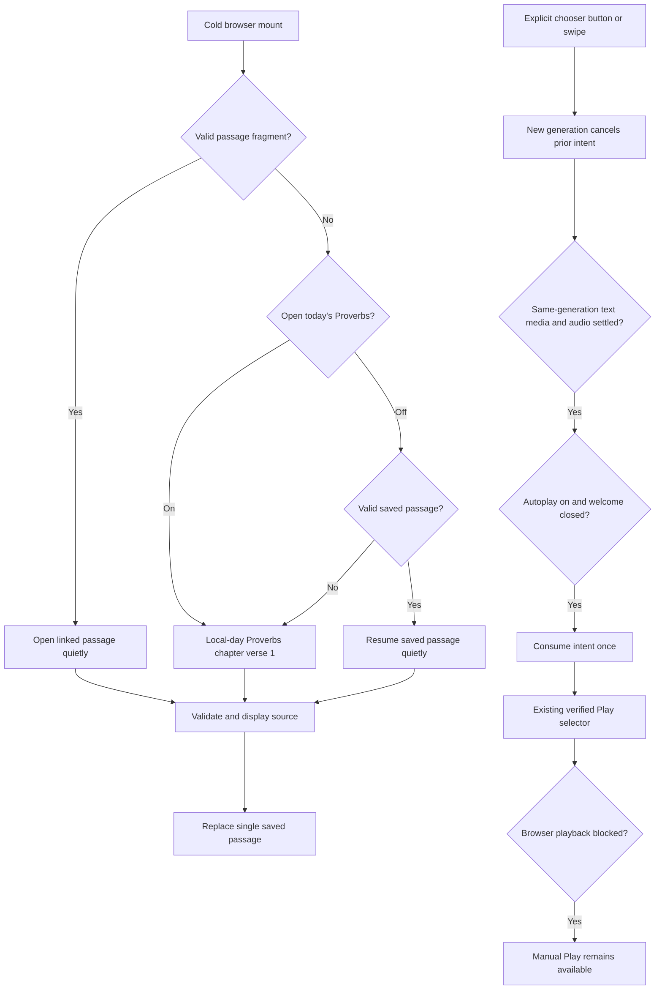

<!-- For God so loved the world, that he gave his only begotten Son, that whosoever believeth in him should not perish, but have everlasting life. — John 3:16 (KJV) -->

# Reader welcome and local preferences

The welcome is one short screen, acknowledged once per deliberate welcome-content revision. A deployment hash and periodic media refresh never change this revision. Start reading is primary; the optional tutorial is reachable from Help. The welcome requests neither tutorial MP4 bytes nor audio playback. Info links to the existing About study-aids and license information.

Preferences use local storage only. Today and autoplay default on; an explicitly saved false keeps either preference off. Storage denial falls back to these defaults without preventing reading, and choices still work for the current visit. Only a successfully validated source replaces the single last-passage value. Neither foregrounding, hash restoration, retry, rendition changes nor closing the welcome creates an autoplay intent.

After mounting, the pure mobile-store helper selects an existing App Store link for iPhone, iPad, iPod or touch-enabled desktop-mode iPadOS, or an existing Google Play link for Android. Desktop, unknown and legacy Windows Phone browsers receive no mobile suggestion. The matching optional link appears only in Welcome and Help; the tutorial remains available. Browser properties are used locally for this display hint, without network lookups, tracking or device persistence. A store opens only when the reader chooses its link.

AudioVerse reports its captured navigation generation alongside its lesson identity. The shell also waits for settled media and verified source, then invokes the existing verse Play control once. This preserves the normal video/human/synthetic/assembled-word selection, speed, rendition, failure fallback and cancellation rules. A stale first-A callback cannot consume the newest A after A/B/A navigation. A settled verse with no available playback consumes the intent without playing; a later periodic media refresh cannot revive it. Manual audio/Stop/rendition actions, a newer passage, disabling autoplay, hiding the page and component destruction cancel pending intent. Opening a word card keeps the currently playing reading.

The tutorial is a separate prerendered page with a lazy EN/ES manifest, user-controlled MP4, captions and transcript. Its videos remain separate from canonical Bible verse media. Changing language, leaving the route or hiding the document explicitly pauses/releases the tour's player. Root's tutorial delivery workflow validates the two archived videos and companions before publication.

Unattended playback tests force the native media gain to zero before every play and block device speech. Silent decoding, rate and cancellation checks are not audible or listener acceptance.

The main verse action uses the same selected reading and matching visible-video predicate as playback. It says Play verse video only when the next Play uses that video, Listen to verse for audio/assembled words, and Stop while active. A failed visit-local video changes the next action to audio without replacing the failure status. Labels-only observer updates notice matching video insertion/hash changes, ignore their own text writes, and preserve the controller's self-contained offline form.

A NotAllowedError from the browser restores idle controls and offers a short localized prompt to tap Play. It does not mark a verified video as failed: manual Play retries that same video. Other playback or media errors retain the existing visit-local video failure and next-Play audio fallback. Stale rejection callbacks cannot change a newer play.
