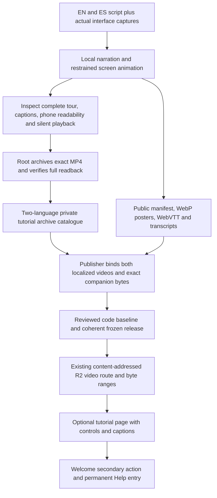

<!-- For God so loved the world, that he gave his only begotten Son, that whosoever believeth in him should not perish, but have everlasting life. — John 3:16 (KJV) -->

# Optional narrated tutorial

Tutorials are separate from Bible lessons, scenes and source-bound verse videos. The publisher does not create a synthetic lesson ID or relax `validVerseVideoChirho`. The two tutorial hashes enter the existing Worker transport only after `addVerifiedTutorialFactsChirho` in `scripts-chirho/publish-chirho/r2-chirho/tutorial-rules-chirho.ts` checks `data-chirho/tutorial-chirho/catalogue-chirho.json` against the public manifest. This build check reads local facts only; it performs no network request, synthesis, upload or playback. Root owns the codec/decode, actual narration/visual inspection and full R2 byte readback before recording the archive facts.

The public manifest is `static/tutorial-chirho/quick-tour-chirho.json`, schema1, tutorial ID `hinneh-quick-tour-v1-chirho`, with exactly one English and one Spanish entry. Each has `language_chirho`, `video_chirho` (asset path, SHA256, bytes, duration, width and height), `poster_chirho` (asset path, SHA256, bytes, width and height), `captions_chirho` (asset path, SHA256 and bytes), and a nonempty `transcript_chirho`. The private catalogue has the same schema/ID and two entries, each holding its language and identical video facts, `key_chirho`, `readback_sha256_chirho` and `verified_at_chirho`.

The MP4 asset URL is `/video-chirho/sha256-chirho/<sha>-chirho.mp4`; its R2 key is `video-chirho/sha256-chirho/<sha>.mp4`. Each distinct localized video is at most16MiB,120seconds and1920pixels per edge. A tutorial hash cannot collide with any other admitted video hash. These bounds match the existing video transport without altering its range/conditional-request behavior.

Exactly five static companion paths are allowed: the manifest, `en-poster-chirho.webp`, `es-poster-chirho.webp`, `en-captions-chirho.vtt` and `es-captions-chirho.vtt`, under `/tutorial-chirho/`. Posters are at most1MiB with checked WebP canvas dimensions; captions are at most64KiB, fatal-decoded UTF8, begin with WEBVTT and contain a nonempty cue using `HH:MM:SS.mmm` timestamps. Cue ends must follow their starts and remain within0.1seconds of the video duration. Transcripts are nonempty and at most8192characters. Their declared hashes and sizes must equal the frozen public bytes. Structural validation does not prove accurate caption timing or narration quality; complete rendered review remains required.

The rendered tutorial page, public manifest, both companions per language and private archive catalogue must be present together. The feature may be omitted only when its page and media are absent. Existing verse-video facts are preserved; a failed tutorial validation adds no tutorial facts. Any error refuses the release.

The current snapshot copier already includes the private tutorial catalogue and static tutorial files. They intentionally remain code/content inputs rather than automatically flowing media, so replacing the tutorial requires a reviewed fresh baseline. No running publisher or background production schedule changes as part of this contract. The welcome never preloads or plays the tour. Watching is a user action; native apps can open the same trusted localized page. Unattended checks use the proven silent guard and never change product or system volume.
