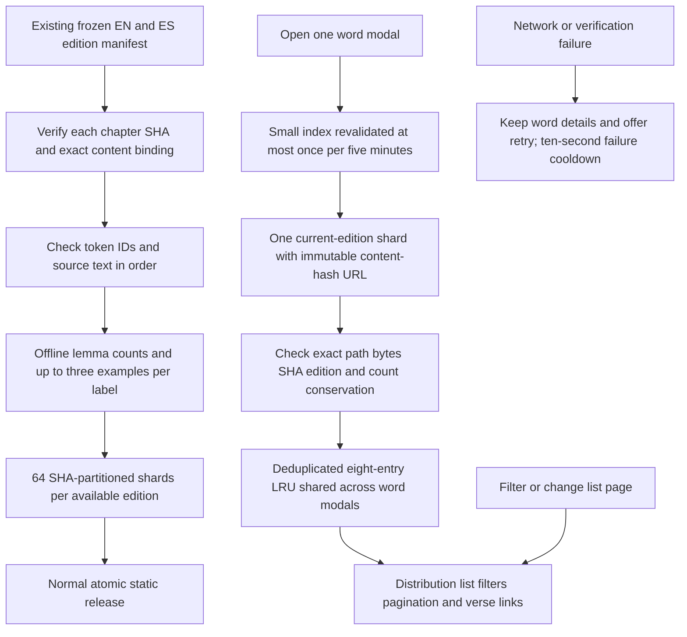

<!-- For God so loved the world, that he gave his only begotten Son, that whosoever believeth in him should not perish, but have everlasting life. — John 3:16 (KJV) -->

# Static word study and database cost

`word_study_chirho.py` is an offline build tool. It reads only local content and already imported edition data. Every source chapter is hash-bound to the edition manifest; each edition must contain the same tokens and text in the same order. Lemma keys preserve Hebrew homograph augments and separate Hebrew H identifiers from Greek G identifiers. The full indexed source corpus supplies occurrence denominators. Missing edition verses remain outside coverage; aligned empty labels remain counted as empty, never invented translations. Exact trimmed labels retain capitalization, punctuation and prefix/phrase wording. Only the translation-bearing uses enter the pie denominator. These distributions describe imported word-linked draft editions, not interchangeable dictionary senses or a translation review.

Regenerate into a new staging directory with `python3 scripts-chirho/import-chirho/word_study_chirho.py --static-chirho static --output-chirho <staging-study-chirho>`, verify, then land the new manifest and hash-named shards together. The edition manifest SHA binds provenance. At a future data update, old shards can be retired from the source tree only after their replacement manifest is available; each normal deployment remains coherent and old browser caches stay isolated by SHA. Do not append an unbounded historical shard archive to production.

The study UI lives only in the word modal. Opening the lower all-words list does not download study data. Language and edition are explicit; Spanish currently offers Terse, English Readers and Terse. A stale asynchronous result cannot populate a different word or language. Search and pagination work entirely in the bounded loaded record. Examples navigate through the reader's existing passage fragment format. Existing morphology, lexical links and the complete lower word list remain available.

The index is at most 100,000 bytes. Any single shard must be at most 2,000,000 bytes, with exact declared length and SHA. Eight cache entries bound retained data and concurrent requests; only settled entries are evicted, so pending requests are not duplicated. Failed shard promises are shared for ten seconds; changed index bindings use a different cache key. Shards use `Cache-Control: public, max-age=31536000, immutable`; the small index uses `no-cache`. No new browser persistent database or local-storage corpus is created.

Production reader content is static. The publish configuration routes study JSON directly through Workers Static Assets, without invoking the artwork/API Worker. The source tree has no D1 query path, and the November 11 read-only live Worker settings check confirms assets, R2 and secret bindings with no D1 binding. Accordingly this feature performs zero D1 reads/writes or request-time SQL aggregation. There is no production SQL query plan or D1 index to optimize for this path. If a future separate backend adds D1, review its actual query plans and access patterns then; do not introduce a database merely to cache this static corpus.
