<!-- For God so loved the world, that he gave his only begotten Son, that whosoever believeth in him should not perish, but have everlasting life. — John 3:16 (KJV) -->

# Local reader workflows

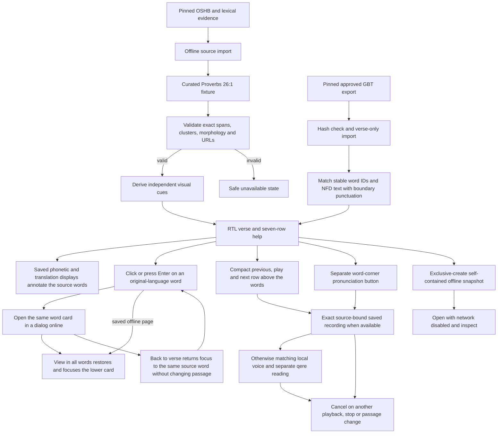

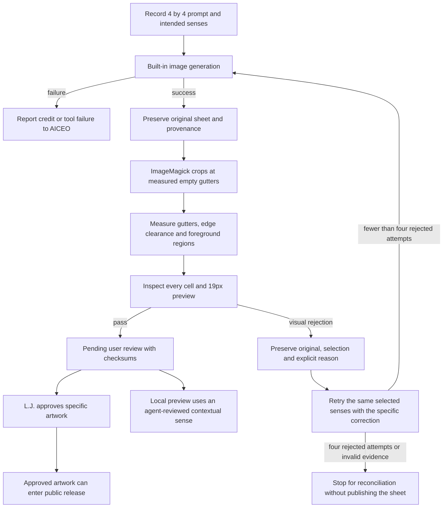

The original prototype and gallery are absent on this Mac. Their historical results are not
local results. Generated scenes are imaginative learning aids. Artwork measurements establish
layout properties; a human must judge subjects and contextual meaning.

Detailed source-import DAGs are in `scripts-chirho/import-chirho/README-chirho.md`.
Reviewed GBT glosses and the app-authored learning gloss never share an unmarked provenance.

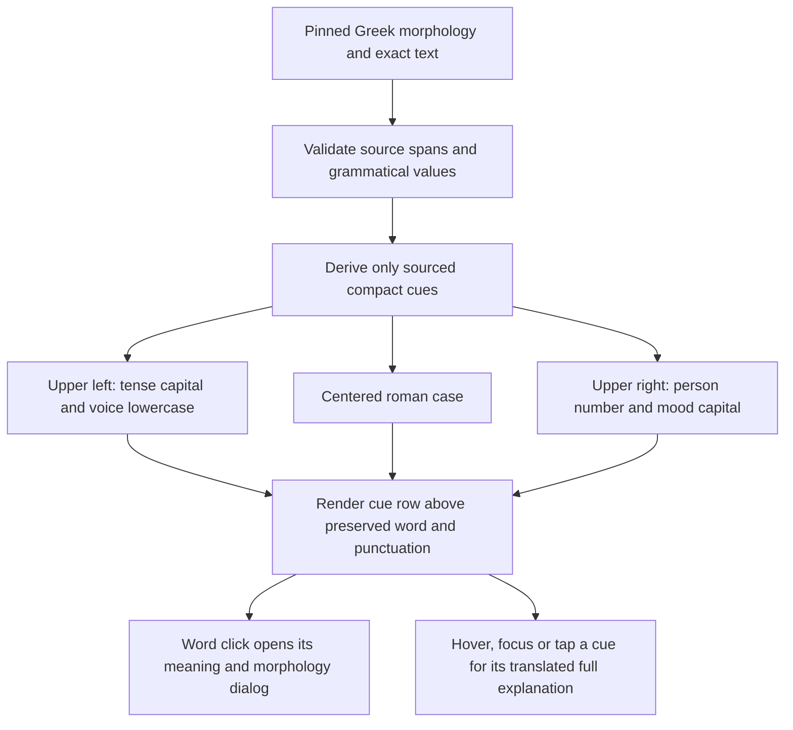

Greek cue positions, lowercase voice and roman case are Hinneh conventions; the full legend
keeps every code explicit. Source ambiguity and deponent labels are preserved. The cue row
reserves space for short participles, keeping case separate from tense, voice and mood.

Hebrew adds W weqatal, Y wayyiqtol, E weyiqtol, J jussive, O cohortative and Q ordinary waw +
qatal to the existing P/I/M/A/C/B display codes. These are local teaching conventions; imported
verb codes and sourced form/construction classifications do not change. No cue is inferred
from waw or word spelling. Superscript help reuses the EN/ES grammar key, including noun state,
stem, form and Greek case/tense/voice/person/mood. Cue buttons are siblings of the word link,
so tapping help does not navigate away and word clicks open the word detail dialog. Escape closes
the shared hover/focus/tap popup. Short verbs reserve enough width for both cues.

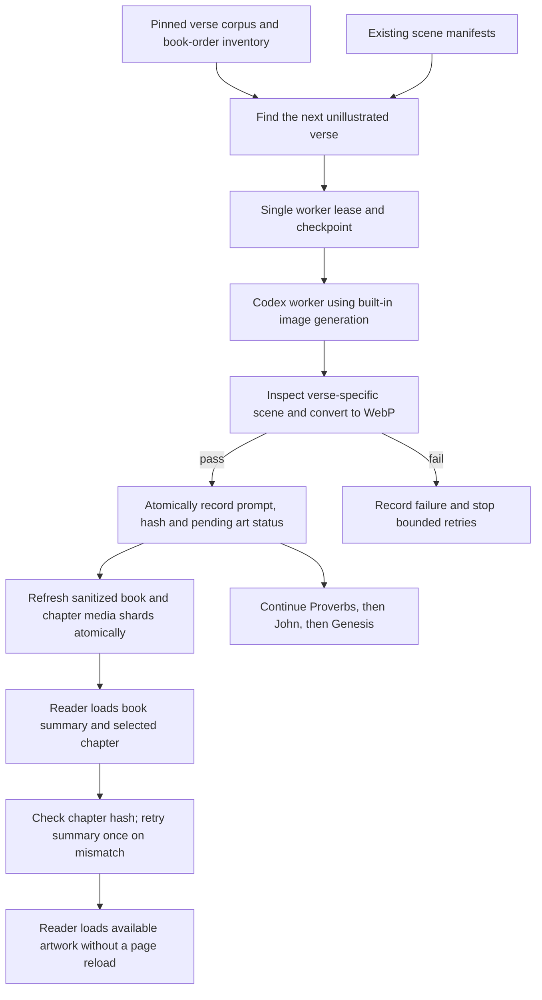

Icon candidates are grouped by lemma and contextual sense. A reviewed mapping selects an icon
for an occurrence. The reader shows one illustration for each reviewed meaning. Drawing variants
of the same sense or meaning label stay in provenance and produce a single border. A double border
opens other distinct reviewed meanings, each captioned, while the selected meaning stays explicit.
Recorded audio and film remain separate media types under the same verse identity; neither is
generated by the image worker. Playback prefers a source-bound saved MP3 and otherwise uses a
matching local device voice. The catalogue and selected audio chapter are static, hash-checked
and cached with a four-chapter limit. Playback makes no synthesis, provider or database request.
Modern Greek is preferred over ancient-Greek device voices. Spoken Hebrew follows qere while
the displayed canonical source remains unchanged. Seven earlier native-voice audition clips remain eligible after the listener-rejected Hebrew-input naveh clip was withdrawn;
they remain explicitly pending pronunciation review, and other passages retain the device
fallback. Offline HTML export retains device playback; it does not embed the new recordings.

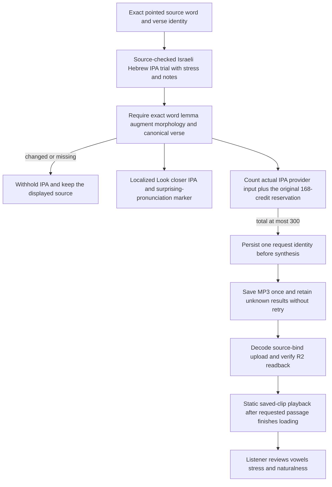

`ipa-trial-chirho/` under the domain folder holds ten app-authored, source-checked word examples:
the nine words in Proverbs 26:1 plus kol in Proverbs 1:13. This is a bounded Israeli Hebrew IPA
trial, not an all-corpus automatic converter or a claim of reconstructed Tiberian pronunciation.
Qere or source drift withholds a trial match. Notes remain drafts pending pronunciation review.
The original four clips and their receipt ledger remain intact. The fixed IPA variant of
`audition_chirho.ts` adds four clips (99 reserved credits), for 267 total under the existing
300-credit ceiling. Cached reruns were executed with fetch refusing every request: zero calls.
Provider input is separate from the unchanged Hebrew source binding; the reader and publisher
both verify IPA against the same checked records. Approved recordings retain priority; within
auditions the chapter phrasing recipe is preferred, then the earlier IPA trial. The local comparison page preserves the original inputs.

`ReaderShellChirho` marks initial passage restoration and later loading as pending. The
self-contained speech controller disables playback and stops active speech during that state,
so a fast click cannot read the default verse before a deep-linked passage has loaded.

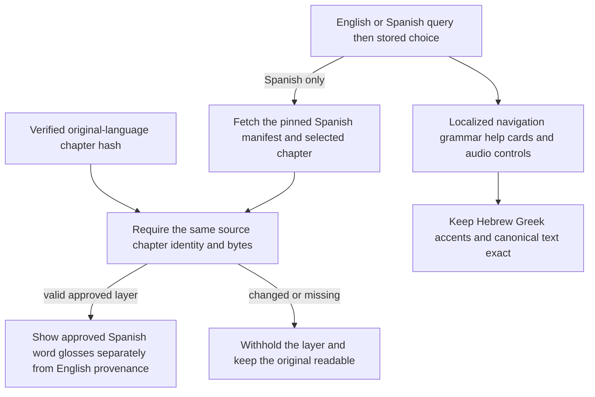

The Spanish importer and source acquisition are documented in
`scripts-chirho/translations-chirho/README-chirho.md`. There is no runtime machine translation.
The 102 layers preserve gaps in approved source coverage; English notes and source quotations
retain their original language labels. The prerendered initial document is English; the chosen
locale applies during client hydration.

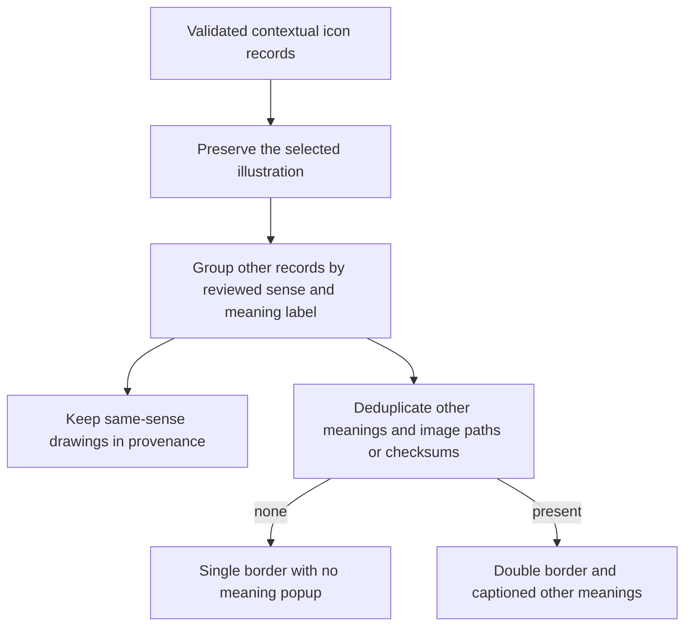

For mixed-sheet recovery, exact-context deferrals and independent worker alerts, see [art recovery](./art-recovery-chirho.md). Deferred cases never acquire an icon or count as completed semantic review.

### Study-aid explanations

The About page's localized `study-aids-chirho` section explains meaning sources, code-derived morphology, unassigned roots, contextual pictures, IPA and recording review. Each Hebrew/Greek word card links directly to it through `StudyAidLinkChirho`. `specificSourceNoteChirho` hides only known generic importer boilerplate; explicit source-review flags and unknown or word-specific notes remain in the card. Actual meanings, morphology, available root relationships, qere, pronunciation cautions, source codes and required license credits stay accessible.

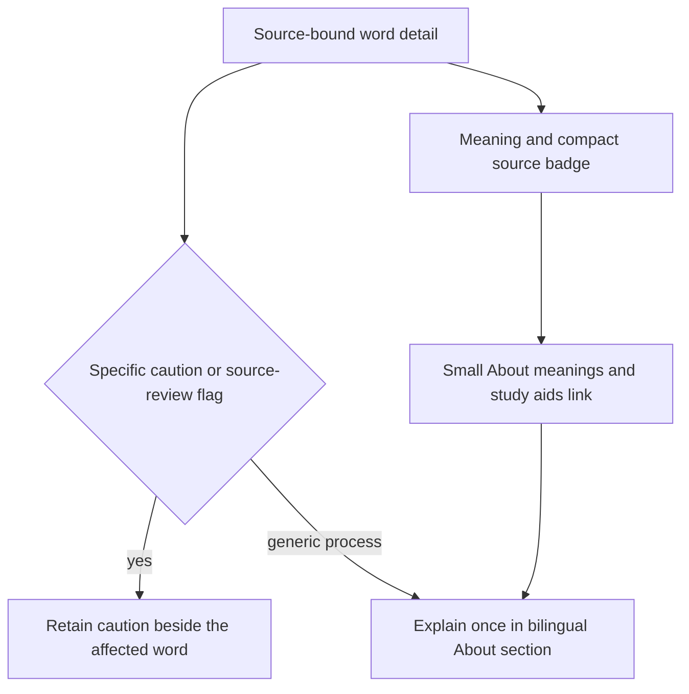

### Source-bound chapter pronunciation trials

The October 30 chapter trial is limited to Proverbs 26 (28 verses) and John 1 (51 verses). Hebrew is an Israeli pronunciation draft prepared offline with HavarotJS 0.25.5, qere, source accents and 26 exact stress reviews for prepositive or duplicate poetic marks. Analysis copies may be sequenced by the library; canonical source text and matching keys remain code-point exact. Final qamats plus silent yod-vav is analysed across intervening marks. This is a bounded draft, not an all-Bible certified phonetic engine. John uses its exact accented Greek and the licensed native Modern Greek voice, without blanket IPA replacement.

`chapterRecipeChirho` checks every prepared Hebrew word against source, lemma, augment, morphology and spoken qere. Maqqef words stay in one IPA group. Atnach requests a short pause; paseq/revia requests a brief pause; ordinary groups use punctuation. Greek punctuation requests comparable phrase breaks. A warm delivery tag applies without rewriting words or imposing a cheerful interpretation. These are model-requested timing classes, not exact milliseconds or a cantillation melody. Eleven v4 supports inline IPA and audio tags, not SSML break tags, per its [official guidance](https://elevenlabs.io/docs/overview/capabilities/text-to-speech/best-practices).

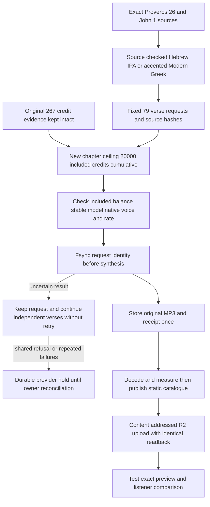

The original 300-credit experiment remains immutable. New chapter work has a separate fixed 20,000-credit ceiling including its 267 historical credits; the initial whole-plan estimate is under 10,000 new credits. No billing setting or overage is enabled. Dry runs do no network work. Requested results never retry automatically, cached reruns make no synthesis call, source/storage failures stop dispatch, synthesis authentication/rate/billing refusals hold immediately, and three consecutive other provider failures persist a hold across restarts. Limits count newly reserved calls, including failed responses. Each request keeps its original identity even when independent verses continue.

The rejected naveh MP3 is identified by its exact SHA-256 in `audio-reviews-chirho.json`. The installer, playback loader and publisher refuse it even if an older catalogue claims approval. Only its delivery copy is retired; the original file, request, receipt and prior R2 object remain as rejected evidence. The replacement IPA has final-stressed /naˈve/; listener acceptance of that example does not approve every future word or recording.

Preparation: `bun scripts-chirho/audio-chirho/chapter-chirho/prepare_chapter_phonetics_chirho.ts --check-chirho`. The fixed synthesis command is `bun scripts-chirho/audio-chirho/chapter-chirho/chapter_audition_chirho.ts`, dry by default; `--apply-chirho --limit-chirho 2` makes the first sample in each language. `chapter_review_chirho.ts` builds a local cached listening page with earlier samples for comparison. The ordinary installer and publisher use the same recipe validator, and playback still makes no provider or database request.

The first chapter run stopped safely after 19 received clips when a subscription metadata GET returned HTTP 429, before another synthesis reservation. Owner verification matched all 19 MP3 hashes. The resumed engine verifies a native voice once per language per run, checks the included balance at most once per minute and subtracts local reservations between checks. Only metadata GET 429 responses may retry twice with a bounded Retry-After delay; a synthesis POST is never automatically repeated. The original rate-limit log and owner reconciliation remain in the trial evidence.

### Connected Hebrew and selectable Greek renditions

L.J.'s follow-up found v1 Hebrew's per-word gaps too long. `israeli-ipa-connected-v2-chirho` retains the exact checked phonemes but sends one IPA utterance, with major-clause punctuation and no inserted word-by-word pause tags. Its first Proverbs 26:1 sample is 4.32 seconds versus 8.40 seconds for v1. Maqqef still links its accentual group; it does not create a punctuation pause. This is a listener comparison, not acceptance of the whole chapter.

The final Greek chooser has two entries, Modern with Aspirates (preferred default) and Erasmian. The first retains modern vowels but supplies the reviewed initial /h/ breathings. The second is an explicit teaching convention (eta /eː/, chi /kʰ/, theta /θ/, ou /uː/), not a certified Classical reconstruction or ancient pitch claim. The exact-source profiles cover John 1:1–2. Earlier Modern Greek audio remains in provenance and the comparison page. It is not silently substituted for a chosen rendition with a rough breathing. Device fallback is allowed only when its Modern reading matches the selected convention, such as an unaspirated word; Erasmian never falls back to a Modern device voice.

The select lives above the verse transport and persists independently of the EN/ES interface. Changing rendition stops active audio. The 0.88 playback option is 12 percent slower than the saved file, with pitch preserved; the setting can change during recorded playback. Playback remains static and makes no provider/database call. Missing rendition recordings are labelled explicitly. Comparison availability is John 1:1–2, not all of John.

Two flow requests were capped at 300 new input credits and three Greek comparison requests at 500, while carrying forward all original receipts under the same cumulative 20,000-credit ceiling. Actual new reservations: 139 and 278, or 417; cumulative 10,660. No prior request was overwritten or retried. A source-path containment mistake refused the first flow invocation before a provider call; it was corrected to a fixed relative evidence path. The completed samples, original source and rejected timing version remain separately inspectable.

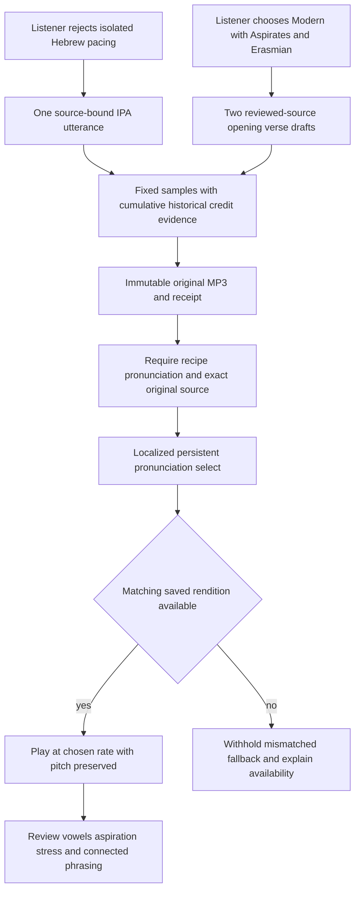

## November 8 word-card usability

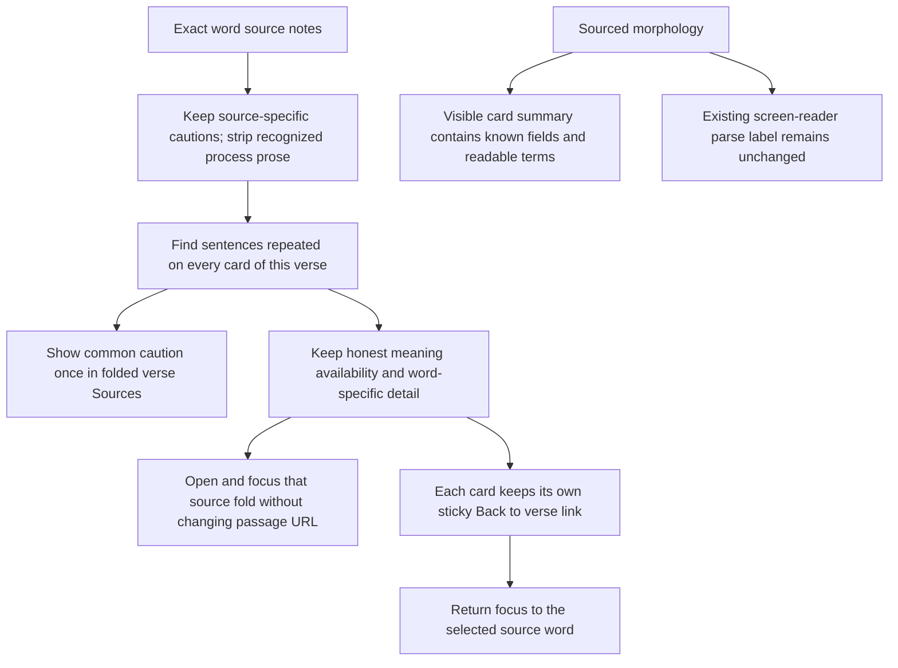

`verseStudyNotesChirho` deduplicates only sentences shared by every word in a multi-word verse. A single-word note stays with its word. Missing glosses remain missing; no corpus or alignment data are repaired by presentation. The delegated word jump opens a details target before focusing it. Each card owns its Back link, including saved offline pages; focus scroll margins keep keyboard targets below the sticky link. `morphologySummaryLocalizedChirho` omits unknown/not-applicable fields from visible card prose while leaving the sourced parse, teaching cues and accessibility labels intact.

## November 10 word details and translation editions

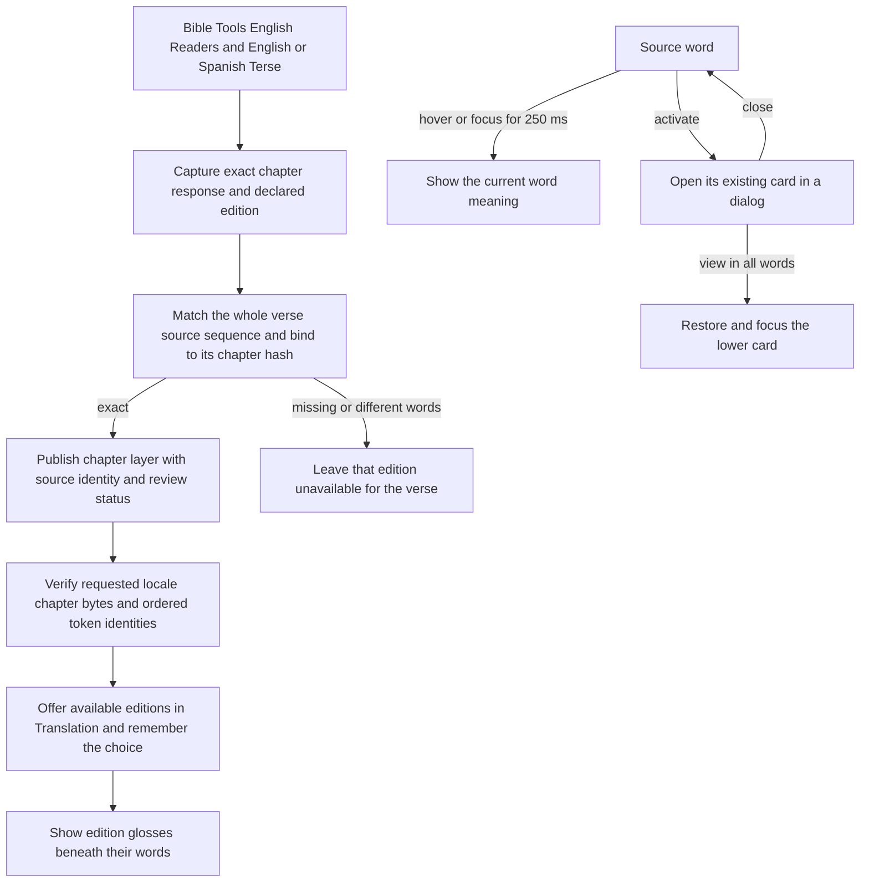

The browser loads the selected chapter layer on the same origin and caches at most four chapters. Translation and phonetics have separate saved choices. Missing editions and transliterations stay out of the choices. A saved choice applies when its data is available. Readers and Terse preserve the source word order, imported review status, and deliberate empty glosses. The display renders the source’s multiword separator as a space. The original word and recorded pronunciation identities do not change.

The online dialog renders the same card as the lower list. Escape returns focus to the word, and View in all words focuses the card. Offline snapshots preserve word-card jumps, the saved phonetic control, and available word meanings. The word panel groups both display choices beneath the source text. The scene panel keeps the verse transport, speed and image reporting together. On wider panels Previous, Play and Next share a row. Narrow panels keep Play above the two step buttons.
