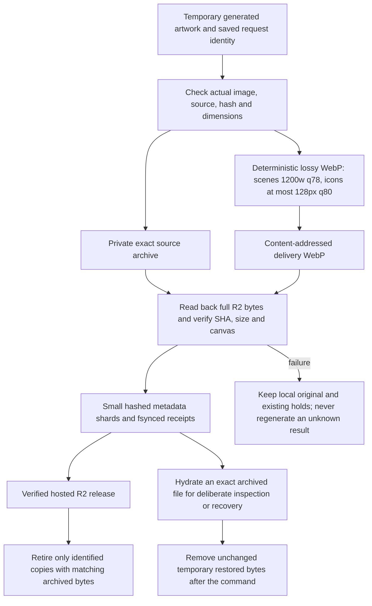
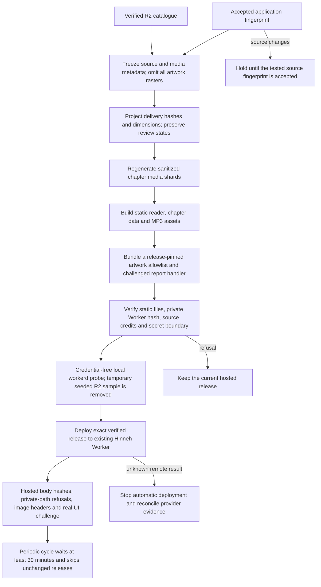
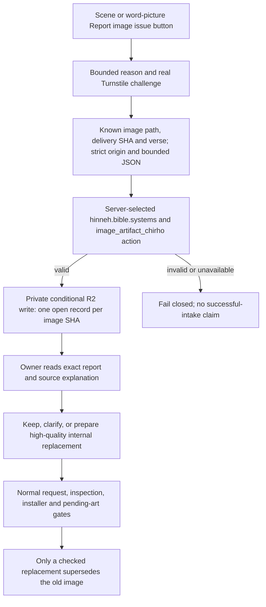

<!-- For God so loved the world, that he gave his only begotten Son, that whosoever believeth in him should not perish, but have everlasting life. — John 3:16 (KJV) -->

# Hinneh media delivery

## November 1: R2 is the artwork store

L.J. directs R2 storage without permanent local artwork copies. The existing private `hinneh-media-chirho` bucket retains exact source evidence and compressed public delivery objects. Source/review/request metadata remains local. No new bucket, domain or D1 is introduced. This replaces the earlier static artwork mirror and permanent external artwork-copy policy. Audio remains static MP3 delivery; this migration concerns artwork.

`archiveArtworkChirho` in `scripts-chirho/publish-chirho/r2-chirho/archive-artwork-chirho.ts` defaults to a dry plan. `--verify-remote-chirho` checks source/delivery objects, uploads only missing content-addressed bytes, and records complete readbacks. An unchanged replay reuses checked receipts, performs no network request and creates no raster. Local bytes, if present, must still match their declared hash. Metadata index/shards remain stable when nothing changes.

`retireArtworkChirho` inventories only this project's static/workspace/build artwork, its owned external release folders, and exact generator-output references in project journals. It skips symlinks and unrelated projects. `--archive-chirho` archives and verifies without deletion. Adding `--retire-verified-chirho` also requires the hosted R2 proof, checks each current local hash again, fsyncs its recovery receipt, then unlinks that exact file. Run retirement only at an owner checkpoint with producers drained; never remove active working files. Original unresolved evidence can remain byte-exact PNG privately in R2. Public delivery is lossy WebP.

`withArtworkChirho` restores only exact archived files or a bounded attempt scope, refuses changed existing files and redirected parents, runs one inspection/recovery command, then removes the unchanged hydrated files. Interrupted or changed temporary files require owner reconciliation, not replacement generation. The scene dispatcher uses this wrapper for its archived style reference. Existing scene catalogues, reuse and shard checks use exact remote facts when local rasters are absent. Old icon-sheet replays can deliberately hydrate their own attempt directory through the same wrapper. Never reset retry caps or turn missing archived bytes into a new image request.

The localhost comparison gallery now uses `serve_comparison_chirho.ts`: its 31 whitelisted trial WebPs stream from private R2 without a disk cache. It binds only 127.0.0.1 and exposes neither original files nor other bucket keys.

## Publication and request costs

The release manifest binds both the static file set and the private artwork Worker bundle/catalogue. No artwork raster enters the public static release. Legacy paths remain valid; immutable SHA aliases are also available. A release refuses missing remote proofs, mismatched source/delivery facts, source drift, private material or unapproved publication states. The recorded preview keeps pending artwork pending and asks not to be indexed.

The existing Worker runs first only for artwork and API paths. Text, application chunks and MP3s use static assets. There is no D1 binding or request-time synthesis. Unknown image paths refuse before R2. Known HEAD and unchanged ETag responses need no R2 read. Known GETs share a SHA-based edge-cache key across aliases and query strings; uncached responses are checked against their pinned length and SHA before caching. Cache eviction or another edge location can require another R2 read. These are cost reductions, not a global billing cap. Rate limiting for flags is best effort per edge/IP/hour; the queue is deduplicated by known image identity.

Cloudflare references: [static asset binding and selective routing](https://developers.cloudflare.com/workers/static-assets/binding/), [R2 Worker bindings and conditional writes](https://developers.cloudflare.com/r2/api/workers/workers-api-reference/), [Turnstile server validation](https://developers.cloudflare.com/turnstile/get-started/server-side-validation/). Provider docs were checked November 1; local and hosted checks are separately recorded in the landing report.

For rollback, use the prior verified version in `build-chirho/release-cycle-chirho/deploys-chirho.jsonl` through the isolated owner credential environment, then verify HTTPS before resuming. The former assets-only deployment is version `9e856bb6-7d15-44bd-b011-6d2b059fc5d5`; the old Cloudflare release retains its uploaded asset set independently of local retirement. No rollback has been exercised for this migration.

## Artifact reports

`flag-queue-chirho.ts` reads at most 100 private records per owner invocation and signals a larger queue. Reports contain an image hash/path, verse, reason and time. No visitor IP, challenge token, email or free text is stored. IP-based rate keys are HMAC-derived and temporary at the edge. Only the two narrow runtime secrets are configured; the fleet environment is never deployed wholesale. The hostname allocation is AICEO DM2629, independently of actual hosted challenge/intake acceptance.

A flag grants no image request, spend, provider change, retry reset or artwork approval. The controlled owner acceptance-test record is explicitly marked in local triage metadata and must never become a regeneration job. Real reports are inspected before the existing high-quality internal generation workflow is invoked. Scene explanations and source/attempt histories survive replacement.

## Audio and process recovery

Content-addressed MP3s, exact pronunciation/source bindings, credit reservations, unknown-result holds and listener-review states are unchanged. `audition_chirho.ts` and reusable-word workers never synthesize during playback. R2 recording uploads require the existing exact account/bucket confirmation and identical readback before a release receipt.

These are local Mac processes, not Cloudflare cron jobs. They do not survive a reboot automatically. Drain and reconcile producers before restoring uploads or a periodic release cycle. The independent art-progress monitor is described in `art-recovery-chirho.md`; it cannot renew leases, generate art, clear holds or deploy.
