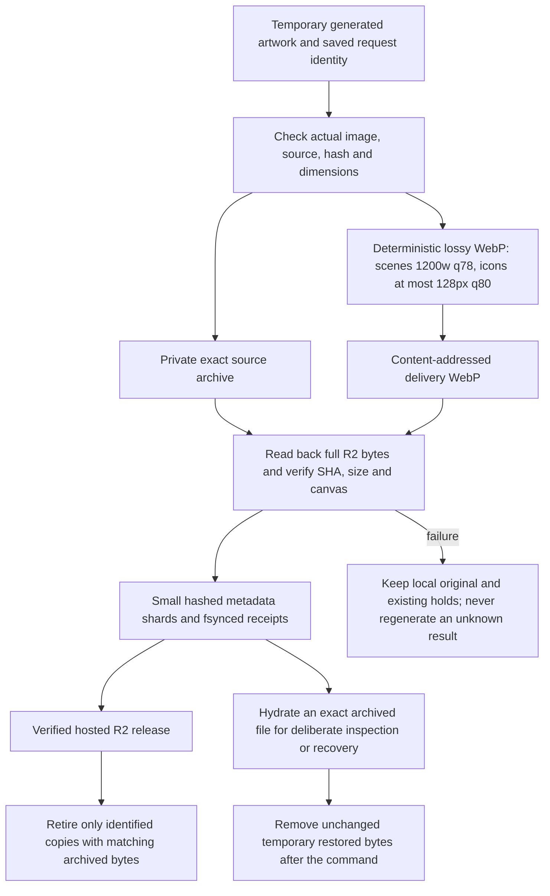
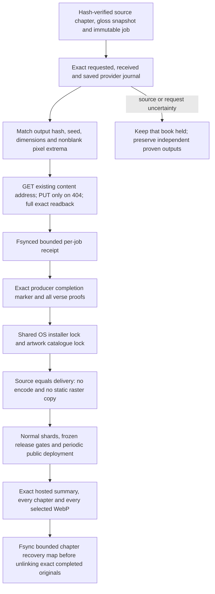
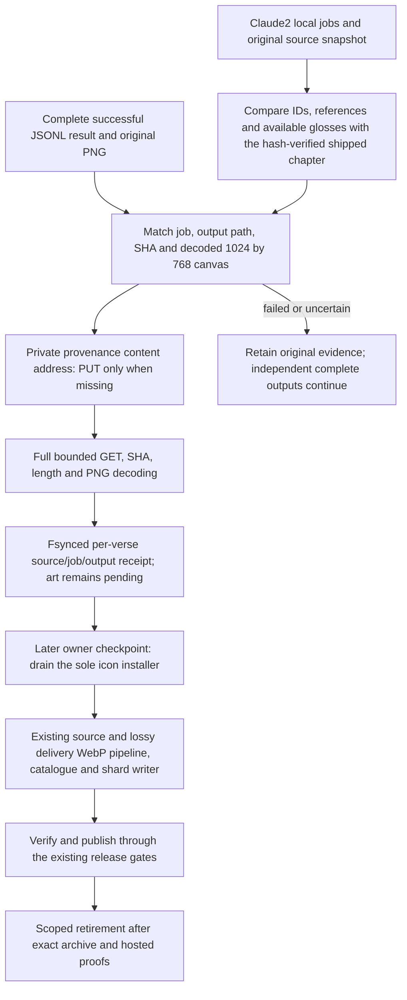
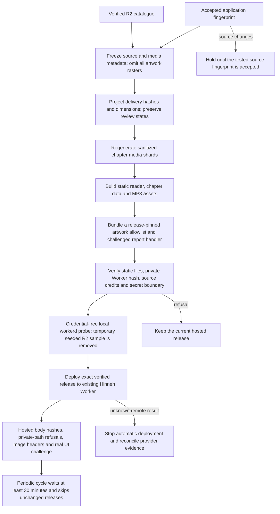
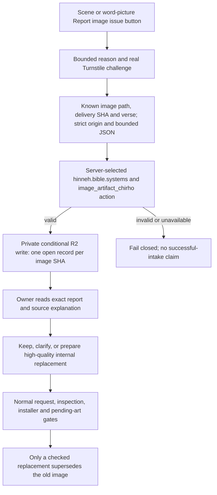
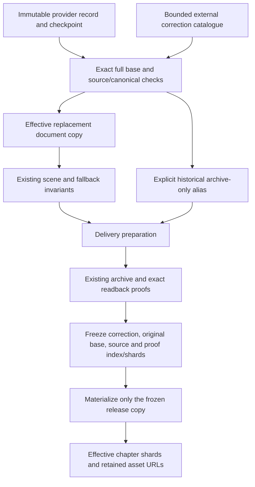

<!-- For God so loved the world, that he gave his only begotten Son, that whosoever believeth in him should not perish, but have everlasting life. — John 3:16 (KJV) -->

# Hinneh media delivery

## November 1: R2 is the artwork store

L.J. directs R2 storage without permanent local artwork copies. The existing private `hinneh-media-chirho` bucket retains exact source evidence and compressed public delivery objects. Source/review/request metadata remains local. No new bucket, domain or D1 is introduced. This replaces the earlier static artwork mirror and permanent external artwork-copy policy. Audio remains static MP3 delivery; this migration concerns artwork.

`archiveArtworkChirho` in `scripts-chirho/publish-chirho/r2-chirho/archive-artwork-chirho.ts` defaults to a dry plan. `--verify-remote-chirho` checks source/delivery objects, uploads only missing content-addressed bytes, and records complete readbacks. An unchanged replay reuses checked receipts, performs no network request and creates no raster. Local bytes, if present, must still match their declared hash. Metadata index/shards remain stable when nothing changes.

`retireArtworkChirho` inventories only this project's static/workspace/build artwork, its owned external release folders, and exact generator-output references in project journals. It skips symlinks and unrelated projects. `--archive-chirho` archives and verifies without deletion. Adding `--retire-verified-chirho` also requires the hosted R2 proof, checks each current local hash again, fsyncs its recovery receipt, then unlinks that exact file. Run retirement only at an owner checkpoint with producers drained; never remove active working files. Original unresolved evidence can remain byte-exact PNG privately in R2. Public delivery is lossy WebP.

`withArtworkChirho` restores only exact archived files or a bounded attempt scope, refuses changed existing files and redirected parents, runs one inspection/recovery command, then removes the unchanged hydrated files. Interrupted or changed temporary files require owner reconciliation, not replacement generation. The scene dispatcher uses this wrapper for its archived style reference. Existing scene catalogues, reuse and shard checks use exact remote facts when local rasters are absent. Old icon-sheet replays can deliberately hydrate their own attempt directory through the same wrapper. Never reset retry caps or turn missing archived bytes into a new image request.

The localhost comparison gallery now uses `serve_comparison_chirho.ts`: its 31 whitelisted trial WebPs stream from private R2 without a disk cache. It binds only 127.0.0.1 and exposes neither original files nor other bucket keys.

## Exact provider WebP passthrough (November 4)

The remaining 62-book run is owned by Claude2 under L.J.'s direct instruction. Its 27,155 planned scenes exclude Genesis, Proverbs, John and Mark. The provider returns 1024 by 768 lossy WebP at quality 45; those exact bytes are both the preserved original and public delivery. Root's delivery lane makes no generation call, changes no retry or spend allowance, and performs no vision review. Source and artwork review states remain distinct.

`bun scripts-chirho/publish-chirho/local-scenes-chirho/provider-chirho/worker-chirho.ts` defaults to read-only, network-free planning. `--book-chirho Exod --limit-chirho 1 --apply-chirho` is a bounded preservation probe. `--watch-chirho --apply-chirho` runs one coordinator for at most six hours with six bounded archival requests, drains on SIGTERM, serializes completed-book installation, and waits for public delivery before retirement. A storage failure drains requests and stops new archival work. An unknown provider result is never resent by this tool. Missing optional append records remain pending; immutable plan drift holds its book.

The canonical chapter read bound matches the reader at 4 MiB, including the 2,136,428-byte Psalm 119 file; job, snapshot, journal, image and marker bounds are unchanged. An exact full-canon closure records `complete` only after every selected book is installed and every original has its hosted/recovery retirement proof. A finished installation awaiting deployment records `waiting_for_publication`; retirement failures remain explicit holds.

Per-job bindings and installed/retired stamps live under `build-chirho/provider-scenes-2026-11-04-chirho/`. A finite authoring manifest is `data-chirho/media-chirho/bible-runware-scenes-chirho.json`; normal public chapters remain hash-bound and bounded. The common artwork catalogue writer is shared with the existing encoder archive path. A provider passthrough cache row is accepted only for the fixed recipe, identical source/delivery hashes and exact verified remote facts. Normal cwebp recipes and encoder checks remain unchanged.

Recovery aliases are sharded by book and chapter under `workspace-chirho/art-chirho/remote-archive-chirho/provider-copies-chirho/`, avoiding growth of the older 56 MB alias journal. Each row contains the exact original path, private R2 object key, SHA-256, length and dimensions. A deliberate recovery can GET that key, verify SHA/length, and restore only the named absent file. These new maps are separate from the legacy `with-artwork-chirho.ts` journal. No timer, marker or percentage grants visual acceptance.

## Publication and request costs

### Local Mark placeholder preservation (November 4)

L.J. directly assigned Claude2 all 674 Mark source entries, including Mark 16:99, as local Schnell placeholders and waived post-generation visual inspection for this pass. That waiver does not approve the artwork or relax source, storage or release checks. The generation owner retains its jobs, original output files and timing records. GPT owns archival and later installation.

`bun scripts-chirho/publish-chirho/local-scenes-chirho/watch-chirho.ts` is a dry, network-free scan. `--apply-chirho --limit-chirho 1` bounds the first real preservation pass. `--apply-chirho --watch-chirho` polls every 30 seconds for at most six hours under one dedicated lock, draining its current upload/readback on SIGTERM. It reads at most 16 bounded chapter plans and result files; a partial JSONL tail is not a completed image. Missing or failed jobs never become new generation requests. The prompt snapshot omits only empty/unavailable `-` glosses; the complete chapter and canonical verse hashes remain exact.

Only completed PNGs enter `provenance-chirho/sha256-chirho/`. The tool does not write production media keys, shared archive receipts, catalogues, delivery mapping or reader shards. Its small receipts and progress live under `build-chirho/local-scenes-chirho/mark-schnell-2026-11-04-chirho/`. Unchanged replay verifies the local binding and reuses the prior exact proof without a request. A PUT whose response is lost is reconciled by GET before another PUT. Nothing is deleted, and no receipt grants visual approval or permission to retire an active file. Shared production installation remains a separate serialized owner checkpoint, using the existing encoder, archival and publisher chain.

The subsequent owner handoff switched Mark 3–16 to Runware Schnell under L.J.'s direction. `variants-chirho.ts` binds Runware jobs to the original source, prompt, seed and fixed model; resumed local plans must contain byte-identical original job lines. The PNG stager has four bounded workers, one coordinator lock and a synchronous per-pass limit reservation. A completed retry of a known 429 refusal is accepted only with its matching requested/error/requested/received/saved journal; this reconciliation never requests a retry.

Deterministic pixel inspection found 114 initial all-black outputs despite successful provider responses. Claude2's separately journaled r2–r4 passes, on L.J.'s direction, retained all failed files and produced the missing nonblack images. The provider-reported total is $0.4410. The internal cause of black outputs is not established by the absence of a returned safety/error field. `repairs-chirho.ts` validates each already-completed repair against its same prompt/seed/model, its exact request journal and a predecessor whose RGB channel maximum is at most 8. It performs no synthesis. Original and repair receipts have distinct names; all 808 files, including 134 black attempts, remain recoverable through their exact private PNG content addresses. The final owner inventory must select 674 verified nonblack files.

`install-plan-chirho.ts` freezes that selection only after PNG preservation. `install_chirho.py` defaults to a read-only plan; `--prepare-chirho` creates pixel-identical lossless source WebPs in the private build cache. `--apply-chirho` takes the same OS lock as the icon coordinator, permits only identical existing scenes plus verified additions, and invokes the existing delivery encoder, full R2 archive/readback and shard refresher. Uniform, invisible and near-black output is withheld by pixel checks, with no vision review. A partial installation requires the explicit `--allow-uniform-holds-chirho` operator flag. The first 560-scene metadata cut and its 114 holds are retained under `first-cut-chirho/`; verified replacements add the missing scenes without erasing those records. Final public delivery remains lossy WebP and artwork remains pending.

The release manifest binds both the static file set and the private artwork Worker bundle/catalogue. No artwork raster enters the public static release. Legacy paths remain valid; immutable SHA aliases are also available. A release refuses missing remote proofs, mismatched source/delivery facts, source drift, private material or unapproved publication states. The recorded preview keeps pending artwork pending and asks not to be indexed.

The existing Worker runs first only for artwork and API paths. Text, application chunks and MP3s use static assets. There is no D1 binding or request-time synthesis. Unknown image paths refuse before R2. Known HEAD and unchanged ETag responses need no R2 read. Known GETs share a SHA-based edge-cache key across aliases and query strings; uncached responses are checked against their pinned length and SHA before caching. Cache eviction or another edge location can require another R2 read. These are cost reductions, not a global billing cap. Rate limiting for flags is best effort per edge/IP/hour; the queue is deduplicated by known image identity.

Cloudflare references: [static asset binding and selective routing](https://developers.cloudflare.com/workers/static-assets/binding/), [R2 Worker bindings and conditional writes](https://developers.cloudflare.com/r2/api/workers/workers-api-reference/), [Turnstile server validation](https://developers.cloudflare.com/turnstile/get-started/server-side-validation/). Provider docs were checked November 1; local and hosted checks are separately recorded in the landing report.

For rollback, use the prior verified version in `build-chirho/release-cycle-chirho/deploys-chirho.jsonl` through the isolated owner credential environment, then verify HTTPS before resuming. The former assets-only deployment is version `9e856bb6-7d15-44bd-b011-6d2b059fc5d5`; the old Cloudflare release retains its uploaded asset set independently of local retirement. No rollback has been exercised for this migration.

## Artifact reports

`flag-queue-chirho.ts` reads at most 100 private records per owner invocation and signals a larger queue. Reports contain an image hash/path, verse, reason and time. No visitor IP, challenge token, email or free text is stored. IP-based rate keys are HMAC-derived and temporary at the edge. Only the two narrow runtime secrets are configured; the fleet environment is never deployed wholesale. The hostname allocation is AICEO DM2629, independently of actual hosted challenge/intake acceptance.

A flag grants no image request, spend, provider change, retry reset or artwork approval. The controlled owner acceptance-test record is explicitly marked in local triage metadata and must never become a regeneration job. Real reports are inspected before the existing high-quality internal generation workflow is invoked. Scene explanations and source/attempt histories survive replacement.

## Audio and process recovery

Content-addressed MP3s, exact pronunciation/source bindings, credit reservations, unknown-result holds and listener-review states are unchanged. `audition_chirho.ts` and reusable-word workers never synthesize during playback. R2 recording uploads require the existing exact account/bucket confirmation and identical readback before a release receipt.

These are local Mac processes, not Cloudflare cron jobs. They do not survive a reboot automatically. Drain and reconcile producers before restoring uploads or a periodic release cycle. The independent art-progress monitor is described in `art-recovery-chirho.md`; it cannot renew leases, generate art, clear holds or deploy.

## Exact-base scene corrections

A targeted correction lives in `data-chirho/art-corrections-chirho/catalogue-chirho.json`, outside the ordinary `data-chirho/media-chirho/*.json` scan. The v1 catalogue is bounded to 64 entries and 512 KiB. Each entry names one source document, lesson and variant; preserves the full exact original record and its sorted-JSON SHA-256; pins the chapter bytes and canonical verse; and supplies one pending replacement with a distinct versioned asset path and source hash. Duplicate targets/aliases, fallback substitutions, correction chains, changed originals, foreign source bindings and changed canonical scalars refuse. This mechanism does not approve artwork or alter an original provider request, prepared job, installed receipt or worker checkpoint.

The TypeScript and Python helpers share one small hermetic fixture. They return effective document copies plus explicit retained original assets. Ordinary sharding validates and selects the effective scene alongside the existing fallback. Delivery preparation explicitly requests the extra historical source assets, so its cached-alias guard and the archival catalogue keep old source/delivery identities. TypeScript archive-only aliases have no `scene_record_chirho` and cannot become another visible scene tier. No old source document is rewritten by either helper.

The release builder, raw-document R2/local overlays and Python collector use the same effective-document view. Only three exact record states are recognized: the full pinned base, the full replacement source, or the full replacement with SHA/dimensions derived from its corresponding verified archive entry. The materialized case must also retain the original base's exact archive entry; a filename, partial field match or another object's delivery proof is insufficient. Re-reading a materialized correction does not reinterpret its derivative as a new original. Existing unrelated delivery transforms keep their prior contract.

Artwork snapshots capture the correction catalogue and its source chapter/manifest before the archive proof index/shards, then recheck the catalogue bytes. The frozen input map preserves the original base and source facts even if the live filesystem advances. The correction is a media fingerprint input. Both the sharding and R2 upload watchers hash the small overlay itself, so a correction-only change triggers normal validation without a retry/cap reset. With no correction catalogue, ordinary media and missing-folder/parse-reason behavior remain unchanged.

The first intended consumer is the pending 1 Corinthians 1:1 hand correction. Its root-owned PNG, lossless source, visual review and final installation/publication remain separate from this implementation. A focused test executes cached delivery preparation with encoding forbidden and retains every prior alias; other tests cover source/base/canonical drift, chain/foreign targets, archive-bound materialized replay, cross-language parity, actual release-builder selection, coherent snapshot/R2 overlay and old URL/fallback preservation. Fixture archive facts are synthetic and are never evidence of a production upload, image review or hosted release.
