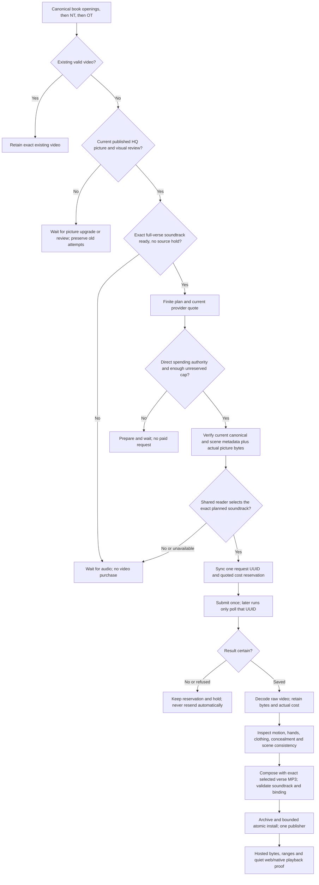

<!-- For God so loved the world, that he gave his only begotten Son, that whosoever believeth in him should not perish, but have everlasting life. — John 3:16 (KJV) -->

# Ordered chapter-opening videos

L.J. directs book 1:1 first, remaining NT chapter openings second, and remaining OT chapter openings third. A high-quality picture must exist before buying any motion. Existing exact videos are retained. An unresolved picture/source/audio hold remains a hold.

`scripts-chirho/video-chirho/opening_gate_chirho.py` validates the finite plan, current HQ picture proof, source-specific visual review and spending authority. `opening_runner_chirho.py` uses the existing PixVerse prompt/client helper, an exclusive run lock, a durably synced append-only journal and at most two concurrent jobs. Without `--apply-chirho` it reads local inputs only. Apply requires an exact plan hash and a separately pinned record of L.J.'s actual approval and finite dollar cap. A prepared authorization template is not approval.

The synthetic soundtrack contract belongs to `src/lib/domain-chirho/verse-video-chirho.ts`. A Greek video must bind the exact admitted selected whole-verse clip and pronunciation. Old apps must safely retain the picture/audio while withholding an unsupported video. Human videos retain their existing Be'eri source/window binding. Motion generation never invents a human reading source, clears a voice/pronunciation hold, or silently changes the rendition.

Raw clips and run evidence live under `workspace-chirho/video-chirho/chapter-openings-2026-11-09-chirho/`. A saved provider result is pending visual review, not publication or user acceptance. Source picture changes require reconciliation before a new request or installation. The existing catalogue's 1,000-record and 4 MiB bounds remain in force; shard before the OT tail crosses them. The independent HQ artist and Greek audio screen continue through their existing single owners.

Before any reservation, the Python request preflight sends the exact already hash-verified content/audio UTF-8 bytes to `selected_recording_chirho.ts`. This bounded stdin-only bridge uses the reader’s shared admission and automatic full-verse selection. It returns the selected file, recipe, profile, source/window and raw key-presence identity. A planned clip merely remaining in the catalogue is insufficient. A higher-priority legacy row, unavailable selector or synthetic row with missing recipe/explicit-null source keys holds the request. The bridge runs without dotenv loading, automatic dependency installation or inherited provider credentials. Source metadata and published picture/manifest bindings are rechecked before the one request is reserved.
