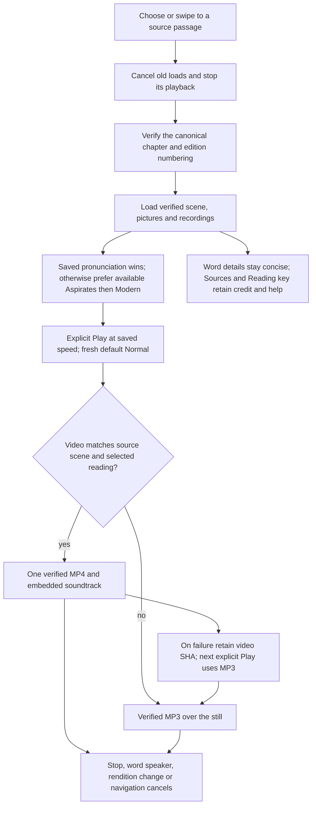
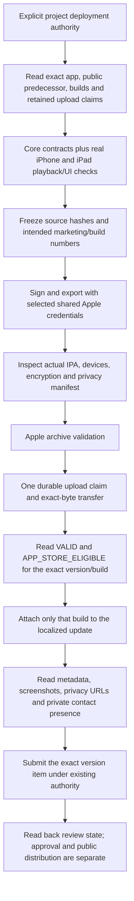
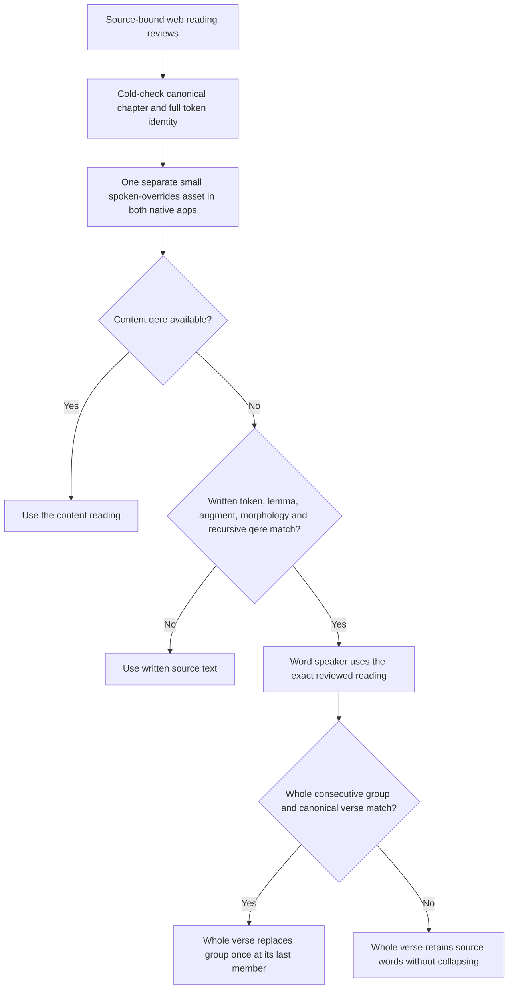

<!-- For God so loved the world, that he gave his only begotten Son, that whosoever believeth in him should not perish, but have everlasting life. — John 3:16 (KJV) -->

# iOS reader update and release

Root owns the iOS implementation and App Store submission. The November 8 update preserves the existing app, signing team, privacy declarations, localized metadata and automatic-after-approval release choice. Android and web implementation remain with their respective writers.

ReaderModelChirho invalidates audio selection with a request identity and cancellation, including repeated A/B/A choices and revisiting a passage. Old recordings disappear immediately while a different pronunciation loads. AudioPlayerChirho identifies each play independently, verifies the complete asset before AVPlayer starts, and rejects late callbacks. Speed applies to words, verse MP3s and matching videos with pitch preserved. Video scrubbing and browser-style edge starts are excluded from verse swipes; vertical scrolling remains available. Edition-aware previous/next targets also control disabled buttons and navigation returns to the heading.

The iOS video validator requires explicit soundtrack keys, even for a silent CC0 record, and withholds duplicate records for a verse. Invalid video selection leaves valid scene and word pictures available. Exact Be'eri attribution and its license remain in each verse's Sources fold. General AI/source-review explanations live in reading help and About.

The next-version operator, its bounded private journal and command contract are documented in apps-chirho/ios-chirho/scripts-chirho/release-chirho/README-chirho.md. Shared upload claims and unknown outcomes are retained. A lost response never authorizes a duplicate POST/upload. No owner legal declaration is inferred from a successful build. The private progress database and store responses remain outside the public source mirror; binaries stay in ignored build output.

## Reviewed spoken forms and human Aramaic readings

The exporter writes only the three reviewed overrides not already carried by content qere. Native assets are byte-identical and malformed assets give no overrides. iOS compares Unicode scalars exactly, preserving the web identity boundary rather than Swift's normalization-equivalent String equality. No canonical Scripture or phonetic guess is introduced. Valid human Be'eri recordings in Aramaic or mixed-language passages may pass the human validator; the existing exclusions still apply to synthesized Aramaic words and verses. A failed human claim is never treated as an AI clip.

The0.1.2/build4 source candidate repairs the97 safely withheld human readings in0.1.1/build3. A pending submitted version stays immutable. Candidate archive/export, Apple validation, upload, review and public release are separate evidence states; preparing the next binary does not withdraw or replace an existing review. Silent file/core checks can run while the submitted version awaits Apple.
