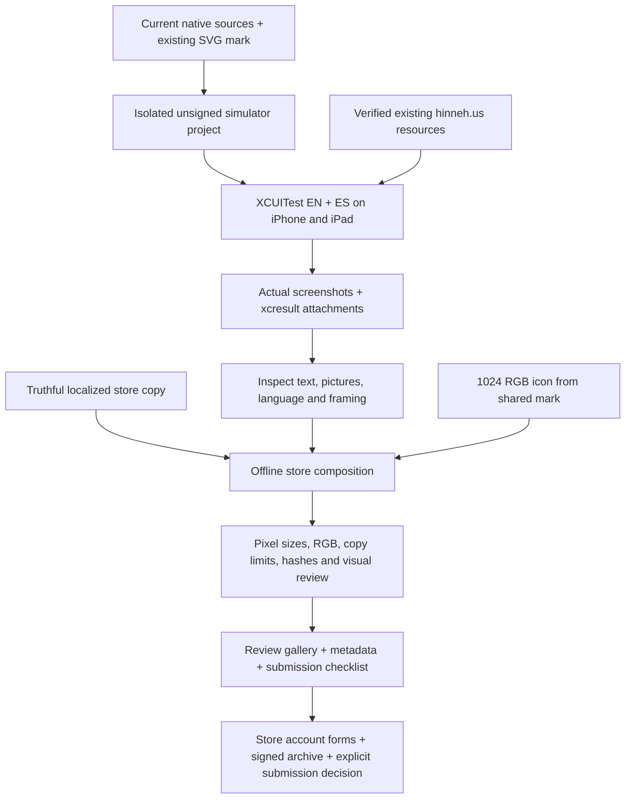

<!-- For God so loved the world, that he gave his only begotten Son, that whosoever believeth in him should not perish, but have everlasting life. — John 3:16 (KJV) -->

# Native iOS store assets Chirho

`apps-chirho/ios-chirho/scripts-chirho/store-chirho/` owns the opt-in capture and offline renderer. The Swift harness is copied into a disposable simulator project; it is not part of the ordinary app or test suite. The existing physical-device session, selected Xcode signing team, shared scheme and background media producers are preserved. No provider synthesis or replacement artwork is requested.

Render the shared icon first with `bash apps-chirho/ios-chirho/scripts-chirho/ios_chirho.sh icon`. From the repository root, run `python3 -I -B apps-chirho/ios-chirho/scripts-chirho/store-chirho/capture_store_chirho.py --device-chirho iphone-chirho --output-chirho workspace-chirho/native-apps-chirho/app-store-chirho/<date>-chirho`, then repeat with `ipad-chirho`. Each capture claims a fresh `build-chirho/ios-store-chirho/<package-name>/<device>/` snapshot; existing work is refused rather than deleted. Only a shutdown iPhone 17 Pro or iPad Pro 13-inch (M5) on iOS 26.5 is booted; the owned simulator is shut down in cleanup. XCUITest waits for real words and exports named screenshots from its result bundle. Missing or partial captures fail the pass. Inspect the images: a timer alone does not establish that every image loaded.

Then run `bun apps-chirho/ios-chirho/scripts-chirho/store-chirho/render_store_chirho.ts <same-output-folder>`. It uses the captured native screen without altering its content, plus the existing book mark and localized captions. Rendering is network-blocked. PNGs are converted losslessly to RGB with no alpha. The renderer requires native 1206×2622 iPhone or 2064×2752 iPad input, preserves those final dimensions, validates store-field character/byte ceilings, and writes an asset hash manifest and local review gallery. This is a finite user-requested export, not a persistent artwork mirror.

The app's `PrivacyInfo.xcprivacy` declares app-local `UserDefaults` access under Apple's CA92.1 reason and no tracking domains. It does not substitute for an App Store Connect data-handling assessment. Inspect actual app code, server handling and linked-site boundaries when completing that form. Never infer accessibility acceptance, age rating, encryption classification, signed-device behavior or App Review acceptance from simulator captures. Native feature claims must match the captured native version; web-only IPA, image reports and lexicon navigation are not advertised as native features.

Apple requirements checked November 4, 2026: [screenshots](https://developer.apple.com/help/app-store-connect/reference/app-information/screenshot-specifications/), [product-page fields](https://developer.apple.com/app-store/product-page/), [required reason APIs](https://developer.apple.com/documentation/bundleresources/describing-use-of-required-reason-api), [privacy details](https://developer.apple.com/app-store/app-privacy-details/). Recheck before a later submission. Prepared assets, an unsigned build, an uploaded archive and an accepted store release are separate outcomes.
