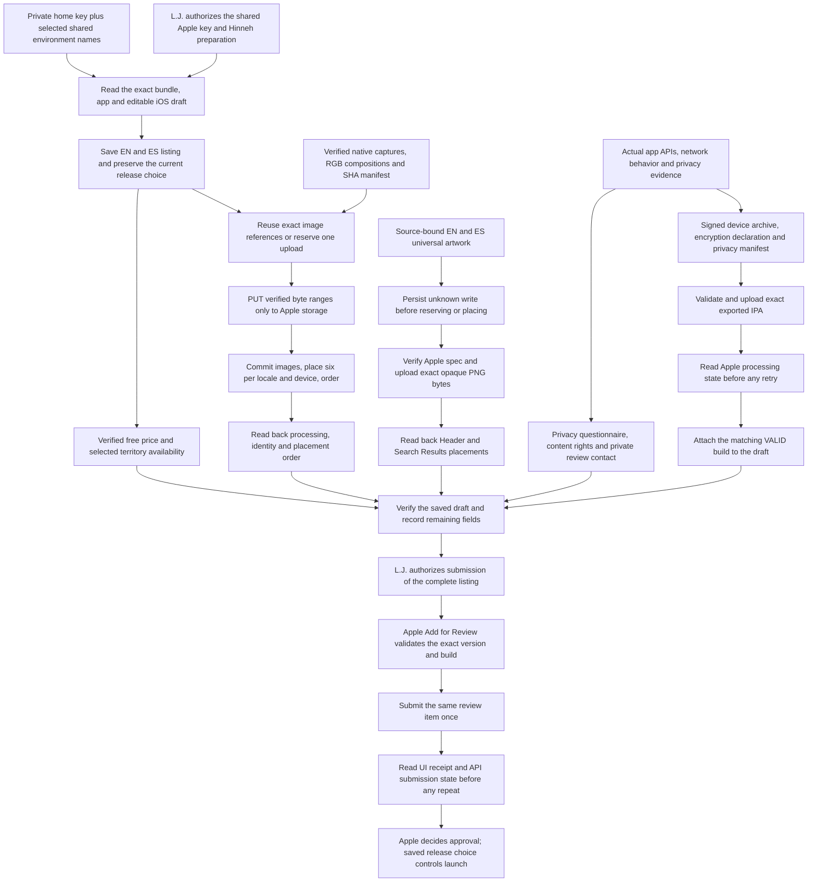

<!-- For God so loved the world, that he gave his only begotten Son, that whosoever believeth in him should not perish, but have everlasting life. — John 3:16 (KJV) -->

# App Store Connect preparation Chirho

The narrow operator client and listing commands live under `apps-chirho/ios-chirho/scripts-chirho/store-chirho/`. The client reads only the named Apple entries from `~/.env-chirho`, loads the P-256 key into memory, and signs short-lived API tokens. Credentials, upload authorization URLs and private review contacts never belong in source, public metadata or progress reports. This administrative credential is shared storage, not a Hinneh runtime secret; it must never be deployed to the website.

From the repository root, use `rtk proxy bun apps-chirho/ios-chirho/scripts-chirho/store-chirho/app-store-listing-chirho.ts inspect-chirho`. The mutating modes are `prepare-chirho --apply-chirho`, `media-chirho --apply-chirho` and `attach-build-chirho --apply-chirho`. They require the exact Hinneh bundle and an iOS version in PREPARE_FOR_SUBMISSION. This first-release tool expects one iOS version; revise that assumption deliberately before a later release. It has no review-submission or public-release command.

Screenshot upload follows Apple's Asset Library API and current image specifications. Each image reference includes its prepared SHA-256. Existing references and reservations are reconciled before upload. PUT requests carry only Apple's upload headers, never the API bearer token, and remain inside their verified byte ranges. Unknown reservations, interrupted uploads, unexpected placements and API write failures are retained for remote readback. Do not delete and recreate an asset merely because a client timed out.

Header and Search Results artwork use `render_creative_chirho.ts` and `creative_upload_chirho.ts`. The renderer binds its Hebrew/Greek specimens and existing illustrations to the preview and corpus hashes. The uploader accepts only the two fixed EN/ES opaque PNGs, verifies the current Apple image specification, and fsyncs an unknown journal entry before every reservation or placement. Unknown writes require exact remote reconciliation; they cannot be repeated automatically. `--verify-chirho` checks both processed images and all four active placements without submitting them.

Archive the actual project with the owner's signing team preserved. Export for App Store Connect, validate the exact IPA, and upload it once through Apple's authenticated upload tool. After a timeout or uncertain upload, list builds and reconcile version, build number and processing state before another upload. Only the matching VALID and APP_STORE_ELIGIBLE build is attached. Select a later build explicitly with `attach-build-chirho --build-chirho 2 --apply-chirho`; the default remains build 1. The current system HTTPS and SHA-256 integrity use is declared exempt with `ITSAppUsesNonExemptEncryption = NO`; reassess if cryptographic behavior changes. The app-local UserDefaults reason and collected-data declarations in PrivacyInfo do not complete the store privacy questionnaire.

The November 4 security probe found a retained Cloudflare security event with a readable IP and request path hours after the request. It retained no raw IP or path in project evidence. This defeats the transient-request exception, but does not establish that every resource request is logged. The narrow current App Privacy classification is Other Diagnostic Data, used for App Functionality, linked while raw IPs are retained, and not used for tracking. The native manifest and EN/ES policy describe that behavior. Do not add location or reading-analytics purposes the project does not use, and do not assert an unmeasured maximum retention period. App Privacy and DSA trader declarations are owner forms; the current public Apple API has no endpoint for completing them. DSA status is required even when EU distribution is excluded. China mainland religious-content distribution needs its own permit; do not invent filing or permit details.

On November 4, app 6830790082 holds draft version 0.1 with build 1 attached, English and Spanish metadata, 24 processed screenshots, free pricing, and the 175 currently listed territories selected without automatic future-territory opt-in or pre-orders. This remains an unsubmitted draft with manual release. The private review-contact phone, privacy-label questionnaire, and content-rights/regional compliance forms must be completed from accurate owner and data-handling evidence before submission. No legal agreement was accepted and no paid contract was enabled by this workflow.

The later November 4 readback supersedes that initial checkpoint: corrected build 2 is VALID, APP_STORE_ELIGIBLE and attached; the private review contact and technical notes are complete; third-party content rights are declared. The two EN/ES creative images have four active Header/Search Results placements. All 24 screenshot identities/order and 175 free prices are verified. Initial selected availability is 174 regions, excluding China mainland without its required religious-content permit. The latest draft is still PREPARE_FOR_SUBMISSION but now shows AFTER_APPROVAL rather than MANUAL; preserve the saved choice and make its launch consequence clear to the owner. App Privacy publication and DSA status remain unverified owner forms. No review submission or public release is performed by these tools.

On November 5, L.J. authorized completion of App Privacy and putting Hinneh into Apple review, and requested Spanish alongside English. The authenticated UI published Other Diagnostic Data for App Functionality, linked to the user and not used for tracking. The existing account non-trader selection and active DSA row were inspected without any declaration change, public contact entry or new agreement acceptance. The separate contact-verification banner was not treated as permission to publish private contact information.

English and Spanish names, subtitles, descriptions, keywords, promotional text, policy/support URLs and 24 active screenshot placements were read back. A narrow two-description PATCH updated scene coverage to all 66 books, preserving AFTER_APPROVAL. Its initial malformed localization path returned a definite HTTP422 without a valid target; the operator was corrected, then both actual localization ids and saved descriptions were verified. Free prices remain zero in all 175 territories; selected availability remains 174 with China mainland excluded.

Apple accepted Add for Review, then Submit for Review returned “1 Item Submitted.” Review submission 0fe2204e-0487-4932-93fe-4760d20a5d78 was submitted at 2026-11-05T16:19:15.742Z. Both the UI and public API show WAITING_FOR_REVIEW for app 6830790082, iOS version 0.1, with existing build 2 (de6e79da-d400-404f-8459-df147befee06). The saved AFTER_APPROVAL setting remains. This is submission, not Apple approval or a public listing. No binary was rebuilt or uploaded again. November 5 proof is private under workspace-chirho/native-apps-chirho/app-store-creative-chirho/2026-11-05-chirho/checks-chirho/.

Private, dated API receipts and final verification belong under `workspace-chirho/native-apps-chirho/app-store-connect-chirho/2026-11-04-chirho/`. Signed archives, exports and upload logs stay under ignored `build-chirho/ios-distribution-chirho/`. The website privacy explanation is published separately through the sole existing publisher; store uploads never start another artwork writer or publisher.

Apple references: [API authentication](https://developer.apple.com/documentation/appstoreconnectapi/creating-api-keys-for-app-store-connect-api), [image uploads](https://developer.apple.com/documentation/appstoreconnectapi/uploading-and-managing-image-assets), [asset placement](https://developer.apple.com/documentation/appstoreconnectapi/placing-assets-on-your-app-store-surfaces), [price schedules](https://developer.apple.com/documentation/appstoreconnectapi/post-v1-apppriceschedules), [App Privacy details](https://developer.apple.com/app-store/app-privacy-details/) and [encryption export declarations](https://developer.apple.com/documentation/Security/complying-with-encryption-export-regulations). These were checked for this dated preparation; recheck before a later release.
