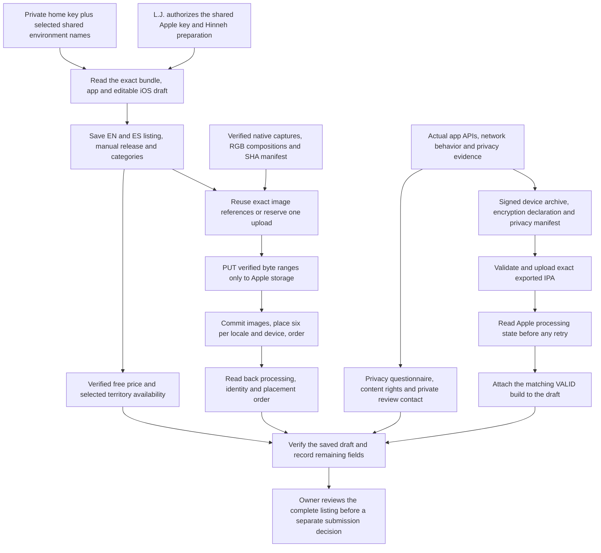

<!-- For God so loved the world, that he gave his only begotten Son, that whosoever believeth in him should not perish, but have everlasting life. — John 3:16 (KJV) -->

# App Store Connect preparation Chirho

The narrow operator client and listing commands live under `apps-chirho/ios-chirho/scripts-chirho/store-chirho/`. The client reads only the named Apple entries from `~/.env-chirho`, loads the P-256 key into memory, and signs short-lived API tokens. Credentials, upload authorization URLs and private review contacts never belong in source, public metadata or progress reports. This administrative credential is shared storage, not a Hinneh runtime secret; it must never be deployed to the website.

From the repository root, use `rtk proxy bun apps-chirho/ios-chirho/scripts-chirho/store-chirho/app-store-listing-chirho.ts inspect-chirho`. The mutating modes are `prepare-chirho --apply-chirho`, `media-chirho --apply-chirho` and `attach-build-chirho --apply-chirho`. They require the exact Hinneh bundle and an iOS version in PREPARE_FOR_SUBMISSION. This first-release tool expects one iOS version; revise that assumption deliberately before a later release. It has no review-submission or public-release command.

Screenshot upload follows Apple's Asset Library API and current image specifications. Each image reference includes its prepared SHA-256. Existing references and reservations are reconciled before upload. PUT requests carry only Apple's upload headers, never the API bearer token, and remain inside their verified byte ranges. Unknown reservations, interrupted uploads, unexpected placements and API write failures are retained for remote readback. Do not delete and recreate an asset merely because a client timed out.

Archive the actual project with the owner's signing team preserved. Export for App Store Connect, validate the exact IPA, and upload it once through Apple's authenticated upload tool. After a timeout or uncertain upload, list builds and reconcile version, build number and processing state before another upload. Only the matching VALID and APP_STORE_ELIGIBLE build is attached. The current system HTTPS and SHA-256 integrity use is declared exempt with `ITSAppUsesNonExemptEncryption = NO`; reassess if cryptographic behavior changes. The app-local UserDefaults reason in PrivacyInfo does not complete the store privacy questionnaire.

On November 4, app 6830790082 holds draft version 0.1 with build 1 attached, English and Spanish metadata, 24 processed screenshots, free pricing, and the 175 currently listed territories selected without automatic future-territory opt-in or pre-orders. This remains an unsubmitted draft with manual release. The private review-contact phone, privacy-label questionnaire, and content-rights/regional compliance forms must be completed from accurate owner and data-handling evidence before submission. No legal agreement was accepted and no paid contract was enabled by this workflow.

Private, dated API receipts and final verification belong under `workspace-chirho/native-apps-chirho/app-store-connect-chirho/2026-11-04-chirho/`. Signed archives, exports and upload logs stay under ignored `build-chirho/ios-distribution-chirho/`. The website privacy explanation is published separately through the sole existing publisher; store uploads never start another artwork writer or publisher.

Apple references: [API authentication](https://developer.apple.com/documentation/appstoreconnectapi/creating-api-keys-for-app-store-connect-api), [image uploads](https://developer.apple.com/documentation/appstoreconnectapi/uploading-and-managing-image-assets), [asset placement](https://developer.apple.com/documentation/appstoreconnectapi/placing-assets-on-your-app-store-surfaces), [price schedules](https://developer.apple.com/documentation/appstoreconnectapi/post-v1-apppriceschedules), [App Privacy details](https://developer.apple.com/app-store/app-privacy-details/) and [encryption export declarations](https://developer.apple.com/documentation/Security/complying-with-encryption-export-regulations). These were checked for this dated preparation; recheck before a later release.
