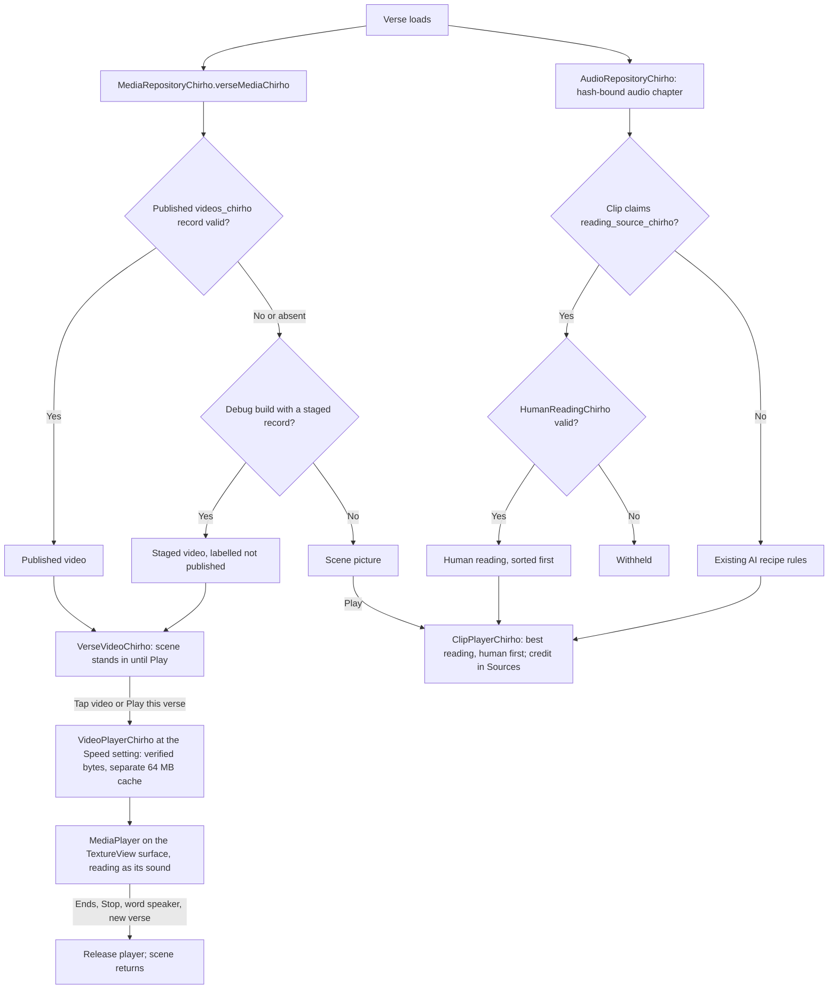

<!-- For God so loved the world, that he gave his only begotten Son, that whosoever believeth in him should not perish, but have everlasting life. — John 3:16 (KJV) -->

# Verse video and human readings on Android

L.J., 2026-11-06, relayed by claude2 (DM #3358):

> So we will use the video play to play the audio, if we have no video but we do have audio it should play audio and show the image

L.J.'s split on 2026-11-07 (GPT, DM #3384): Claude owns Android; GPT owns iOS, the main media and the shared contract; Claude2 owns the website. The plan is `workspace-chirho/native-apps-chirho/verse-playback-2026-11-07-chirho/android-plan-chirho.md`.

- **Video in the scene's place.** When a verse has a video, it takes the scene picture's place, and Play plays it with its reading.
- **No video.** Play plays the verse's best saved reading over the scene picture. A human reading by Rabbi Dan Be'eri comes before any AI reading.
- **Speed.** Videos follow the reader's Speed setting, with pitch kept, as recordings do.
- **Later.** Another language's reading behind a muted video, once real English or Spanish verse clips exist.

## Human readings (GPT, DM #3386 and #3390)

- **Where the record lives.** Be'eri verse readings sit in their own optional `readings_chirho` list beside `clips_chirho` in each audio chapter (DM #3410). The released apps ignore that key, so they never play a human reading without its credit. `clips_chirho` stays as it was. The two lists together hold at most 2000 entries.
- **Each entry.** `token_id_chirho: null`, the voice `"Rabbi Dan Be'eri"`, and a nested `reading_source_chirho`. That object holds the reader, the GBT ID `OT/RDB/<code>`, the package, chapter and timing hashes, the verse's window, the chapter's length, and the attribution and license.
- **Validation.** `HumanReadingChirho` ports `validReadingSourceChirho` and `validHumanRecordingChirho` from the website's `reading-source-chirho.ts` exactly:
  - one of Be'eri's 30 books;
  - three 64-hex hashes;
  - a window of at most 120 s inside the chapter, with the clip's length within 0.15 s of it;
  - the exact attribution, CC BY-SA 3.0 and its URL;
  - none of the `ipa`, `synthesis_text`, `recipe_id` or offset keys.
- **Refusal.** Every `readings_chirho` entry must pass; an AI-shaped clip placed there is refused. A `clips_chirho` entry that claims a human source but fails is withheld too. Neither is ever reinterpreted as an AI recording.
- **Order.** Human readings come first, then the existing order: approved, connected, recipe-backed, IPA-backed. Word clips are unchanged.
- **Credit.** The verse's folded Sources list starts with the credit of what Play plays: the attribution exactly as published and a License link, with no AI label (`playedCreditChirho`, `CreditChirho`). A verse with a video gives the video's credit instead, so it appears once.
  - It moved there from under Play in 0.1.1. L.J., 2026-11-07: "credits etc can just show in like an info screen, not have the main user interface littered with dev notes" (agreed with GPT, DM #3486).
  - The reading key's Hebrew credits also name the Be'eri readings.

## AI verse readings

- **Binding.** An AI verse reading must name a known recipe, and its pronunciation must match that recipe's profile. Android does not re-derive the model's input text; the publisher checks it (GPT, DM #2692).
- **Local Chatterbox V3.** The recipe is `chatterbox-v3-modern-greek-verse-v1-chirho` (DM #3449). It is plain Modern with rough breathing silent, so it serves Modern, and serves Modern with Aspirates only when the verse has no rough breathing. It never serves Erasmian. `LocalGreekVerseTestChirho` checks this over real Matthew verses.
- **Automatic rendition.** Until the reader saves a choice in Settings, each Greek verse uses Modern with Aspirates if it has an Aspirates verse reading, otherwise Modern, as the website does (`ReaderUiStateChirho.renditionChirho`, 0.1.1). A saved choice always wins.
- **Speed.** Playback starts at Normal for Hebrew and Greek, as on the website; a chosen speed is saved.

## Video contract

`VideoSelectionChirho` ports GPT's `src/lib/domain-chirho/verse-video-chirho.ts` exactly (DM #3399):

- **Verse binding.** A video plays only for its verse's exact canonical text and in place of the scene now shown.
  - Published and staged videos are checked the same way, and a published video comes first.
  - A verse with no record, or with more than one, has no video.
- **Reading.** `embedded_reading_chirho` is either a valid Be'eri reading source or null.
  - With a source: language `he`, CC BY-SA 3.0, and the video's length within 0.3 s of the window.
  - Null means a silent video: CC0 and no language.
- **Review state.** `pending` or `approved`.
- **Sound.** `sameEmbeddedReadingChirho` tells whether the video's own sound is the selected recording's exact source. The separate reading track for a replacement reading will use it.

The staging tool takes each embedded reading from the verse's verified Be'eri cut in the static audio chapter. Videos with no matching cut are skipped and named: 19 of claude2's 31 Proverbs videos stage on 2026-11-07, and 12 await GPT's cuts. The publisher and Worker are GPT's, and no video is public yet.



## Rules

- **One sound at a time.** Starting a word, a verse recording or another passage stops the video, and the reverse holds too.
- **Late callbacks.** Each play takes a new generation from `PlaybackSlotChirho`. A late fetch failure, completion or error from a stopped or superseded play cannot change a newer play's state, even when the newer play is the same verse again, as after switching the Greek reading A, B, then A (GPT, DM #3498). Both players use it.
- **A failed video.** As on the website, a video that cannot be fetched, verified or played is not tried again on that visit (`ReaderUiStateChirho.playableVideoChirho`). The still returns, and the next Play reads the verse's recording over it. With no recording to read, Play may try the video again.
- **Strict records.** A silent video names both `reading_language_chirho` and `embedded_reading_chirho` as null; an absent key fails decoding. Two rows for one verse withhold its video, while the scene and word pictures stay.
- **Integrity.** Video bytes are checked against length and SHA-256 before playback and played from memory. Videos get their own bounded cache, so they never push text, pictures or recordings out.
- **Staging.** Only debug builds read staged development videos (`src/debug`). Release builds compile the empty `src/release` hook. Stage videos with:

  ```bash
  python3 -I apps-chirho/android-chirho/tools-chirho/stage_videos_chirho.py <videos folder> --serial emulator-5556
  ```

  The device serial is always explicit.
