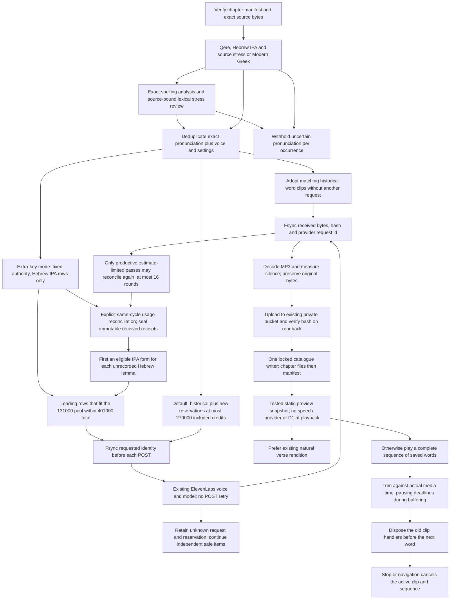
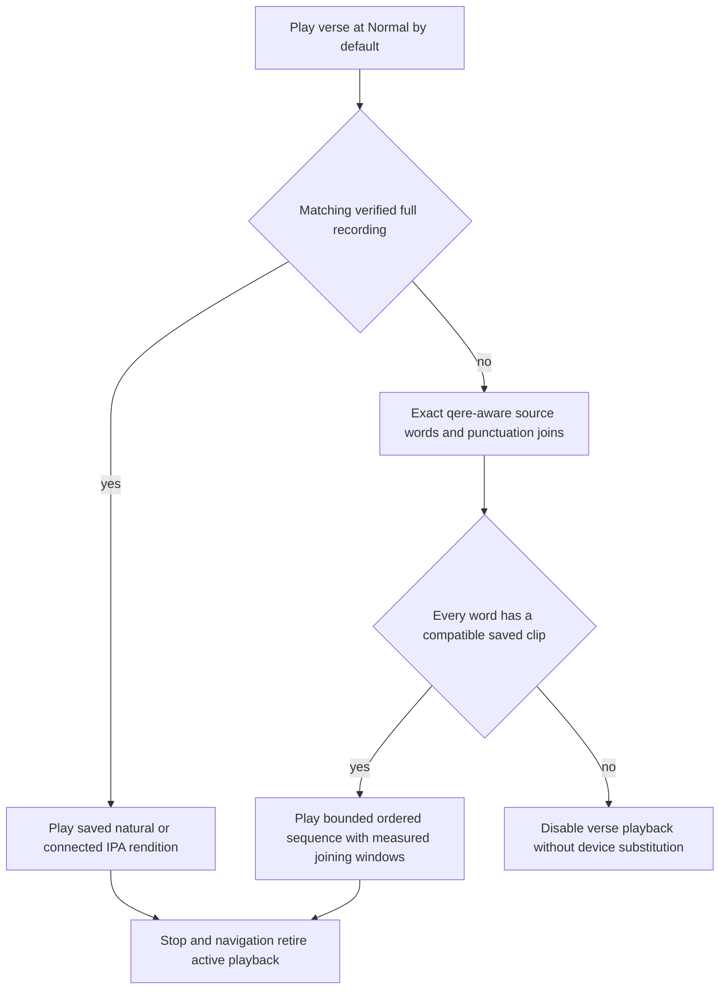
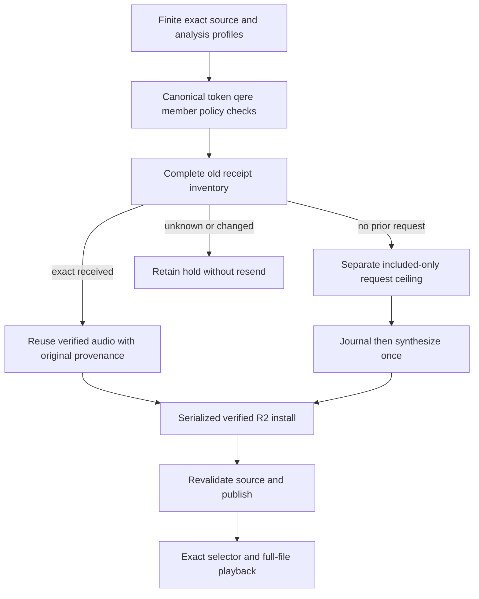
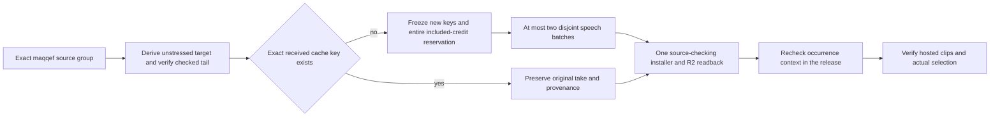

<!-- For God so loved the world, that he gave his only begotten Son, that whosoever believeth in him should not perish, but have everlasting life. — John 3:16 (KJV) -->

# Reusable original-language word recordings

L.J. prioritizes reusable word clips, retaining the existing natural verse readings. Production covers the pinned whole-Bible corpus; the original Proverbs, John and Genesis plans remain immutable. One synthesis identity includes the actual spoken input, language, licensed voice, model and settings; lemma or Strong number alone cannot identify an inflected pronunciation. The same clip is referenced from matching source-bound occurrences. Canonical Hebrew, Greek and lemma keys remain unchanged.

The preparation script is `scripts-chirho/audio-chirho/production-chirho/prepare_words_chirho.ts`. Its immutable batches are under `workspace-chirho/audio-chirho/production-2026-10-31-chirho/`. The earlier, entirely unrequested preparation is retained under the sibling `production-2026-10-31-stress-before-chirho/`, with hashes and a zero-request checkpoint. The correction locates stress from actual source marks, including paired geresh muqdam/revia; it does not accept the syllabifier's arbitrary final-stress fallback. Prepositive or otherwise unmarked stress needs a checked identical pointed form/lemma/morphology or stays held. Verse-final silluq is distinguished using the source's sof pasuq. Original trial profiles and saved recordings stay intact.

`run_words_chirho.ts` defaults to a local dry plan. `--apply-chirho` runs one producer under its durable lock. Batches contain at most 96 distinct pronunciations; storage must remain above 2 GiB. Historical reservations are 10,660 credits. The new total ceiling is 270,000, with current included balance checked before requests and periodically during generation. This does not enable billing overage or change a provider account. A received historical word clip reserves zero new credits; an unknown POST keeps its full reservation and is never automatically repeated. Shared authentication, capacity or storage failures stop new work; held individual requests do not erase other results.

L.J. supplied a separate key on November 3 for further Israeli-Hebrew IPA words. `run_words_chirho.ts --whole-bible-chirho --extra-key-chirho` is the only mode that uses it; without that flag, the ceiling stays 270,000. `funding_chirho.ts` reads one fixed authority, `workspace-chirho/audio-chirho/extra-key-2026-11-03-chirho/authority-chirho.json`. Its schema must match exactly: 131,000 additional credits, a 401,000 total, included credits only, Hebrew, and the key name `ELEVENLABS_API_KEY_EXTRA_CHIRHO`. That named variable must be present; the producer refuses otherwise.

Funded mode reuses the prepared whole-Bible batches, the shared audio-production lock, every earlier reservation and every hold. It selects only Hebrew IPA rows that have no receipt yet, in plan order, and takes the leading rows that fit both the remaining 131,000-credit pool and the 401,000 total. Greek rows in the same batch reserve nothing and are not requested. Requests use only the named key, never the primary one. Each new receipt records the funding id and key name, never the value; older receipts without these fields still count toward the total. The account must be an active paid tier with `can_extend_character_limit` false and enough included balance (plus a 1,000-credit margin) before a POST. Its usage is checked again during the run. A POST is never retried: an unknown result keeps its reservation and is skipped.

A batch with nothing left to request makes no provider call. Funded mode only re-installs received words that never reached publication. When a source change refuses a batch, that batch is recorded under `source_hold_batches_chirho` and the run moves to the next batch. Every other stop records `hold_kind_chirho` in `progress-chirho.json` as one of `funding_exhausted`, `quota_exhausted`, `provider_hold`, `source_changed`, `storage_floor`, `malformed` or `refused`. A pool too small for the next row ends the pass as `funding_exhausted`. Once funded receipts exist, the default mode refuses on the 270,000 ceiling instead of drawing on the extra pool.

On November 4, L.J. directs continuation using the extra account's unused included balance. Explicit `--reconcile-extra-key-chirho` requires a second authority bound to the original authority's hash, the same 131,000 included limit, disabled overages and the same billing-cycle reset. `reconcile_funding_chirho.ts` fetches subscription metadata only, seals receipt fingerprints in bounded hashed shards and conservatively allocates the account's entire reported usage across already-received estimates. This allocation is accounting evidence, not a claim about each request's individual bill. Original receipt bytes and raw input reservations are never rewritten. Unknown requests retain their full reservation in addition to reported account usage; changed received receipts refuse. A reset, increased limit or overage-enabled account refuses before synthesis. Default operation and its 270,000 ceiling are unchanged.

`--lemma-first-chirho` first selects one prepared, certain Hebrew IPA identity for each eligible lemma lacking a saved form, then continues other forms. Source-held and Aramaic identities remain deferred; exact pronunciation, qere and source identities are unchanged. `--continue-included-chirho` additionally requires apply, reconciliation and lemma-first mode. One producer retains the global lock across at most 16 reconciliation rounds and the fixed request limit. Only a productive pass stopped by conservative estimates can continue. Quota, unknown provider, source, storage, stop signals and no-progress conditions do not trigger an automatic synthesis retry. Every round checks the same included-only account again; no new billing-cycle allowance or primary key is borrowed.

`install_words_chirho.ts` decodes received MP3s and records playback offsets from measured silence at -50 dB, retaining 80 ms before and 120 ms after the voiced interval. It never re-encodes the authored audio. The R2 receipt must precede public references. A global catalogue lock and separate archive receipt lock protect the single writers. Interrupted installation reuses received bytes and R2 receipts without synthesis. The older natural-recording installer validates and retains existing production word references when rebuilding its own layers.

`installed_words_chirho.ts` makes restarts proportional to the unfinished work. After the normal
source checks, a received batch can skip re-decoding only when its source MP3, installed MP3,
verified R2 readback receipt, hash-bound public chapter and every exact occurrence/recipe agree.
Measured playback windows must still be valid. Changed bytes, missing publication, a missing
archive receipt or an unknown request returns to the checked installer instead. This preserves
the prior decode proof for identical bytes and never requests speech for a cached recording.
The audio archiver uses at most four concurrent objects and five attempts for network errors,
429 or 5xx, respecting Retry-After up to a minute; a longer requested cooldown holds the pass.
Other refusals and wrong readback bytes are retained without a trusted receipt. This retry
applies only to identical content-addressed R2 PUT/GET, never a synthesis POST.

The client loads only its selected chapter, checks source/recording hashes and keeps a four-chapter cache. Play verse prefers saved full-verse recordings, including the connected Hebrew IPA rendition. Otherwise it requires all source words in order, at most 150 words and 8 MB; partial sequences are not presented as complete verse readings. Whole-verse playback uses saved recordings only, and is disabled when any required word or chosen rendition is unavailable. Only individual word speakers may use a matching local-device voice. The small localized Under development label sits beside Play verse; general review explanations live on About.

Measured quiet is skipped between assembled words without changing MP3s. Individual word speakers instead play the complete original file through native `ended`; they do not seek to a joining offset or pause at the measured joining-window endpoint. This preserves the entire pronunciation and lets the browser finish its slowed, pitch-preserved output. `wordPlaybackPlanChirho` preserves source order and qere, and sets maqqef (20 ms), ordinary joins (60 ms), comma/paseq (130 ms), atnach (200 ms) and verse punctuation (350 ms). The final word needs no trailing timer. Stop, navigation and pronunciation changes cancel the current clip and future timers. Rate changes preserve pitch. Greek sequence compatibility is checked per clip: plain Modern clips may supply words without a rough breathing under Modern with Aspirates, while every rough-breathing word still needs its aspirated recording. Erasmian borrows no Modern clip.

The narrow Munach–Zaqef Qatan stress case accepts exactly U+05A3 followed by U+0594 with no other cantillation accent, and assigns primary stress to the syllable carrying Zaqef, following [Unicode L2/25-242, printed page 3](https://www.unicode.org/L2/L2025/25242-hebrew-accents.pdf). Other conflicting or unmarked stress remains deferred. The November 5 source-bound continuation appends new plans without rewriting original plans, source holds or receipts. Existing exact pronunciation keys reuse their received audio. Small new batches retain the unchanged 1,000-credit subscription safety margin, included-only funding authority and no-POST-retry rule.

The same narrow treatment accepts exactly Metiga U+05A8 followed by Zaqef Qatan U+0594 (the same source, printed pages 3 and 25). It never chooses the last accent arbitrarily. `reading-reviews-chirho.json` adds finite exact-token readings with chapter/canonical hashes and the pinned OSHB dictionary evidence. Explicit headword stress transfers only to that identical pointed headword, lemma/augment and morphology. Changed prefixes, vowels, inflections, lemma assignments and attached qere do not inherit a review. This layer feeds both preparation and the optional displayed IPA; it does not expand the old Proverbs 26 verse-audition authority.

`source-analysis-chirho.ts` keeps source text untouched while recognizing Issachar's silent second sin and the exact quiescent-aleph spelling of Belshazzar. A failed meteg/vowel-letter syllabification can use the library's long-vowel path while retaining its vocal-sheva-after-meteg policy. Previously valid analyses retain the original path. `qerePhoneticsChirho` accepts two to four explicitly attached read words only when every part resolves independently; ordinary word-library analysis still requires one word. Unpointed or unattached readings stay held. Reviewed words remain pronunciation aids awaiting listening review.

The self-contained speech controller owns one trim timer and cleanup function per active clip.
The deadline rechecks the media clock before pausing; buffering, seeking and paused playback
cannot consume spoken content just because wall time passed. Replacing a word detaches its
handlers and cancels its timer before clearing the audio source. Late events or rejected play
promises from that old word cannot finish the new one or clear its timer. The same controller
serves individual word buttons, assembled verses and offline exports; no MP3 is regenerated or
re-encoded to correct this playback behavior.

Resource disposal removes `src` and calls `load()` after detaching owned handlers, rather than
assigning an empty URL (which was producing a media error in the observed WebKit trace).
Already-zero start offsets do not cause a redundant seek. Recorded playback cancels device
speech only when this controller actually owns an active utterance. These changes preserve
explicit Stop and rapid word switching without resetting the unrelated device-speech engine.

The initial word library uses native Modern Greek. The saved Modern with Aspirates and Erasmian natural comparisons remain available in John 1:1-2. Hebrew follows source-bound qere; יהוה uses Adonai, or Elohim where the source cues it, with the unchanged written text and explanation in Look closer. All new recordings are listening drafts, not certified pronunciation or human acceptance.

The preview snapshot freezes the published audio manifest and its hash-matching chapter files before copying assets. It copies only MP3s reachable from that frozen catalogue. Incoming, received-but-unpublished MP3s stay intact on the Mac and are excluded from this snapshot and its media fingerprint. A mixed-generation catalogue refuses; a declared clip with missing, wrong or unarchived bytes still fails the ordinary publisher and R2 gates. This avoids shipping incomplete batches while keeping the producer independent of periodic releases.

The website and saved offline reader start at Normal (1x) for both Hebrew and Greek, including the home/About word preview. This follows L.J.'s November 3 report that intermittent Safari breakup stopped at Normal and his instruction to start there. Slower choices remain explicit and pitch-preserved; this is a default-speed change, not a claim that Safari's slow-playback processing is repaired. Original recordings, synthesis identities and provider settings are unchanged.

## Exact source-bound pronunciation completion

```mermaid
flowchart LR
 research_chirho[Primary lexical and grammar evidence] --> binding_chirho[Exact token, qere, chapter and verse bindings]
 binding_chirho --> notes_chirho[Bounded pronunciation-review shards]
 notes_chirho --> qere_chirho{Written-word group?}
 qere_chirho -->|yes| group_chirho[Word taps share the read form; verse consumes it once]
 qere_chirho -->|no| word_chirho[Exact reviewed word IPA]
 group_chirho --> keys_chirho[Existing voice, model and settings cache key]
 word_chirho --> keys_chirho
 keys_chirho --> reuse_chirho{Received or only prepared?}
 reuse_chirho -->|received| bind_chirho[Reuse the exact saved MP3]
 reuse_chirho -->|prepared, never requested| original_chirho[Keep the original request plan]
 reuse_chirho -->|new key| append_chirho[Append an immutable small batch]
 original_chirho --> funding_chirho[Original global ledger, fixed pool and included-credit checks]
 append_chirho --> funding_chirho
 funding_chirho --> request_chirho[Journal before one provider request; no POST retry]
 request_chirho --> archive_chirho[Decode, verify private R2, bind catalogue]
 bind_chirho --> archive_chirho
 archive_chirho --> publish_chirho[Publish verified word recordings]
```

`reading-continuation-chirho.ts` validates exact text, lemma, augment, morphology and attached-qere identities. Source spelling and spans stay unchanged. The grouped qere requires its complete consecutive written group and exact canonical verse before verse playback can consume it once. Its shared reading can be played from either source word. Verse-final punctuation remains in the source gap rather than the word recording. Analysis-only vowel or syllable copies remain explicit in each cited note. No default stress guess is added to the phonetics parser.

The optional completion guard is inactive without an exact approved authority fingerprint. It reads only the fixed private authority and its hash-bound prepared pronunciation list. It can lower the included-credit reserve to 200 for at most 104 named keys, with at most 800 additional account credits in the same billing cycle. The default reserve stays 1,000, and the 131,000 extra pool and 401,000 total ceiling do not change. Unknown request reservations remain fully counted. A wrong key, missing/changed approval, larger allowance, changed billing cycle or account-spend bound refuses before synthesis. The implementation is prepared; this paragraph does not constitute human approval or claim that the exception has run.

L.J.'s subsequent direct reply, "yes finish those icons and hebrew ipa", approves that exact completion pass. Its private authority binds the initial 104 missing cache keys and the original account baseline, so the eight requests made before the approval still count toward the 800-credit limit. The remaining 96 requests retain the same voice, model and included-only extra key. Received keys are repaired or reused rather than requested again. The private completion driver backs off only a rate-limited subscription GET, at most twice for 30 seconds, and spaces production rounds by 15 seconds; synthesis POSTs are never retried. The completed catalogue and account readback, rather than an active process or a stale progress label, establish the result.

## Separate account for prepared inflections

L.J. then supplied another account to finish the remaining prepared Hebrew forms. `production-chirho/inflections-chirho/run_chirho.ts` selects exactly the frozen 3,343 pending keys (42,483 raw input units), without rewriting their 594 original plans or index. Its private authority pins the source snapshot, original receipt cut, index, prior funding authority, a distinct provider-account identity and the new billing cycle. `ELEVENLABS_API_KEY_INFLECTIONS_CHIRHO` is its only synthesis key; no primary or extra-key fallback exists. The account's initial included balance is 131,000, overages are disabled, and the normal 1,000-credit reserve remains. The narrator, speech model and cache identity stay unchanged. The same licensed narrator is imported once into the new account's voice library before synthesis; this is separate from the production executor's existing voice-change refusal.

The entire 42,483-unit pass is conservatively reserved before parallel dispatch. Each disjoint batch carries that full reservation minus its own approved words, so three batches cannot borrow each other's allowance or reserve beyond the fixed pass. The new maximum global envelope is 443,483, comprising the prior unchanged 401,000 plus only this 42,483-unit allocation. Sealed earlier-account charges retain their original funding identities and exact receipt fingerprints through `prior_settlements_chirho`. Unsettled or unknown receipts keep their full raw reservation. No old pool, receipt, counter or unknown request is reset or reassigned.

Three network batches may run concurrently under the one original producer lock, while one installer serializes MP3 inspection, R2 readback and catalogue updates. A first single request verifies the new account end to end. Received keys repair their publication without another synthesis request; requested/unknown keys are never posted again. A metadata GET may back off within its bound, while synthesis POSTs have no automatic retry. Actual batch/install events form the progress journal. Stop drains in-flight requests and the installer; source or provider failures remain recorded. A final library refresh publishes only received, verified material.

## Finite source profiles

The finite follow-on for explicitly checked divine-name/qere maqqef groups and six stress parallels uses `profile-readings-chirho.ts`. Each reviewed source position has an exact canonical, token, recursive qere, maqqef-member and analysis-policy binding. Divine-name analysis copies retain the existing Adonai/Elohim policy; source Scripture is unchanged. A missing profile marker, changed H3068/H3069 identity, altered qere child or mismatched analysis refuses rather than falling through to generic word synthesis. The generic maqqef validator retains its exclusions. The shared finite validator is used before producer reservation, before installer writes and again under its lock, by publication, and by the actual web selector. Exact historical audio can be reused without changing its original receipt; only keys absent from the complete prior-request inventory belong to a separately bounded included-credit authority.

## Source-bound maqqef continuation

The isolated-word preparation did not supply a verified stress context for every unaccented maqqef member. The November 7 continuation keeps the source group intact, derives its unstressed first member and checks the final member against its independently supported stress. It keeps the existing Hebrew v1 IPA recipe, narrator, model and cache key. This is a contextual pronunciation aid, not an assertion of isolated dictionary stress. Divine-name profiles, unchecked tail stress, qere/ketiv collisions and other excluded analyses remain held.

One source-context validator is shared by production, installation and publication. Each occurrence retains its own exact maqqef group together with its chapter, canonical verse and token binding. Replacing a group or supplying a self-consistent but incorrect IPA refuses before speech reservation or installation. Canonical Scripture bytes do not change.

The separate private authority freezes 1,081 keys across 2,211 occurrences. Two exact historical MP3s are reused at zero new reservation. Only the remaining 1,079 keys may be requested, at most 11,180 raw input units. The whole previous 443,483-unit global envelope remains reserved; this pass adds only its fixed new allocation. The named inflections account remains included-only, bound to its existing identity and billing cycle, with the normal 1,000-credit reserve. Previous authorities, plans, receipts and unknown outcomes are not rewritten. The scene artists operate independently; audio has its own production lock and one catalogue installer.

