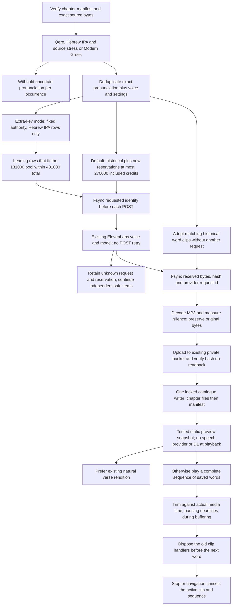

<!-- For God so loved the world, that he gave his only begotten Son, that whosoever believeth in him should not perish, but have everlasting life. — John 3:16 (KJV) -->

# Reusable original-language word recordings

L.J. prioritizes reusable word clips, retaining the existing natural verse readings. The initial production input is the current pinned Proverbs, John and Genesis corpus. Whole-Bible source expansion is subsequent work. One synthesis identity includes the actual spoken input, language, licensed voice, model and settings; lemma or Strong number alone cannot identify an inflected pronunciation. The same clip is referenced from matching source-bound occurrences. Canonical Hebrew, Greek and lemma keys remain unchanged.

The preparation script is `scripts-chirho/audio-chirho/production-chirho/prepare_words_chirho.ts`. Its immutable batches are under `workspace-chirho/audio-chirho/production-2026-10-31-chirho/`. The earlier, entirely unrequested preparation is retained under the sibling `production-2026-10-31-stress-before-chirho/`, with hashes and a zero-request checkpoint. The correction locates stress from actual source marks, including paired geresh muqdam/revia; it does not accept the syllabifier's arbitrary final-stress fallback. Prepositive or otherwise unmarked stress needs a checked identical pointed form/lemma/morphology or stays held. Verse-final silluq is distinguished using the source's sof pasuq. Original trial profiles and saved recordings stay intact.

`run_words_chirho.ts` defaults to a local dry plan. `--apply-chirho` runs one producer under its durable lock. Batches contain at most 96 distinct pronunciations; storage must remain above 2 GiB. Historical reservations are 10,660 credits. The new total ceiling is 270,000, with current included balance checked before requests and periodically during generation. This does not enable billing overage or change a provider account. A received historical word clip reserves zero new credits; an unknown POST keeps its full reservation and is never automatically repeated. Shared authentication, capacity or storage failures stop new work; held individual requests do not erase other results.

L.J. supplied a separate key on November 3 for further Israeli-Hebrew IPA words. `run_words_chirho.ts --whole-bible-chirho --extra-key-chirho` is the only mode that uses it; without that flag, the ceiling stays 270,000. `funding_chirho.ts` reads one fixed authority, `workspace-chirho/audio-chirho/extra-key-2026-11-03-chirho/authority-chirho.json`. Its schema must match exactly: 131,000 additional credits, a 401,000 total, included credits only, Hebrew, and the key name `ELEVENLABS_API_KEY_EXTRA_CHIRHO`. That named variable must be present; the producer refuses otherwise.

Funded mode reuses the prepared whole-Bible batches, the shared audio-production lock, every earlier reservation and every hold. It selects only Hebrew IPA rows that have no receipt yet, in plan order, and takes the leading rows that fit both the remaining 131,000-credit pool and the 401,000 total. Greek rows in the same batch reserve nothing and are not requested. Requests use only the named key, never the primary one. Each new receipt records the funding id and key name, never the value; older receipts without these fields still count toward the total. The account must be an active paid tier with `can_extend_character_limit` false and enough included balance (plus a 1,000-credit margin) before a POST. Its usage is checked again during the run. A POST is never retried: an unknown result keeps its reservation and is skipped.

A batch with nothing left to request makes no provider call. Funded mode only re-installs received words that never reached publication. When a source change refuses a batch, that batch is recorded under `source_hold_batches_chirho` and the run moves to the next batch. Every other stop records `hold_kind_chirho` in `progress-chirho.json` as one of `funding_exhausted`, `quota_exhausted`, `provider_hold`, `source_changed`, `storage_floor`, `malformed` or `refused`. A pool too small for the next row ends the pass as `funding_exhausted`. Once funded receipts exist, the default mode refuses on the 270,000 ceiling instead of drawing on the extra pool.

`install_words_chirho.ts` decodes received MP3s and records playback offsets from measured silence at -50 dB, retaining 80 ms before and 120 ms after the voiced interval. It never re-encodes the authored audio. The R2 receipt must precede public references. A global catalogue lock and separate archive receipt lock protect the single writers. Interrupted installation reuses received bytes and R2 receipts without synthesis. The older natural-recording installer validates and retains existing production word references when rebuilding its own layers.

`installed_words_chirho.ts` makes restarts proportional to the unfinished work. After the normal
source checks, a received batch can skip re-decoding only when its source MP3, installed MP3,
verified R2 readback receipt, hash-bound public chapter and every exact occurrence/recipe agree.
Measured playback windows must still be valid. Changed bytes, missing publication, a missing
archive receipt or an unknown request returns to the checked installer instead. This preserves
the prior decode proof for identical bytes and never requests speech for a cached recording.
The audio archiver uses at most four concurrent objects and five attempts for network errors,
429 or 5xx, respecting Retry-After up to a minute; a longer requested cooldown holds the pass.
Other refusals and wrong readback bytes are retained without a trusted receipt. This retry
applies only to identical content-addressed R2 PUT/GET, never a synthesis POST.

The client loads only its selected chapter, checks source/recording hashes and keeps a four-chapter cache. Natural verse clips take priority. An assembled verse requires all its source words in order, at most 150 words and 8 MB; partial word sequences are not presented as complete verse readings. Measured quiet is skipped between assembled words without changing MP3s. Individual word speakers instead play the complete original file through native `ended`; they do not seek to a joining offset or pause at the measured joining-window endpoint. This preserves the entire pronunciation and lets the browser finish its slowed, pitch-preserved output. Gaps use maqqef (20 ms), ordinary joins (60 ms), atnach (200 ms) and verse punctuation (350 ms). Stop, navigation and pronunciation changes cancel the current clip and future timers. Rate changes preserve pitch. Missing renditions remain explicit or use a clearly labelled matching local-device voice.

The self-contained speech controller owns one trim timer and cleanup function per active clip.
The deadline rechecks the media clock before pausing; buffering, seeking and paused playback
cannot consume spoken content just because wall time passed. Replacing a word detaches its
handlers and cancels its timer before clearing the audio source. Late events or rejected play
promises from that old word cannot finish the new one or clear its timer. The same controller
serves individual word buttons, assembled verses and offline exports; no MP3 is regenerated or
re-encoded to correct this playback behavior.

Resource disposal removes `src` and calls `load()` after detaching owned handlers, rather than
assigning an empty URL (which was producing a media error in the observed WebKit trace).
Already-zero start offsets do not cause a redundant seek. Recorded playback cancels device
speech only when this controller actually owns an active utterance. These changes preserve
explicit Stop and rapid word switching without resetting the unrelated device-speech engine.

The initial word library uses native Modern Greek. The saved Modern with Aspirates and Erasmian natural comparisons remain available in John 1:1-2. Hebrew follows source-bound qere; יהוה uses Adonai, or Elohim where the source cues it, with the unchanged written text and explanation in Look closer. All new recordings are listening drafts, not certified pronunciation or human acceptance.

The preview snapshot freezes the published audio manifest and its hash-matching chapter files before copying assets. It copies only MP3s reachable from that frozen catalogue. Incoming, received-but-unpublished MP3s stay intact on the Mac and are excluded from this snapshot and its media fingerprint. A mixed-generation catalogue refuses; a declared clip with missing, wrong or unarchived bytes still fails the ordinary publisher and R2 gates. This avoids shipping incomplete batches while keeping the producer independent of periodic releases.
