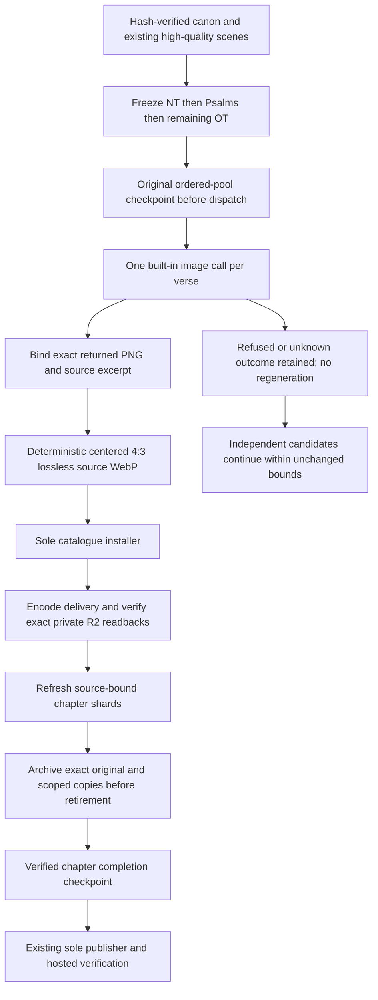

<!-- For God so loved the world, that he gave his only begotten Son, that whosoever believeth in him should not perish, but have everlasting life. — John 3:16 (KJV) -->

# High-quality scene upgrades

L.J.'s November 6 order is New Testament, Psalms, then the remaining Old Testament. Existing built-in Proverbs, John and Genesis scenes remain. The inventory pins all 66 canonical book manifests and preserves source verse numbers. The new queue covers 27,829 existing placeholders; one original built-in image request per candidate, at most three active artists and one installer. No paid renderer or automatic image retry is available.

The implementation lives in `scripts-chirho/art-chirho/recovery-chirho/scene_upgrade_sources_chirho.py` and `scene_upgrades_chirho.py`. It reuses `ordered_pool_chirho.py`, the managed Codex launcher and exact-original validator from the icon pipeline, and the established delivery/archive/retirement tools. The public high-quality scene catalogue is separate from the original placeholder catalogues. Mark's pending Schnell records gain only `fallback_chirho: true`, with exact original bytes retained; the shard builder prefers a high-quality primary over that fallback. Old three-book requests, holds and provenance are unchanged.

Each chapter has its own durable pool under `workspace-chirho/art-chirho/queue-chirho/high-quality-scenes-chirho/books-chirho/`. The global progress file records actual dispatch/install/recovery events. One file lock owns the supervisor. A 15 GiB free-space floor drains new work. `SIGUSR1`, `SIGTERM` or a `PAUSE-chirho` file drains active artists. Three consecutive generator failures stop the run. Archive/source failures stop dispatch and preserve the same received output for recovery. Helper output is streamed through a fixed 64 KiB diagnostic tail; its full byte count and SHA-256 remain in a stage receipt, avoiding a duplicate whole-library index per scene. Timeout stops only that helper process group and preserves the received scene. Human artwork review remains pending.

Dry inventory: `/opt/homebrew/bin/python3 -I -B scripts-chirho/art-chirho/recovery-chirho/scene_upgrades_chirho.py`. Add `--apply-chirho` to run; `--limit-chirho 1 --concurrency-chirho 1` bounds the first end-to-end proof. The limit counts attempted dispatches, including preflight failures. Resume reuses checked installed or prepared outputs and never resubmits an uncertain request. Continue with the default three generators only after the bounded proof is verified.
