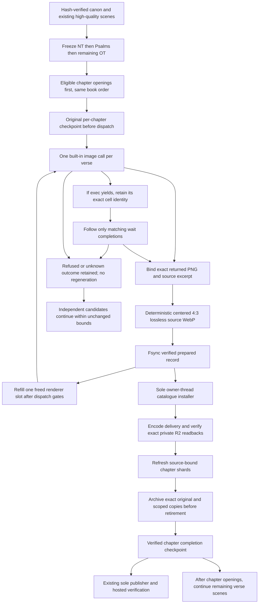

<!-- For God so loved the world, that he gave his only begotten Son, that whosoever believeth in him should not perish, but have everlasting life. — John 3:16 (KJV) -->

# High-quality scene upgrades

L.J.'s November 6 order is New Testament, Psalms, then the remaining Old Testament. Existing built-in Proverbs, John and Genesis scenes remain. The inventory pins all 66 canonical book manifests and preserves source verse numbers. The new queue covers 27,829 existing placeholders; one original built-in image request per candidate, at most three active artists and one installer. No paid renderer or automatic image retry is available inside this background queue. The separately authorized finite Runware book-opening task adopts verified completed records into the same checkpoints, with honest provider provenance.

The implementation lives in `scripts-chirho/art-chirho/recovery-chirho/scene_upgrade_sources_chirho.py` and `scene_upgrades_chirho.py`. It reuses `ordered_pool_chirho.py`, the managed Codex launcher and exact-original validator from the icon pipeline, and the established delivery/archive/retirement tools. The public high-quality scene catalogue is separate from the original placeholder catalogues. Mark's pending Schnell records gain only `fallback_chirho: true`, with exact original bytes retained; the shard builder prefers a high-quality primary over that fallback. Old three-book requests, holds and provenance are unchanged.

The integrated-only `chapter-opening-priority-chirho.json` policy enables `chapter_openings_chirho.py`. Three artists can work on three different chapters; each retains its original durable chapter owner. One shared lock serializes catalogue/R2 installation and restores the parent's context after success or failure. Completed scenes and original held first verses are skipped without another request. Already completed other verses stay in each recovery scope. A restart reconciles the same per-chapter original request; it does not migrate or renew an unknown attempt. This changes dispatch order, not the immutable source inventory or request allowance.

Each chapter has its own durable pool under `workspace-chirho/art-chirho/queue-chirho/high-quality-scenes-chirho/books-chirho/`. The global progress file records actual dispatch/install/recovery events. One file lock owns the supervisor. A 15 GiB free-space floor drains new work. `SIGUSR1`, `SIGTERM` or a `PAUSE-chirho` file drains active artists. Three consecutive generator failures stop the run. Archive/source failures stop dispatch and preserve the same received output for recovery. Helper output is streamed through a fixed 64 KiB diagnostic tail; its full byte count and SHA-256 remain in a stage receipt, avoiding a duplicate whole-library index per scene. Timeout stops only that helper process group and preserves the received scene. Human artwork review remains pending.

Dry inventory: `/opt/homebrew/bin/python3 -I -B scripts-chirho/art-chirho/recovery-chirho/scene_upgrades_chirho.py`. Add `--apply-chirho` to run; `--limit-chirho 1 --concurrency-chirho 1` bounds the first end-to-end proof. The limit counts attempted dispatches, including preflight failures. Resume reuses checked installed or prepared outputs and never resubmits an uncertain request. Continue with the default three generators only after the bounded proof is verified.

The shared `icon_pipeline_chirho/process_chirho.py` validator binds an asynchronous image result through the original exec's returned cell id and only that cell's wait chain. Missing, cancelled or foreign completions stay held. A completed result must still supply the exact original PNG bytes or returned path, with one image call and the original SHA. Root can reconcile a saved receipt failure after positive evidence and source/visual checks, retaining the original failure and request and installing the existing image through the ordinary R2/checkpoint path. Such recovery creates no image request or new attempt allowance; unrelated holds remain unchanged.

The ordered pool now starts a replacement renderer after the completed output passes the existing record/source checks and its prepared checkpoint is fsynced, before the owner performs synchronous archive/install work. The original pending iterator reserves both active and prepared verse identities. Ordinary fill and lookahead first check completed peer failures, drain state, disk and the existing failure/cap rules. At most three renderer requests remain in flight and one prepared output awaits installation in normal flow; a later installation failure can leave that saved output plus the three already-started results, at most four recoverable artifacts. Those existing requests drain, prepared bytes recover locally first, and unknown requests remain held. The catalogue, R2 archive, retirement and publication frontier still have one installer; no new frame/source/quality bypass or image retry is introduced.

On recovery, the HQ owner exposes the exact incomplete catalogue record without changing its frontier. The matching chapter requires exactly one fully equal prepared record and installs it first, ahead of random attempt-folder order. Missing, changed or duplicate pending artifacts refuse before further installation or dispatch. Completed earlier scopes remain read-only; a different incomplete scope waits for that pending archive. Existing archive/source/checkpoint verification still runs for every recovered image.
