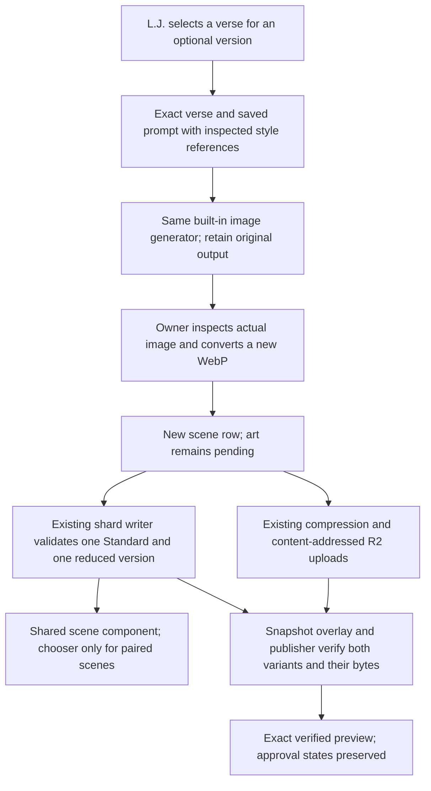
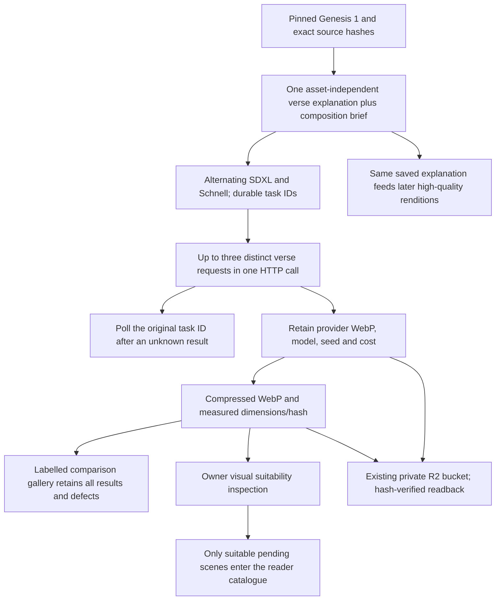
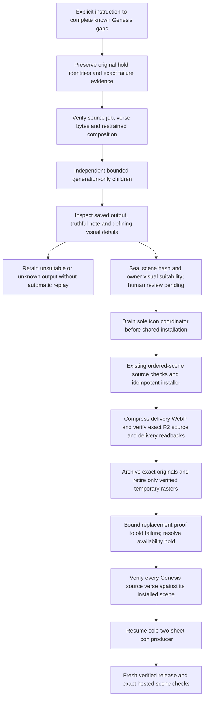

<!-- For God so loved the world, that he gave his only begotten Son, that whosoever believeth in him should not perish, but have everlasting life. — John 3:16 (KJV) -->

# Selective scene versions

Most verses have one shared scene. An optional `variant_chirho: representation_reduced` row adds a second composition; omitted variant means Standard. Each verse has at most one of each, and a reduced scene requires a distinct Standard asset and hash. Only those verses show an English/Spanish chooser. The selected preference is local and optional; a verse without a second image always displays its shared Standard scene. Only the displayed image is requested.

The authoring catalogue stores the variant, actual prompt, tool, style reference, WebP dimensions and hash. The workspace evidence retains the generator original, original hash, exact source text/hash and the user-selected Standard hash. Public shards expose only the scene's existing display fields plus its optional variant. Stored source text is never normalized. The scene count counts image records, including optional versions, rather than distinct verses.

`refresh_sharded_media_chirho.py` refuses duplicates, unknown variants, orphaned reduced versions and aliases of the Standard bytes before writing anything. Unrelated shards are not rewritten. `validateScenesChirho` joins a valid pair independently of record order, and `SceneChirho.svelte` uses a single displayed image with the matching explanatory note. The publisher checks the declared lesson/version identity as well as the existing path, hash, dimensions, chapter and review facts. Missing media keeps the last good shards and the reader keeps its original-language text. Variant generation does not retry or clear any prior held scene/icon attempt, change retry caps, approve art or advance the book-order gate.

## Reusable verse explanations and inexpensive model comparison

L.J., October 31, authorizes Genesis 1 as an alternating SDXL/Flux Schnell comparison. This is independent of the old built-in art producer's held requests and does not clear them or authorize a whole-Bible paid run. `scripts-chirho/art-chirho/comparison-chirho/` prepares the 31 pinned verses, dispatches HTTP batches of up to three, stores every task identity before generation, and reconciles unknown results by `getResponse` on that same ID. It never sends a second generation for a recorded verse. Fixed model IDs, size, steps and output count bound the workload. The local $1 reservation ceiling is conservative bookkeeping, not a provider-enforced quote for compute-priced models. The actual charge is retained from each response.

`recovery-chirho/scene_briefs_chirho.py` stores reusable explanations under `workspace-chirho/art-chirho/briefs-chirho/<book>/chapter-NN-chirho/`, bound to exact verse text and hash. New built-in scene prompts read the existing explanation and return it verbatim, while keeping their actual alt text and imaginative scene relationship specific to the new image. Historical attempts without the extra field still recover unchanged. Replacing an explanation or changing its source requires an explicit new reviewed version; a generator cannot silently rewrite it. These explanations are agent drafts and never become translations or approved exegesis merely because another image reuses them.

## Restrained completion of known Genesis gaps

L.J.'s November 4 instruction authorizes finishing the 17 known missing Genesis scenes. `recovery-chirho/finish_genesis_chirho.py` stages new source-bound, modest or indirect compositions in its own sharded repair queue. Two generation-only children leave the shared catalogue untouched. Original failed requests, unknown identities and retry limits remain intact. A verified text-capacity failure before any image call can resume its original thread with the same model; a saved output is inspected and recovered before considering another image. A known missing visual detail may receive one separately recorded, targeted edit, retaining the rejected original and its failure evidence.

Availability resolution does not erase an original failure or approve the illustration. Scene completion is counted from source membership and verified installed records, separately from icon, pronunciation and human-review holds. An indirect illustration's note names the portion depicted and omitted; it never recasts a grave event as a harmless encounter.
