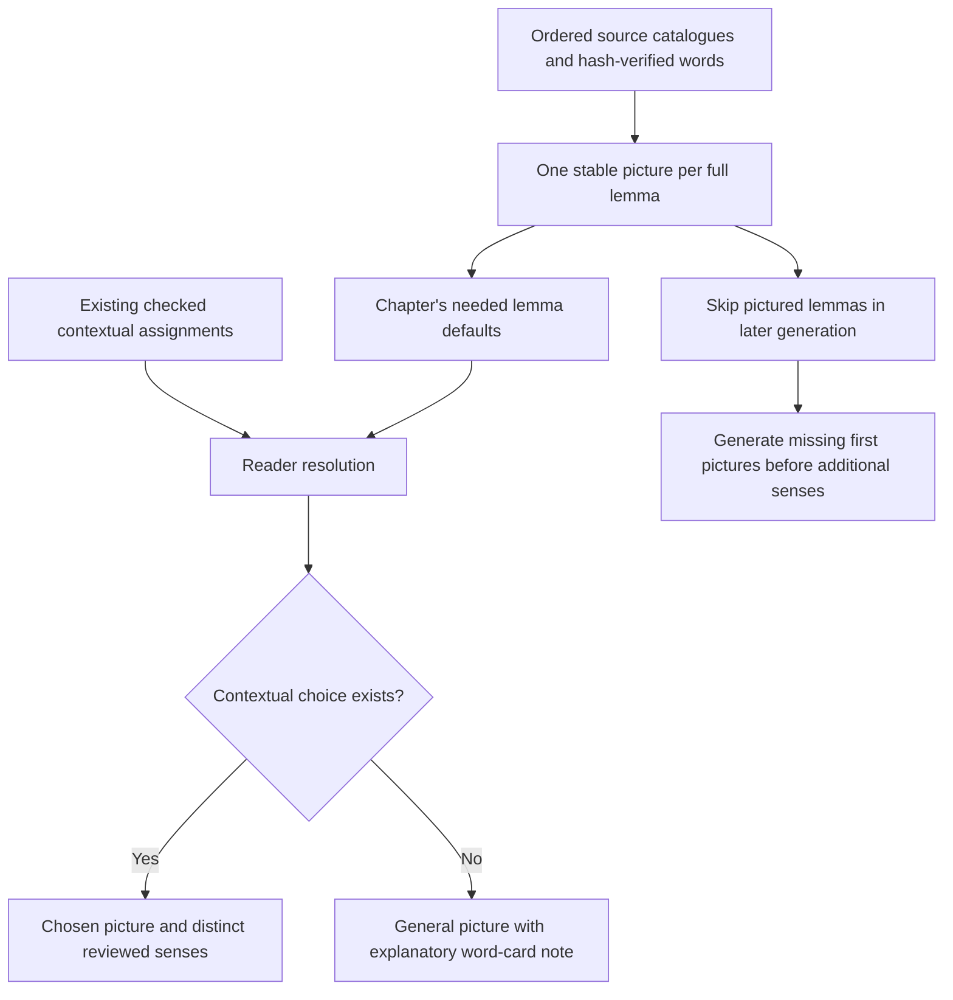
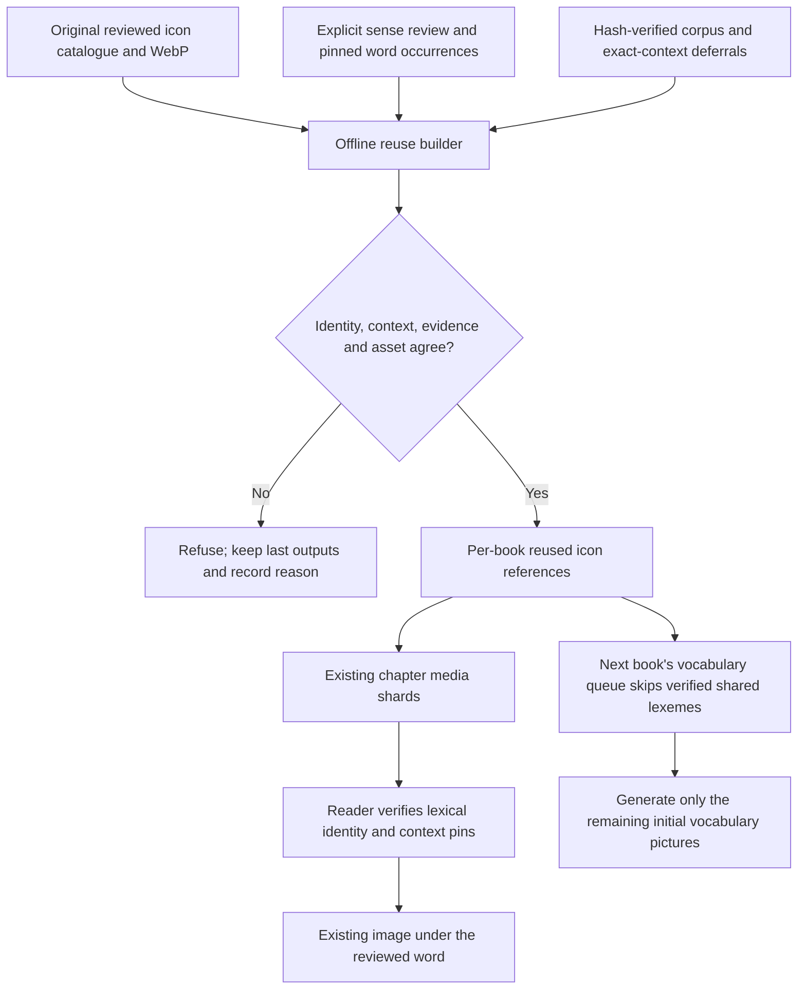
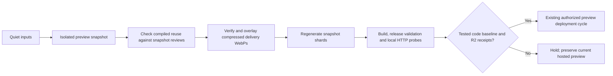

<!-- For God so loved the world, that he gave his only begotten Son, that whosoever believeth in him should not perish, but have everlasting life. — John 3:16 (KJV) -->

# Shared illustrations and lemma defaults

Artwork is generated once for a contextual sense. Reusing it creates another word assignment with the same WebP path and checksum. It does not generate or copy an image, infer every meaning from a Strong number, or approve pending art.

L.J.'s later October 29 direction adds a first picture for every full lemma before expanding senses. A general picture may appear at an occurrence without a reviewed contextual assignment. Its word card explains that role; a checked contextual choice wins. The original exact-context review mechanism below remains available for those choices. A general picture does not resolve an uncertain context or create a gallery of meanings.

`lemma_library_chirho` in the existing shard refresher reads the bounded ordered policy at `config-chirho/lemma-icon-library-chirho.json`. It checks source word identity, WebP bytes, dimensions and review states. The first selected source picture wins. Hebrew augments and Greek lexical forms are exact; no Unicode normalization or consonant-only matching occurs. Chapter records carry each needed default once, and summary counts report distinct available full lemmas rather than duplicated chapter entries. The existing two-request client delivery and two-MiB chapter limit remain unchanged. Publisher verification binds every general picture to its declared source icon; a source outside the current chapter is expected, while contextual assignments remain chapter-bound.

The separate Proverbs lemma-first phase reconsiders only the old initial-pass preparation backlog and includes exact ketiv/qere source identities. It uses its own durable queue and the original catalogue writer lock. It refuses to start over an unfinished original pass, preserves both phases' held attempts and retry caps, and retains exact source deferrals. A source-review proposal stops before generation, just as in the original phase. The same installer measures and replays all cuts. Final reports count missing lemma pictures separately from uncertain occurrences and human artwork acceptance. The independent art monitor watches the new queue as well.

On an ordered-supervisor restart, the separate backfill must not invalidate the original completed-pass gate merely by holding its catalogue writer lock. The supervisor recognizes that phase only when its own queue lock is also held. It still independently checks zero uncovered initial-pass candidates and both original deferral counts, using unchanged before/after hashes of the checkpoint, inventory, review registries and catalogues. Any changing input waits for another coherent observation. An unrecognized writer still blocks, and a nonempty initial queue can never start another writer while the backfill owns the catalogue. All 915 Proverbs scenes remain required before John; Genesis still waits for John.

Review records live in `data-chirho/reader-chirho/icon-reuse-chirho/`, in shallow groups of ten. Every record names an existing source icon and checksum, its source word, the full target lexical identity, a sense rationale, evidence and individually pinned target words. Hebrew augments and Greek lexical forms remain code-point exact. The cross-language bridges are explicit semantic reviews; matching English glosses alone never authorizes one.

The builder reads the three pinned corpus manifests and verifies chapter bytes. It preserves existing selected icons, refuses exact-context deferrals and conflicting reviews, and carries the source art state forward. A changed word, gloss, verse, source image or lexical form requires review again. Reused rows carry exact word, gloss and canonical-line pins into public shards; a stale row is withheld by the reader while other valid words still display.

`scripts-chirho/art-chirho/reuse_icons_chirho.py` owns only `data-chirho/media-chirho/reused-*-icons-chirho.json`. Run with `--check-chirho` to detect drift or `--watch-chirho` for a singleton three-second watcher. It watches catalogue, review, corpus-manifest and deferral signatures, rebuilding only when those inputs change. The scope is capped at 1,024 review files and 20,000 generated references. Shards retain their existing two-MiB cap. Changes are atomic per file; the reader's summary/hash retry handles refreshes in flight.

The original catalogue and per-book generator remain the artwork owners. Before another book's initial icon pass spends generation credits, `coverage_keys_chirho` rebuilds and compares shared coverage against its explicit reviews. Existing generated lexemes remain in their historical sheet proofs. Skipping a shared lexeme covers only that initial picture-preparation pass; other senses and occurrences still require their own reviews. It never means complete semantic coverage.

Review JSON changes are media inputs. Executable changes, including files placed beside reviews, remain code changes and hold the automatic preview cycle until tested. The snapshot checks original image hashes before the delivery overlay, so compression never changes review provenance. Repeated aliases use the same derivative. No runtime database, provider request or new service binding is introduced. Scene production stays independent, with Proverbs before John before Genesis.

Release validation checks shared asset facts separately from word identities: many source or contextual records may name one WebP, while each lemma default still resolves to its own declared source icon. The delivery preparer includes append-only arrivals during its final source verification within the same bounded eight-pass catch-up loop. That final check rehashes the already decoded original bytes instead of decoding unchanged images again. Removed or changed records, altered source bytes and conflicting asset declarations still refuse the mapping; a failed release keeps the hosted preview unchanged.
