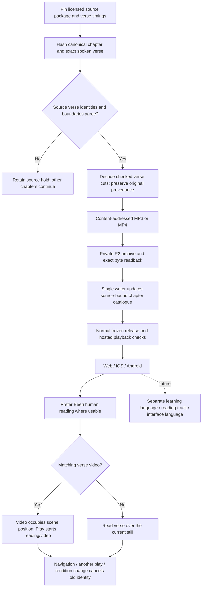
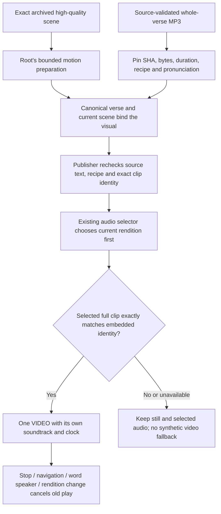
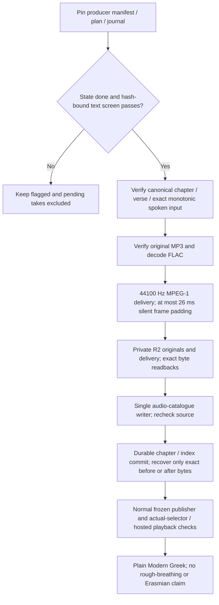
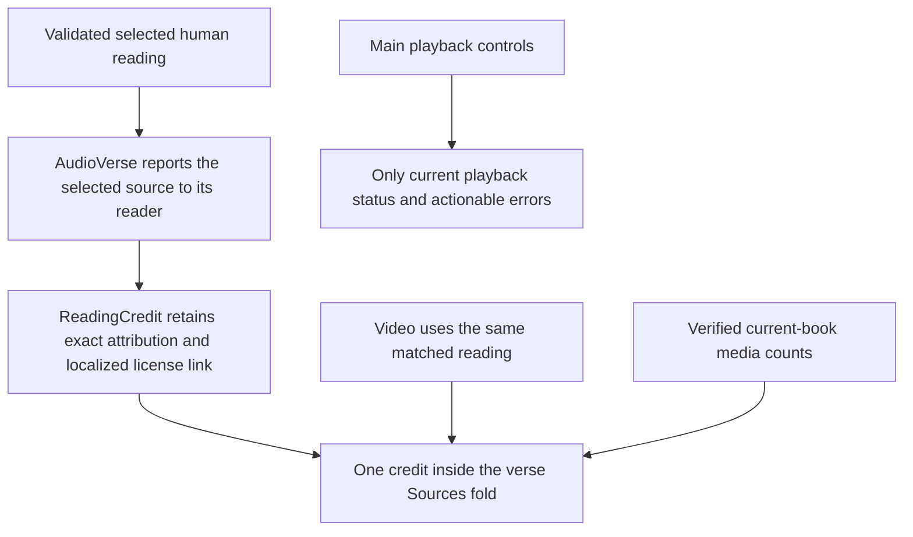
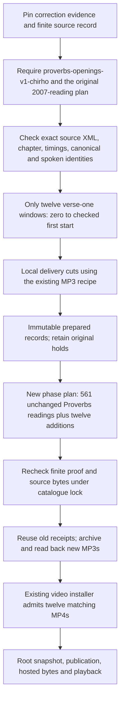
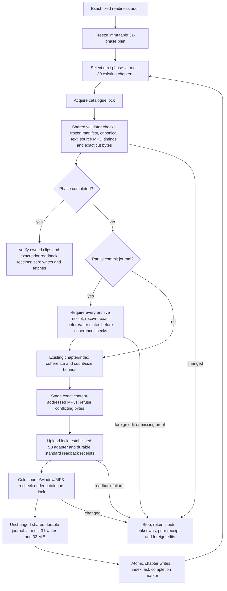
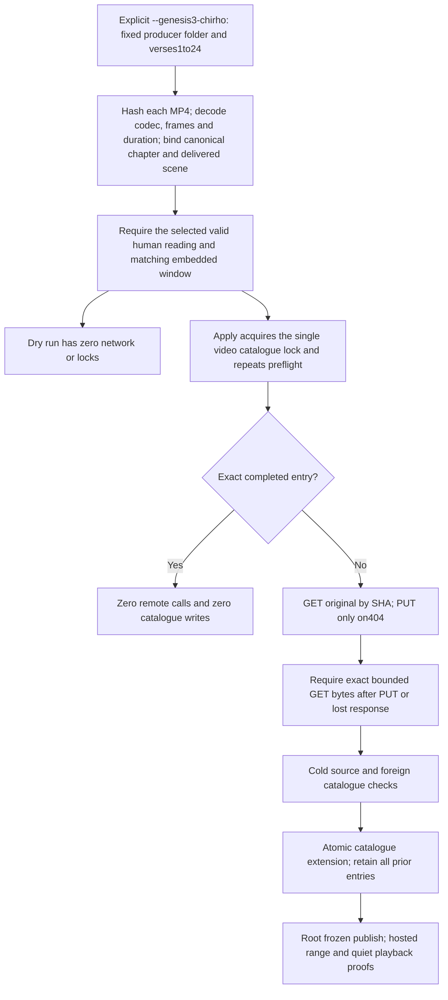
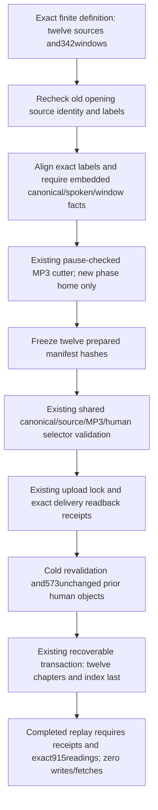
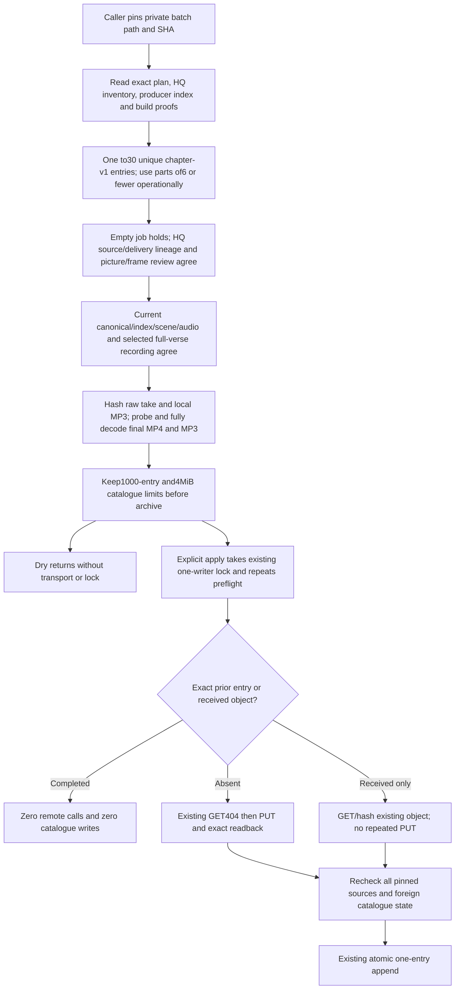
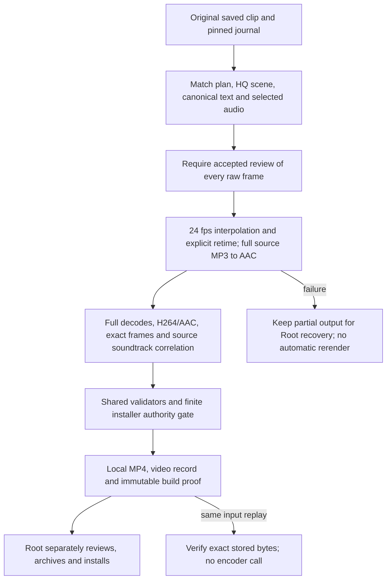

<!-- For God so loved the world, that he gave his only begotten Son, that whosoever believeth in him should not perish, but have everlasting life. — John 3:16 (KJV) -->

# Verse readings and video



Root owns source preparation, R2, catalogue, schema, publisher and iOS. Claude owns Android; Claude2 owns website HTML and the web player. Producers never publish independently. Source preparation has no synthesis or paid-provider POST. New human readings live in readings_chirho, while clips_chirho retains all legacy word/AI clips. Old clients ignore the new array; updated clients require valid human source metadata and show its credit before selecting these readings. Both arrays share the existing combined size/count limits. A whole human reading carries its original CC BY-SA 3.0 attribution and timing hashes; no AI recipe or IPA claim is fabricated. Sample-rate conversion is a delivery derivative and adds no source fidelity. A timing rollover uses the current chapter end, never the next chapter's timestamp. Exact verse-number mismatches or cuts away from measured pauses stay held. Unknown paid generation outcomes and existing retry limits remain independent.

A future translated reading is a separate audio identity from its video. Until a replacement track is verified, use only the named original-language baseline; keep the embedded sound unless a separately selected reading is deliberately chosen. A future learning path can link to lessons, grammar and pronunciation without generating a course in this implementation.

Video originals remain in the producer's folder and are archived without re-encoding. scripts-chirho/video-chirho/install_chirho.ts checks canonical bytes, the delivered scene, a matching selected human reading, codec/dimensions/duration and exact R2 byte readback before adding data-chirho/video-chirho/catalogue-chirho.json. The publisher's video_rules_chirho.ts overlays these records after image delivery/shard refresh, re-hashes the summaries and withholds a video if its scene or source changed. Only verified published records enter the Worker's video hash/length allowlist; MP4s never become Cloudflare static files. The single-range handler returns206with exact Content-Range; invalid ranges/unknown objects do not fetch R2. Changing an embedded reading never silently substitutes a translated track.

Website swipes share the Previous/Next availability rule and existing passage-loading cancellation path. The touch-only action leaves vertical scrolling, pinch and browser edge gestures available, and tracks one finger identity. New touches, multi-touch interruption, cancel and destroy retire transforms and old settle callbacks; the compatibility-click guard is limited to the lift position and never consumes keyboard activation or a new deliberate tap. The native Safari check uses a dedicated simulator and the frozen website, with existing video playback stopped by the same passage change.

## Synthetic verse soundtracks



The additive `embedded_clip_chirho` contains only the published delivery MP3's `sha256_chirho`, `bytes_chirho`, `duration_chirho`, `recipe_id_chirho` and `pronunciation_chirho`. A Greek synthetic record keeps media schema1, declares `reading_language_chirho: "el"` and explicitly sets `embedded_reading_chirho: null`. It carries CC BY4.0 with its exact license link and truthful project attribution. The human CC BY-SA3.0 and silent CC0 branches remain separate, and mixed soundtrack declarations refuse. Existing human records do not need a new key.

Both publisher gates bind synthetic audio to `clips_chirho`, its exact spoken verse, re-derived source recipe, canonical hash and five-field identity. Only an admitted full-verse clip without offsets can supply the soundtrack. The web component exposes the validated pair; the self-contained offline speech controller first selects the compatible current rendition, then compares its MP3 SHA. A Modern video never overrides a saved Erasmian or unavailable rough-breathing choice. Existing allowed non-rough Modern compatibility is preserved. Encoding tolerance stays at0.3seconds; exact soundtrack proof remains the producer/release check.

Old Android0.1.4 and iOS0.1.2 DTOs ignore the additive key and withhold the unsupported Greek video, preserving scene, pictures and audio. Never put a synthetic object inside the old human-source field: the old iOS decoder would reject the chapter. Updated native implementations must make the new descriptor optional/default-null and require resolved selected audio for synthetic playback; their historical human-only fallback does not admit synthetic audio.

Root owns the new HQ-first queue, bounded installer scopes and catalogue sharding. This shared contract does not alter the old Proverbs/Genesis installer scopes,1000-entry/4MiB catalogue cap, retry holds, generation budgets or voice policy. No new video is authorized merely by a valid descriptor.

## Local Greek verse recordings



Only done rows are eligible, even when an excluded row has a chosen take. Automated text screening does not establish listener acceptance; clips remain audition. The local Chatterbox V3 recipe preserves canonical text and separately re-derives the producer's modern monotonic spelling. Existing pronunciation compatibility stays in force: plain Modern may serve the aspirates choice only when the source has no rough breathing. The default rendition is unchanged. Original FLAC headers need not declare duration; preparation measures decoded samples. Original evidence is private, content addressed and never exposed through the public audio route. A partial catalogue commit resumes only with its frozen input binding and each destination's exact before/after hash; foreign edits are held. No synthesis, retake, quota reset or provider spending belongs to installation.

The November 8 chapter-opening adapter supplies the same DAG with a separately pinned 259-job plan and five frozen evidence files (plan, manifest, journal, ASR and finite handoff). Only its 256 screened seed-1 takes enter; John 3:1, Acts 28:1 and 1 Corinthians 13:1 remain held. The input carries its original batch home explicitly, while earlier imports keep their existing home. The shared recipe, source validation, encoder, archive/readback and catalogue transaction are unchanged. See `scripts-chirho/audio-chirho/local-greek-chirho/README-chirho.md` for the bounded commands and exact manifest identity.

These openings apply through small catalogue parts of at most six chapters plus the manifest, with a separate prepared subset and recovery binding per part. The existing 31-write and 32 MiB transaction/recovery bounds remain. Replaying a completed part preserves later additions; a changed prepared subset or foreign catalogue edit refuses. An initial oversized whole-batch intent was refused before any catalogue write and remains preserved as failed-attempt evidence, rather than being repurposed for a smaller part.

## November 8 credit and statistics placement



The source contracts and validators do not change when the credit moves. The exact published Be’eri attribution remains English, as before, with a localized License link. The main playback area no longer repeats the full credit. The existing current-book art count moves from the passage chooser to the last item in Sources; its data and readiness condition are unchanged. General meanings/root/AI-study-aid explanations link to About. Whole-verse playback, Normal default speed, video/reading identity and cancellation behavior remain available.

## Finite corrected Proverbs openings



The shared finite record is data-chirho/audio-chirho/beeri-opening-corrections-chirho.json, pinned by both the Python preparer and TypeScript installer. It derives from the source-bound opening-offset evidence with SHA-256 81fe48d0ce938153a6c4ba121eee87e48b23bc0130bc08aa40208ce613d38eba. Exactly Proverbs 3, 9, 11, 12, 13, 15, 16, 19, 24, 25, 27 and 30 are covered, and only their first verses. No count-based shift is applied elsewhere, and the remainder of those chapters stays outside this phase.

The phase is local-only: it reads preserved source chapter files and does not download packages or synthesize speech. Each new cut keeps its canonical/spoken hashes, source package/chapter/timings/window, and the correction evidence identity. The twelve original hold files, raw timings, prior recordings and install-gen-prov-plan-chirho.json remain unchanged. Phase progress goes to proverbs-openings-v1-progress-chirho.json. Missing or changed proof refuses; a partial local preparation resumes only from identical prepared records.

Installation requires --books-chirho Prov --phase-chirho proverbs-openings-v1-chirho. Its new immutable install-prov-openings-v1-plan-chirho.json contains every prior Proverbs reading unchanged and exactly the twelve additions. The installer rechecks finite source and derivative hashes under the existing catalogue lock, retains normal human-recording validation, and reuses existing archive receipts without rewriting unrelated or unknown receipts. The ordinary non-phase timing path remains unchanged and never interprets a correction marker implicitly.

After the twelve readings are archived and installed, the existing video installer can admit the already rebuilt twelve MP4s. No additional video generation or encoding is needed. Root retains all actual preparation, archive, catalogue, publication and progress-DB ownership. These media additions alone do not require another native binary for clients that already support the current human/video contracts.

Run from the repository root. First command is read-only; root adds --apply-chirho only for the authorized local cuts:

```sh
rtk proxy /opt/homebrew/bin/python3 -I -B scripts-chirho/audio-chirho/readings-chirho/beeri_prepare_chirho.py --run-chirho workspace-chirho/audio-chirho/beeri-verses-2026-11-07-chirho --manifest-chirho build-chirho/verse-media-2026-11-07-chirho/gbt-audio-manifest-chirho.jsonl --books-chirho Prov --phase-chirho proverbs-openings-v1-chirho
rtk proxy /opt/homebrew/bin/python3 -I -B scripts-chirho/audio-chirho/readings-chirho/beeri_prepare_chirho.py --run-chirho workspace-chirho/audio-chirho/beeri-verses-2026-11-07-chirho --manifest-chirho build-chirho/verse-media-2026-11-07-chirho/gbt-audio-manifest-chirho.jsonl --books-chirho Prov --phase-chirho proverbs-openings-v1-chirho --apply-chirho
rtk proxy bun scripts-chirho/audio-chirho/readings-chirho/install_chirho.ts --run-chirho workspace-chirho/audio-chirho/beeri-verses-2026-11-07-chirho --books-chirho Prov --phase-chirho proverbs-openings-v1-chirho
```

The installation dry run must report 573 prepared readings in 31 Proverbs chapters before root applies with its privately derived exact --confirm-chirho target. It must not rewrite the old Gen/Prov phase plan. After exact R2 proof and installation, root runs the existing scripts-chirho/video-chirho/install_chirho.ts dry/apply pair, then the normal frozen publisher and hosted verification. Until that occurs, the twelve openings remain prepared implementation work, not published media.

The fixed November8 Greek continuation imports exactly24new screened takes (21seed2retakes and3seed1firsttakes) through the same archive and durable catalogue transaction. Both the old1084import and this phase read preserved manifest/plan/journal snapshots, so later producer appends cannot invalidate completed replay. The original v1wrapper remains seed1-only; the finite handoff wrapper separately binds every seed2take to its exact source, request, result, raw audio and passing screen. The four failed retakes, unscreened jobs and unknown outcomes remain excluded. Details and the immutable snapshot hashes are in scripts-chirho/audio-chirho/local-greek-chirho/README-chirho.md. No synthesis or provider spending belongs to either import.

## Bounded other-book human readings

The next human-reading import contains exactly 11,451 already-prepared readings in 445 existing chapters. The fixed readiness audit pins every prepared manifest, canonical chapter and original source chapter. Ezra 5 and Daniel 7 remain excluded (45 readings), and all 3,941 source holds stay held. Obadiah is the first phase: 21 readings in one chapter. The remaining phases retain canonical book/chapter order and use no inferred timing changes.



Root commands, from the real repository root after the scratch patch is reviewed and landed:

```sh
bun scripts-chirho/audio-chirho/readings-chirho/bounded_plan_chirho.ts
bun scripts-chirho/audio-chirho/readings-chirho/bounded_plan_chirho.ts --freeze-chirho
bun scripts-chirho/audio-chirho/readings-chirho/bounded_install_chirho.ts --phase-chirho batch-001-chirho
bun scripts-chirho/audio-chirho/readings-chirho/bounded_install_chirho.ts --phase-chirho batch-001-chirho --apply-chirho --confirm-chirho hinneh.us@84bd
bun scripts-chirho/audio-chirho/readings-chirho/bounded_install_chirho.ts --all-chirho
bun scripts-chirho/audio-chirho/readings-chirho/bounded_install_chirho.ts --all-chirho --apply-chirho --confirm-chirho hinneh.us@84bd
```

Run the actual Obadiah archive/install/selector/publication vertical before the all-phases apply. The background command is sequential and stops at the first error. Re-running the same all-phases command starts with disk-backed completed replay and recovers a partial phase before proceeding. The old generic entry point refuses other-book apply; its Gen/Prov flows remain available, including the explicit corrected Proverbs phase.

The immutable plan lives under workspace-chirho/audio-chirho/beeri-verses-2026-11-07-chirho/bounded-other-books-v1-chirho/plan-chirho.json. Phase state is shallow-sharded under phases-chirho/000-chirho, 010-chirho, 020-chirho and 030-chirho. The unchanged shared catalogue helper requires existing regular destinations, preserves foreign edits, and retains its 31-write and 32-MiB recovery ceilings. The new runner checks aggregate journal size before archive and does not raise a bound.

A private fake-S3 proof used copies of the 21 actual Obadiah cuts and canonical/source inputs. It made 42 local stub calls, then a fresh process completed with zero writes and zero fetches while storage keys were absent. This is fixture evidence, not a real R2 readback, production import or listener acceptance. The actual R2/archive/install/deploy remains root's work.

## Existing Genesis 3 video installation



The default scope still replays the31Proverbs openings. Genesis3 requires the explicit fixed scope and accepts at most24records. There is no arbitrary producer-folder argument. Source MP4s stay private/R2 and are not re-encoded. The first handoff has23records, with3:3 deliberately absent until its corrected scene and replacement clip are ready. A changed canonical source, displayed scene, selected reading, file or foreign catalogue stops installation before publication. The catalogue remains bounded to1000entries and4MiB. Completed replay verifies the source and catalogue without object-store calls; an uncertain upload is reconciled by its content-addressed GET before any new PUT. No synthesis, generation, retry reset or paid spending belongs to this installer.

Unattended browser and native playback proofs must be silent. The test harness sets native element volume0 before every attached or detached play, verifies the getter and forbids device speech; native emulators use no-audio output. Quiet timing/decoder/state checks do not establish audible output or listener acceptance. Product and system volume defaults remain unchanged.

## Remaining verses in the twelve corrected Proverbs chapters

The explicit `proverbs-remainder-v1-chirho` phase adds only verses 2 through the last verse in chapters 3, 9, 11, 12, 13, 15, 16, 19, 24, 25, 27 and 30: 342 recordings. The immutable definition embeds their canonical/spoken hashes and exact windows. It pins the earlier twelve-opening definition and the same chapter, package and timing hashes. The old opening evidence is checked before mapping label k to verse k+1. Count differences alone never authorize a shift. The final verse ends at the pinned decoded source duration.



Outputs and transaction state live in `workspace-chirho/audio-chirho/beeri-verses-2026-11-07-chirho/proverbs-remainder-v1-chirho/`. The original source, snapshots, opening-only manifests, historical holds and receipts remain unchanged. Preparation reads the old source and snapshots; it creates only the new phase's chapter cuts and manifests. Existing archived source originals are reused without reupload. The install preserves every old human reading and all word/video metadata. The other-book `--all-chirho` command does not include this new phase.

Root runs the following only after the candidate source is reviewed and landed. Preparation is local cutting, with no synthesis or catalogue change; the default commands remain dry. The immutable plan is frozen only after all twelve manifests are complete.

```sh
rtk proxy python3 -I -B scripts-chirho/audio-chirho/readings-chirho/beeri_prepare_chirho.py --run-chirho workspace-chirho/audio-chirho/beeri-verses-2026-11-07-chirho --manifest-chirho build-chirho/verse-media-2026-11-07-chirho/gbt-audio-manifest-chirho.jsonl --books-chirho Prov --phase-chirho proverbs-remainder-v1-chirho
rtk proxy python3 -I -B scripts-chirho/audio-chirho/readings-chirho/beeri_prepare_chirho.py --run-chirho workspace-chirho/audio-chirho/beeri-verses-2026-11-07-chirho --manifest-chirho build-chirho/verse-media-2026-11-07-chirho/gbt-audio-manifest-chirho.jsonl --books-chirho Prov --phase-chirho proverbs-remainder-v1-chirho --apply-chirho
rtk proxy bun scripts-chirho/audio-chirho/readings-chirho/proverbs_phase_chirho.ts --freeze-chirho
rtk proxy bun scripts-chirho/audio-chirho/readings-chirho/bounded_install_chirho.ts --phase-chirho proverbs-remainder-v1-chirho
rtk proxy bun scripts-chirho/audio-chirho/readings-chirho/bounded_install_chirho.ts --phase-chirho proverbs-remainder-v1-chirho --apply-chirho --confirm-chirho hinneh.us@84bd
```

The shared archive/transaction implementation retains its existing chapter, byte and recovery bounds. A partial commit is recovered from its durable before/after journal after checking archive receipts. Foreign edits or missing proof stop recovery; no unknown request is resent. Root separately verifies actual selection, unchanged prior bodies, publication and hosted delivery. Automated identity and decoder checks do not establish listener acceptance.

## Explicit finite chapter-opening video installation



The generic `--batch-chirho <relative-json-path> --batch-sha256-chirho <sha256>` mode is separate from the unchanged default Proverbs and explicit Genesis3 modes; flags cannot be mixed. A batch has schema1 and `source_plan_chirho`, `source_inventory_chirho`, `source_records_chirho` pins (each path plus SHA), then `entries_chirho`. Each entry names `lesson_id_chirho`, `mp4_path_chirho`, `audio_path_chirho` and a `build_proof_chirho` path/SHA. Source plan jobs and original video records are read without modification; no private plan, provider job ID or budget is built into public source.

Every selected position must have exactly one planned job, inventory row and producer video. It must be verse1 of a valid existing chapter. The source/delivery HQ identity, accepted picture review, empty generation holds, selected audio and accepted raw-frame composition proof must agree. The build proof pins the original raw clip and whole MP3 bytes, the exact video object, full decode and the measured soundtrack match (correlation at least0.998 with absolute lag at most10ms). Installation checks those bytes and current catalogue sources again; a new silent placeholder, changed source or incompatible rendition refuses before archive. Human composites retain CC BY-SA3.0, synthetic composites CC BY4.0. Automated/frame checks remain distinct from L.J.'s acceptance.

At most30 distinct chapter openings enter one invocation, with source indices and metadata independently bounded. Root should prepare immutable parts of at most6 entries when running beside other workers. The existing per-entry atomic append already recovers partial completion; a completed replay makes no archive call, and an object received before a source-change refusal is reconciled by GET. The1000-entry/4MiB catalogue limits remain unchanged. Sharding is required before the later OT tail crosses either cap and is outside this installer change. No speech synthesis, paid motion request, catalogue regeneration or provider retry belongs to this mode.

### Shared admission for finite video and money preflight

The network reader and finite video installer use `recordingsFromChapterChirho` for the same admission and ordering. The automatic full-verse choice is made after admission and before the stricter embedded-video match. A valid preferred legacy clip without a recipe may therefore cause a recipe-bound video candidate to be refused; the installer never chooses another recording merely to fit that video. Profile-scoped verse claims remain withheld.

The bounded Bun bridge `scripts-chirho/video-chirho/selected_recording_chirho.ts` accepts one `lesson_id_chirho`, exact UTF-8 `content_chapter_json_chirho` and `audio_chapter_json_chirho` strings, and their `content_sha256_chirho` / `audio_sha256_chirho` pins on stdin (four MiB maximum, at most 2,000 audio rows). It hashes and parses those two bounded chapter bodies, checks their content/audio binding, selects the one raw verse, and outputs one selected delivery/window identity or null using those same rules. `raw_whole_verse_shape_chirho` also records explicit `token_id_chirho:null` and absent human-source/offset keys. It performs no fetch, provider request, credential lookup or source-file read. The caller must first verify the chapter/content bytes and compare the planned audio's delivery/window identity exactly. It is a source-selection check, not permission to generate or publish.

### Saved chapter-opening composition

`compose_opening_chirho.ts` composes one explicit pinned subset of at most six jobs. It has no fetch, provider-client or credential path. Inputs name the immutable plan/inventory, original requested/received/saved journal snapshot, local original clip, accepted all-frame review, pinned content/audio/media chapters, exact local copies of the hosted scene and whole-verse MP3, and a dedicated private output part. The selected source must still be the reader's automatic choice. A missing or held source is refused without a substitute.



The picture uses the existing `minterpolate`/`setpts=N/(24*TB)` method and H264 settings. Audio is the complete selected hosted MP3, with no offsets, trim, speed change or silent fallback. The synthetic descriptor copies the original MP3 duration verbatim and carries CC BY4; the human branch copies the original Be'eri source/window and CC BY-SA3. All source byte hashes are rechecked before completion. A completed composition replays only when its input identity and files remain exact. An incomplete or changed directory is retained and refused. The free Genesis1:1 reuse remains a separately preserved candidate and is never rebuilt by this workflow.

An explicitly reviewed retained range may be declared in the pinned raw-frame review as `retained_frame_range_chirho: { start_chirho, end_chirho }`, using zero-based `[start, end)` frame indices. Both are integers within the actual original frame count, with at least two retained frames. `all_frames_chirho` continues to identify the complete original raw clip, which is never overwritten. Without this field the complete clip is used; no range is chosen automatically.

The range branch trims those exact source frames before interpolation and retimes their first-to-last timestamp span to the verse target. Two explicitly recorded cloned context frames follow the last endpoint beyond the target time for the motion estimator; the fixed output frame count prevents that context from becoming a visible freeze extension. There is no alternative freeze-frame or provider fallback if encoding or validation fails. The build proof records the full raw SHA/count, retained range/count/span and interpolation context. The selected whole MP3, runtime video contract and licensing rules remain unchanged. Root alone approves a retained range; late visual defects do not authorize replacement calls.

The same pinned review may explicitly declare `retained_crop_chirho: { x_chirho, y_chirho, width_chirho, height_chirho }` and/or `camera_end_zoom_chirho`. Crop values are even integers inside the fully decoded original dimensions, with both retained dimensions at least two pixels. The crop is applied before retiming and scaled back to the original output dimensions. Camera zoom is a finite number from1 through1.08; after retiming, centered deterministic24fps `zoompan` advances from1 to the declared endpoint over the exact target frame count (`d=1`). There is no arbitrary filter field, inferred crop, newly generated picture or automatic repair. Root reviews the resulting transformed video before accepting it. The proof preserves full original raw SHA/count/range and the declared crop/zoom. Explicit transforms use the v3 composition identity; absent crop/zoom retains the v2 identity, replay and exact rendering chain. Existing completed outputs and all earlier frozen snapshots stay unchanged.

Earlier HTTP400 refusals remain refused by default. An optional pinned `reconciliation_chirho` document may attest `kind_chirho: original_uuid_completion_after_http400_chirho` for later completion of the exact original UUID. It pins the original journal, lesson/plan/scene/UUID, requested event hash, ordered refused-event hashes, later received/saved hashes and raw SHA/bytes. Each event hash is SHA-256 of UTF-8 `JSON.stringify(parsedEvent)` with the parsed event's key order. The combined snapshot must retain the complete original journal as a byte-for-byte prefix and keep one original request, the earlier HTTP400 `concurrentRequestLimitExceeded` history, one strictly later received and one saved event in order. Any new UUID, omitted refusal or changed fact is refused. This is original-result reconciliation, never authority for another inference or retry; the proof preserves both journal identities.
