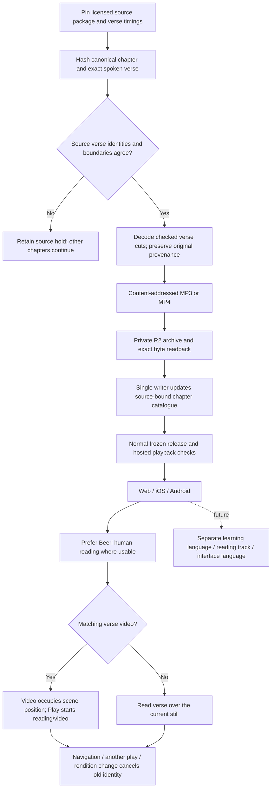

<!-- For God so loved the world, that he gave his only begotten Son, that whosoever believeth in him should not perish, but have everlasting life. — John 3:16 (KJV) -->

# Verse readings and video

Root owns source preparation, R2, catalogue, schema, publisher and iOS. Claude owns Android; Claude2 owns website HTML and the web player. Producers never publish independently. Source preparation has no synthesis or paid-provider POST. New human readings live in readings_chirho, while clips_chirho retains all legacy word/AI clips. Old clients ignore the new array; updated clients require valid human source metadata and show its credit before selecting these readings. Both arrays share the existing combined size/count limits. A whole human reading carries its original CC BY-SA 3.0 attribution and timing hashes; no AI recipe or IPA claim is fabricated. Sample-rate conversion is a delivery derivative and adds no source fidelity. A timing rollover uses the current chapter end, never the next chapter's timestamp. Exact verse-number mismatches or cuts away from measured pauses stay held. Unknown paid generation outcomes and existing retry limits remain independent.

A future translated reading is a separate audio identity from its video. Until a replacement track is verified, use only the named original-language baseline; keep the embedded sound unless a separately selected reading is deliberately chosen. A future learning path can link to lessons, grammar and pronunciation without generating a course in this implementation.
