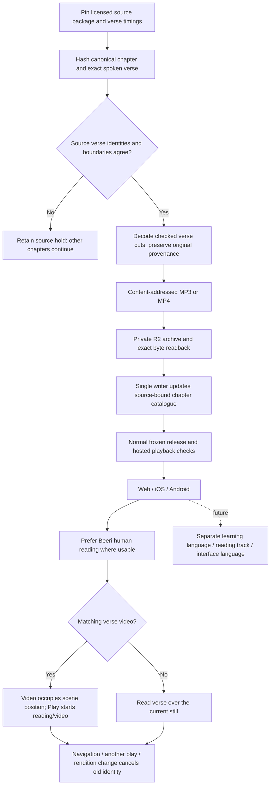
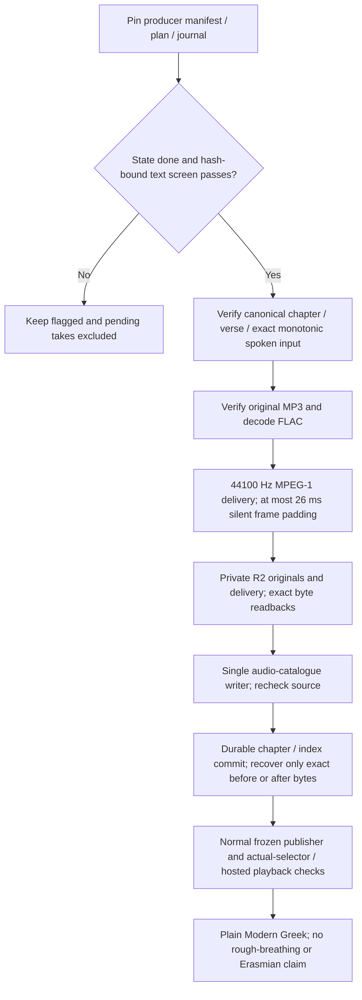
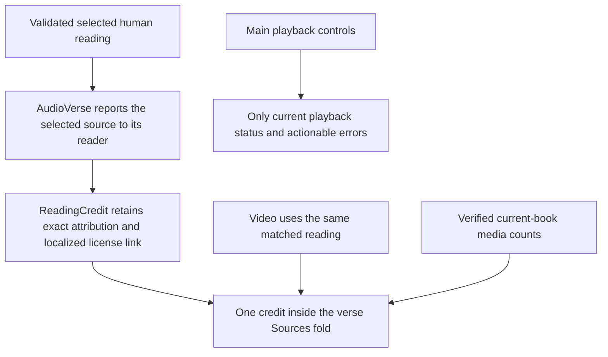
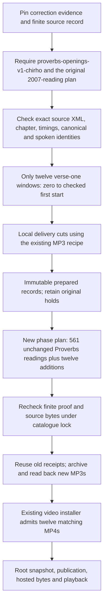
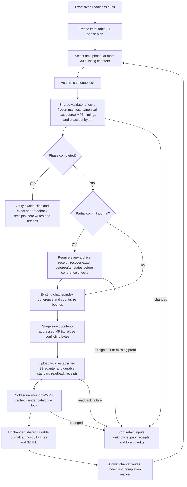

<!-- For God so loved the world, that he gave his only begotten Son, that whosoever believeth in him should not perish, but have everlasting life. — John 3:16 (KJV) -->

# Verse readings and video



Root owns source preparation, R2, catalogue, schema, publisher and iOS. Claude owns Android; Claude2 owns website HTML and the web player. Producers never publish independently. Source preparation has no synthesis or paid-provider POST. New human readings live in readings_chirho, while clips_chirho retains all legacy word/AI clips. Old clients ignore the new array; updated clients require valid human source metadata and show its credit before selecting these readings. Both arrays share the existing combined size/count limits. A whole human reading carries its original CC BY-SA 3.0 attribution and timing hashes; no AI recipe or IPA claim is fabricated. Sample-rate conversion is a delivery derivative and adds no source fidelity. A timing rollover uses the current chapter end, never the next chapter's timestamp. Exact verse-number mismatches or cuts away from measured pauses stay held. Unknown paid generation outcomes and existing retry limits remain independent.

A future translated reading is a separate audio identity from its video. Until a replacement track is verified, use only the named original-language baseline; keep the embedded sound unless a separately selected reading is deliberately chosen. A future learning path can link to lessons, grammar and pronunciation without generating a course in this implementation.

Video originals remain in the producer's folder and are archived without re-encoding. scripts-chirho/video-chirho/install_chirho.ts checks canonical bytes, the delivered scene, a matching selected human reading, codec/dimensions/duration and exact R2 byte readback before adding data-chirho/video-chirho/catalogue-chirho.json. The publisher's video_rules_chirho.ts overlays these records after image delivery/shard refresh, re-hashes the summaries and withholds a video if its scene or source changed. Only verified published records enter the Worker's video hash/length allowlist; MP4s never become Cloudflare static files. The single-range handler returns206with exact Content-Range; invalid ranges/unknown objects do not fetch R2. Changing an embedded reading never silently substitutes a translated track.

Website swipes share the Previous/Next availability rule and existing passage-loading cancellation path. The touch-only action leaves vertical scrolling, pinch and browser edge gestures available, and tracks one finger identity. New touches, multi-touch interruption, cancel and destroy retire transforms and old settle callbacks; the compatibility-click guard is limited to the lift position and never consumes keyboard activation or a new deliberate tap. The native Safari check uses a dedicated simulator and the frozen website, with existing video playback stopped by the same passage change.

## Local Greek verse recordings



Only done rows are eligible, even when an excluded row has a chosen take. Automated text screening does not establish listener acceptance; clips remain audition. The local Chatterbox V3 recipe preserves canonical text and separately re-derives the producer's modern monotonic spelling. Existing pronunciation compatibility stays in force: plain Modern may serve the aspirates choice only when the source has no rough breathing. The default rendition is unchanged. Original FLAC headers need not declare duration; preparation measures decoded samples. Original evidence is private, content addressed and never exposed through the public audio route. A partial catalogue commit resumes only with its frozen input binding and each destination's exact before/after hash; foreign edits are held. No synthesis, retake, quota reset or provider spending belongs to installation.

## November 8 credit and statistics placement



The source contracts and validators do not change when the credit moves. The exact published Be’eri attribution remains English, as before, with a localized License link. The main playback area no longer repeats the full credit. The existing current-book art count moves from the passage chooser to the last item in Sources; its data and readiness condition are unchanged. General meanings/root/AI-study-aid explanations link to About. Whole-verse playback, Normal default speed, video/reading identity and cancellation behavior remain available.

## Finite corrected Proverbs openings



The shared finite record is data-chirho/audio-chirho/beeri-opening-corrections-chirho.json, pinned by both the Python preparer and TypeScript installer. It derives from the source-bound opening-offset evidence with SHA-256 81fe48d0ce938153a6c4ba121eee87e48b23bc0130bc08aa40208ce613d38eba. Exactly Proverbs 3, 9, 11, 12, 13, 15, 16, 19, 24, 25, 27 and 30 are covered, and only their first verses. No count-based shift is applied elsewhere, and the remainder of those chapters stays outside this phase.

The phase is local-only: it reads preserved source chapter files and does not download packages or synthesize speech. Each new cut keeps its canonical/spoken hashes, source package/chapter/timings/window, and the correction evidence identity. The twelve original hold files, raw timings, prior recordings and install-gen-prov-plan-chirho.json remain unchanged. Phase progress goes to proverbs-openings-v1-progress-chirho.json. Missing or changed proof refuses; a partial local preparation resumes only from identical prepared records.

Installation requires --books-chirho Prov --phase-chirho proverbs-openings-v1-chirho. Its new immutable install-prov-openings-v1-plan-chirho.json contains every prior Proverbs reading unchanged and exactly the twelve additions. The installer rechecks finite source and derivative hashes under the existing catalogue lock, retains normal human-recording validation, and reuses existing archive receipts without rewriting unrelated or unknown receipts. The ordinary non-phase timing path remains unchanged and never interprets a correction marker implicitly.

After the twelve readings are archived and installed, the existing video installer can admit the already rebuilt twelve MP4s. No additional video generation or encoding is needed. Root retains all actual preparation, archive, catalogue, publication and progress-DB ownership. These media additions alone do not require another native binary for clients that already support the current human/video contracts.

Run from the repository root. First command is read-only; root adds --apply-chirho only for the authorized local cuts:

```sh
rtk proxy /opt/homebrew/bin/python3 -I -B scripts-chirho/audio-chirho/readings-chirho/beeri_prepare_chirho.py --run-chirho workspace-chirho/audio-chirho/beeri-verses-2026-11-07-chirho --manifest-chirho build-chirho/verse-media-2026-11-07-chirho/gbt-audio-manifest-chirho.jsonl --books-chirho Prov --phase-chirho proverbs-openings-v1-chirho
rtk proxy /opt/homebrew/bin/python3 -I -B scripts-chirho/audio-chirho/readings-chirho/beeri_prepare_chirho.py --run-chirho workspace-chirho/audio-chirho/beeri-verses-2026-11-07-chirho --manifest-chirho build-chirho/verse-media-2026-11-07-chirho/gbt-audio-manifest-chirho.jsonl --books-chirho Prov --phase-chirho proverbs-openings-v1-chirho --apply-chirho
rtk proxy bun scripts-chirho/audio-chirho/readings-chirho/install_chirho.ts --run-chirho workspace-chirho/audio-chirho/beeri-verses-2026-11-07-chirho --books-chirho Prov --phase-chirho proverbs-openings-v1-chirho
```

The installation dry run must report 573 prepared readings in 31 Proverbs chapters before root applies with its privately derived exact --confirm-chirho target. It must not rewrite the old Gen/Prov phase plan. After exact R2 proof and installation, root runs the existing scripts-chirho/video-chirho/install_chirho.ts dry/apply pair, then the normal frozen publisher and hosted verification. Until that occurs, the twelve openings remain prepared implementation work, not published media.

The fixed November8 Greek continuation imports exactly24new screened takes (21seed2retakes and3seed1firsttakes) through the same archive and durable catalogue transaction. Both the old1084import and this phase read preserved manifest/plan/journal snapshots, so later producer appends cannot invalidate completed replay. The original v1wrapper remains seed1-only; the finite handoff wrapper separately binds every seed2take to its exact source, request, result, raw audio and passing screen. The four failed retakes, unscreened jobs and unknown outcomes remain excluded. Details and the immutable snapshot hashes are in scripts-chirho/audio-chirho/local-greek-chirho/README-chirho.md. No synthesis or provider spending belongs to either import.

## Bounded other-book human readings

The next human-reading import contains exactly 11,451 already-prepared readings in 445 existing chapters. The fixed readiness audit pins every prepared manifest, canonical chapter and original source chapter. Ezra 5 and Daniel 7 remain excluded (45 readings), and all 3,941 source holds stay held. Obadiah is the first phase: 21 readings in one chapter. The remaining phases retain canonical book/chapter order and use no inferred timing changes.



Root commands, from the real repository root after the scratch patch is reviewed and landed:

```sh
bun scripts-chirho/audio-chirho/readings-chirho/bounded_plan_chirho.ts
bun scripts-chirho/audio-chirho/readings-chirho/bounded_plan_chirho.ts --freeze-chirho
bun scripts-chirho/audio-chirho/readings-chirho/bounded_install_chirho.ts --phase-chirho batch-001-chirho
bun scripts-chirho/audio-chirho/readings-chirho/bounded_install_chirho.ts --phase-chirho batch-001-chirho --apply-chirho --confirm-chirho hinneh.us@84bd
bun scripts-chirho/audio-chirho/readings-chirho/bounded_install_chirho.ts --all-chirho
bun scripts-chirho/audio-chirho/readings-chirho/bounded_install_chirho.ts --all-chirho --apply-chirho --confirm-chirho hinneh.us@84bd
```

Run the actual Obadiah archive/install/selector/publication vertical before the all-phases apply. The background command is sequential and stops at the first error. Re-running the same all-phases command starts with disk-backed completed replay and recovers a partial phase before proceeding. The old generic entry point refuses other-book apply; its Gen/Prov flows remain available, including the explicit corrected Proverbs phase.

The immutable plan lives under workspace-chirho/audio-chirho/beeri-verses-2026-11-07-chirho/bounded-other-books-v1-chirho/plan-chirho.json. Phase state is shallow-sharded under phases-chirho/000-chirho, 010-chirho, 020-chirho and 030-chirho. The unchanged shared catalogue helper requires existing regular destinations, preserves foreign edits, and retains its 31-write and 32-MiB recovery ceilings. The new runner checks aggregate journal size before archive and does not raise a bound.

A private fake-S3 proof used copies of the 21 actual Obadiah cuts and canonical/source inputs. It made 42 local stub calls, then a fresh process completed with zero writes and zero fetches while storage keys were absent. This is fixture evidence, not a real R2 readback, production import or listener acceptance. The actual R2/archive/install/deploy remains root's work.
