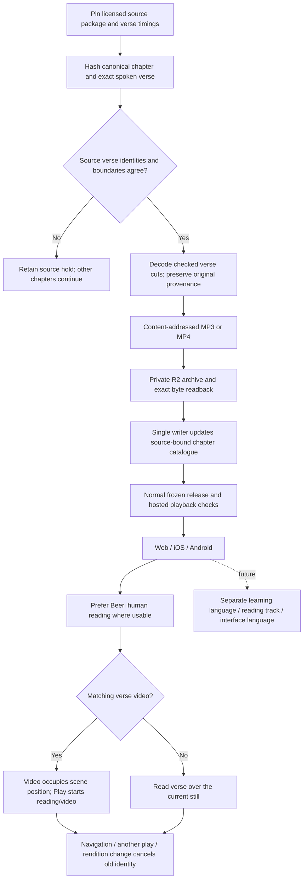
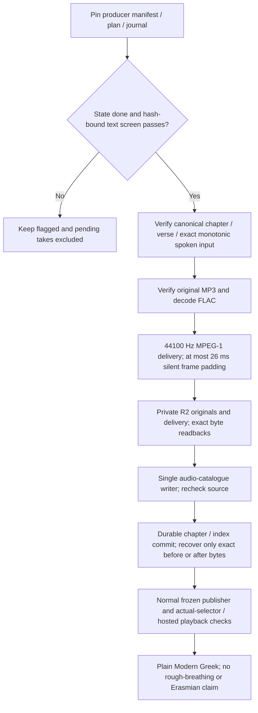
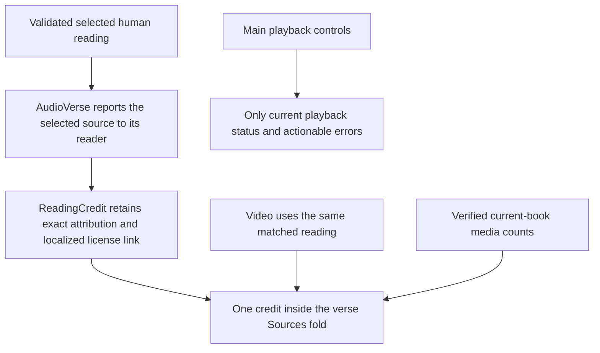

<!-- For God so loved the world, that he gave his only begotten Son, that whosoever believeth in him should not perish, but have everlasting life. — John 3:16 (KJV) -->

# Verse readings and video

Root owns source preparation, R2, catalogue, schema, publisher and iOS. Claude owns Android; Claude2 owns website HTML and the web player. Producers never publish independently. Source preparation has no synthesis or paid-provider POST. New human readings live in readings_chirho, while clips_chirho retains all legacy word/AI clips. Old clients ignore the new array; updated clients require valid human source metadata and show its credit before selecting these readings. Both arrays share the existing combined size/count limits. A whole human reading carries its original CC BY-SA 3.0 attribution and timing hashes; no AI recipe or IPA claim is fabricated. Sample-rate conversion is a delivery derivative and adds no source fidelity. A timing rollover uses the current chapter end, never the next chapter's timestamp. Exact verse-number mismatches or cuts away from measured pauses stay held. Unknown paid generation outcomes and existing retry limits remain independent.

A future translated reading is a separate audio identity from its video. Until a replacement track is verified, use only the named original-language baseline; keep the embedded sound unless a separately selected reading is deliberately chosen. A future learning path can link to lessons, grammar and pronunciation without generating a course in this implementation.

Video originals remain in the producer's folder and are archived without re-encoding. scripts-chirho/video-chirho/install_chirho.ts checks canonical bytes, the delivered scene, a matching selected human reading, codec/dimensions/duration and exact R2 byte readback before adding data-chirho/video-chirho/catalogue-chirho.json. The publisher's video_rules_chirho.ts overlays these records after image delivery/shard refresh, re-hashes the summaries and withholds a video if its scene or source changed. Only verified published records enter the Worker's video hash/length allowlist; MP4s never become Cloudflare static files. The single-range handler returns206with exact Content-Range; invalid ranges/unknown objects do not fetch R2. Changing an embedded reading never silently substitutes a translated track.

Website swipes share the Previous/Next availability rule and existing passage-loading cancellation path. The touch-only action leaves vertical scrolling, pinch and browser edge gestures available, and tracks one finger identity. New touches, multi-touch interruption, cancel and destroy retire transforms and old settle callbacks; the compatibility-click guard is limited to the lift position and never consumes keyboard activation or a new deliberate tap. The native Safari check uses a dedicated simulator and the frozen website, with existing video playback stopped by the same passage change.

## Local Greek verse recordings

Only done rows are eligible, even when an excluded row has a chosen take. Automated text screening does not establish listener acceptance; clips remain audition. The local Chatterbox V3 recipe preserves canonical text and separately re-derives the producer's modern monotonic spelling. Existing pronunciation compatibility stays in force: plain Modern may serve the aspirates choice only when the source has no rough breathing. The default rendition is unchanged. Original FLAC headers need not declare duration; preparation measures decoded samples. Original evidence is private, content addressed and never exposed through the public audio route. A partial catalogue commit resumes only with its frozen input binding and each destination's exact before/after hash; foreign edits are held. No synthesis, retake, quota reset or provider spending belongs to installation.

## November 8 credit and statistics placement

The source contracts and validators do not change when the credit moves. The exact published Be’eri attribution remains English, as before, with a localized License link. The main playback area no longer repeats the full credit. The existing current-book art count moves from the passage chooser to the last item in Sources; its data and readiness condition are unchanged. General meanings/root/AI-study-aid explanations link to About. Whole-verse playback, Normal default speed, video/reading identity and cancellation behavior remain available.
