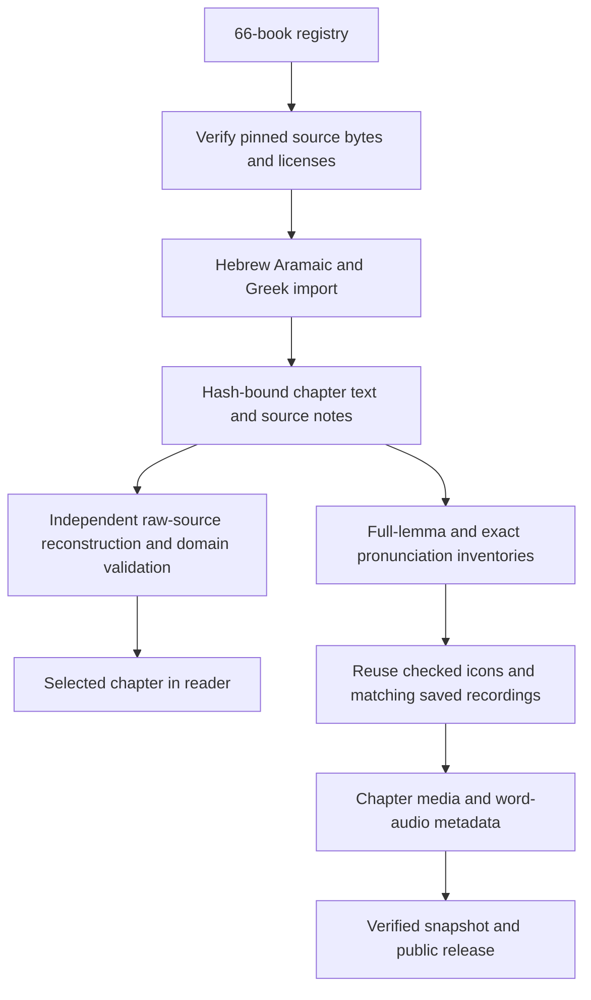
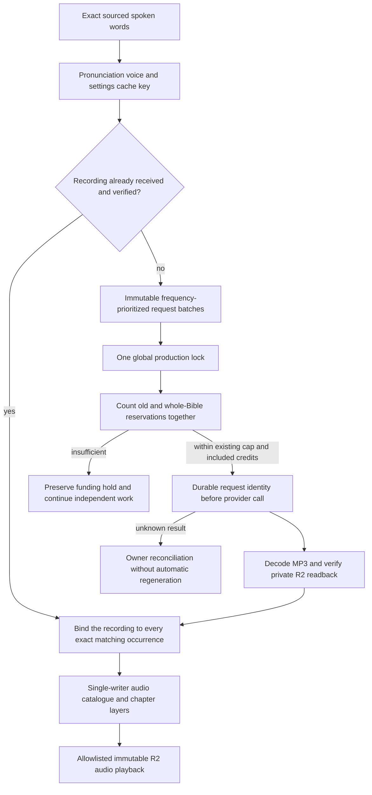
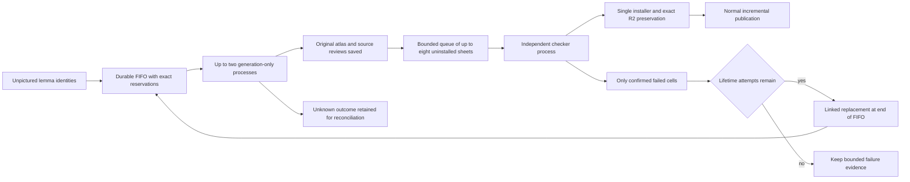
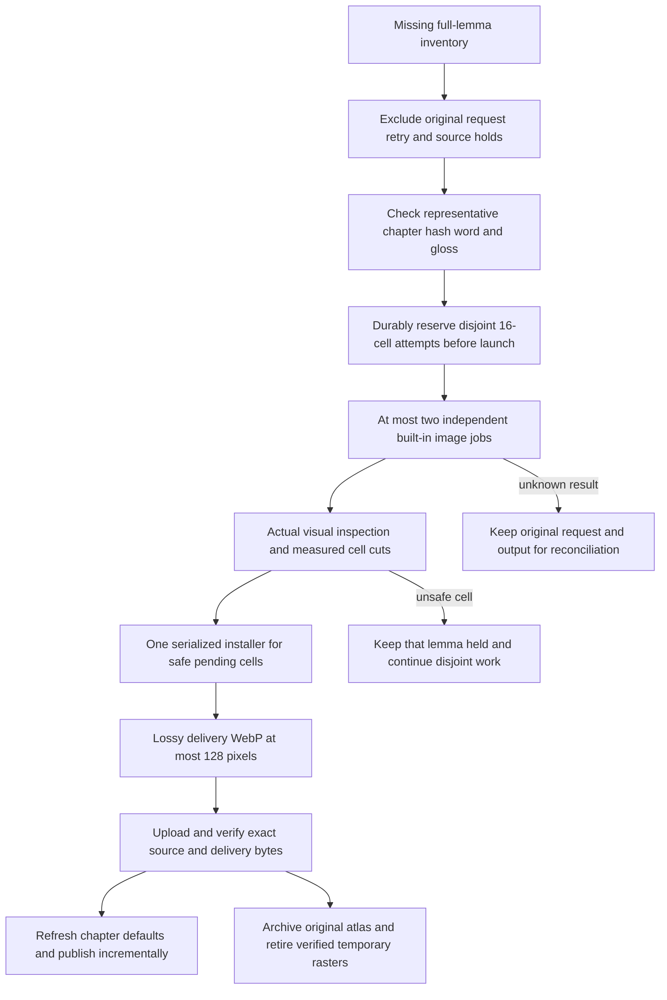

<!-- For God so loved the world, that he gave his only begotten Son, that whosoever believeth in him should not perish, but have everlasting life. — John 3:16 (KJV) -->

# Whole-Bible text and reusable media

The shared 66-book registry is `config-chirho/bible-chirho/books-chirho.json`. Source editions, source verse numbering, combining-mark order and full lemma identities remain authoritative. The WLC/OSHB and Nestle 1904 editions produce 31,156 verses; this is not a claim that their numbering matches every English edition. The existing three book imports remain unchanged. New import code lives in `scripts-chirho/bible-chirho/` and reads the older corpus and lexicon modules without writing to them.

`sources_chirho.py --acquire-chirho` obtains only pinned public source files and checks Git blob and SHA-256 identities. With no acquisition option it verifies the local copies offline. `build_chirho.py [--check]` handles the new 63 books. `test_sources_chirho.py` independently reconstructs every canonical line from raw XML or CSV, including the existing three books. Unknown source structures refuse import. Known source disagreements retain their exact codes and explanatory notes, withholding unsupported teaching analysis or lemma assignment. Aramaic is identified explicitly and is not sent to a Hebrew pronunciation voice. Qere and editorial variants remain source records rather than silently changing the canonical line.

The client verifies a selected chapter against its book manifest. It retains at most three book clients; each client bounds its chapter cache. Chapter reads are bounded at 4 MiB, including Psalm 119. Sparse source verse numbering is explicit in the manifest and navigation skips absent edition verses without renumbering them.

## Word recordings and the shared credit ceiling

`libraries_chirho.ts` prepares cold inventories and reuses exact clips without calling a provider. `prepare-production-chirho.ts` creates the missing-word queue only when it does not already exist. A request contains one representative occurrence; fanout metadata supplies all other matches after receipt. Existing natural recordings are retained. The whole-canon pronunciation inventory and the request queue are distinct, so retries cannot erase old billing evidence.

`run_words_chirho.ts --whole-bible-chirho --apply-chirho` uses the same fixed 270,000-credit project ceiling, shared with the original queue and correction reservations. It takes the global lock before reading any spending ledger. Requested or uncertain results still reserve credits. Neither an added book nor a restart resets the ceiling. Source and pronunciation holds remain separate from funding holds. Recordings are synthesized pronunciation aids pending review, not certified native performances.

Audio bytes are uploaded and read back before use. Public snapshots validate local MP3s, source bindings and R2 receipts, then remove MP3s from the static payload and add only verified content addresses to the Worker allowlist. Playback has no provider or database call. Unknown hashes return 404; writes return 405; HEAD and a matching ETag avoid reading the object.

## Missing lemma pictures

The current `icon_pipeline_chirho/run_chirho.py` separates the production queues. L.J.'s November 5 priority is at least one recognizable general picture per exact lemma identity, with more senses later. A useful general mnemonic does not have to depict every occurrence precisely. Its label and source notes must remain honest, and Hebrew augments/Greek lexical forms are still distinct identities.

`queue_chirho.py` uses SQLite WAL/FULL transactions to reserve each lemma once, order work, and record immutable attempt events. The parent seals its plan hash before a child can request an image. The producer never installs and the checker never generates. The supervisor and both stages retain the original coordinator and installer locks, so no second worker/catalogue writer is introduced. The existing built-in image tool, pending human review state, exact source bindings and R2-before-retirement policy remain. There is no paid provider fallback.

Known visual/layout failures return only the unsuccessful lemma identities to the FIFO tail. Up to three lifetime image-attempt reservations are allowed per lemma, counting known original attempts; the overall sheet bound remains 1,000 and pending local sheets are capped at eight, with a 15 GiB disk floor. A proven pre-image source stop releases only its current unused image reservation; it does not erase old attempts. A concern about one target never withholds fifteen unrelated lemmas. Unsupported source identities and unknown original results stay separate. A malformed review is preserved remotely and held while unrelated sheets continue; an archive/storage failure drains generation and keeps the existing image for recovery rather than rendering it again.

`seed_chirho.py` records hashes of the old state, candidate index, actual media summaries and imported dispositions. Existing pictured lemmas are skipped. Historical records are not rewritten: returned failures obtain linked replacement attempts under the direct November 5 instruction, while legacy, missing-source and unknown outcomes remain held. A definitive Codex `model_not_found` rejection with zero image calls can be reconciled as an unsent reservation, retaining the raw failure and proof; it never supplies permission for a fallback model. The new pipeline's launcher model is an explicit choice using the configured global default when there is no project override. A rejected configuration is reported rather than silently changing models.

Both the generator and checker resolve the managed `~/.local/bin/codex` executable to its actual release path through `icon_generation_chirho.codex_executable_chirho()`. They never select the CLI through background `PATH`. The November 5 failure was an older Homebrew Codex 0.144.1 shadowing the working managed 0.166.0. Original child rollout metadata proves the versions; checking the interactive shell alone missed the difference. A text-only managed-CLI turn verifies model/account availability without creating an image. A missing managed executable refuses before a request journal is opened. Tests put a stale executable first on PATH and execute both real child stages; either stage returning to PATH lookup makes the regression fail. No CLI installation, global PATH, login, model or provider change is needed.

The default command is a read-only plan. `--mode-chirho seed --apply-chirho` creates the source-bound queue; `--mode-chirho run --apply-chirho --sheets-chirho N` runs the independent stages within the fixed bound; `--mode-chirho status` reads actual queue state. Progress timestamps come from recorded state transitions, not polling timers. SIGTERM drains calls and leaves pending originals resumable. A restart rechecks the same saved image or completes its installation, and never reissues an unknown request.

### Earlier coupled worker

The following describes the retained earlier worker and the provenance of its historical attempts. It must not run alongside the new pipeline.

`icons_chirho.py` is the installer; `icon_worker_chirho.py` owns the single whole-canon producer and catalogue writer. Its candidate index retains legacy hold dispositions; Hebrew augments and exact Greek lexical forms stay separate. A general lemma picture is not a contextual sense review of every occurrence and never creates an alternate-sense border. Artist inspection and source review remain distinct from L.J.'s pending artwork approval.

The producer has one coordinator lock, at most two independent generation processes and one serialized installer/archive/shard writer. `icon_generation_chirho.py` owns each child's process, log, request journal and existing 20-minute timeout; no shared child global is used. `--concurrency-chirho 1|2` selects the bound (default 2), while `--sheets-chirho` caps new attempts including failures. Every exact lemma is reserved in `active_attempts_chirho` before launch. Legacy single-attempt state migrates without changing holds. A completed slot is replenished after installation without waiting for its sibling.

A prior active or unknown request is never blindly repeated. Completed sheets resume through the installer; unresolved attempts retain their identities and their lemmas are held while unrelated candidates continue. Three consecutive generator failures stop dispatch for owner reconciliation, including when a successful sibling later finishes. An unavailable image tool stops this lane, with no paid fallback. Storage or archival failure stops new dispatch, drains both children and retains unfinished plans for recovery. SIGTERM drains both requests and their storage chains; it does not kill an unknown image result. Only an expired per-child timeout kills that child's own process group.

Retirement receives the completed attempt's exact scope. The sole installer also owns the static artwork and delivery-output trees; other generator attempts are excluded. Legacy broad retirement protects every attempt still listed in the coordinator journal. Exact referenced generator originals are archived and hash-verified before deletion. A sibling's style reference, source atlas and inspection composite remain available while it works. These boundaries are covered by coordinator, process-lifecycle and retirement tests. The November 4 live two-sheet proof installed 30 icons and retained two cell holds, with two original image calls, disjoint lemma plans, overlapping child lifetimes and serialized R2 readback/shard refresh. That small run is not a sustained throughput benchmark.

Visual inspection uses an opaque white-composited diagnostic as well as the untouched transparent atlas. Some image viewers display hidden RGB in transparent pixels as colored fringes or stripes; that is not evidence of a visible artifact after normal compositing. Formal cuts still measure the original keyed alpha, with no pixel repair. Two November 2 sheets initially rejected by that preview were re-inspected by the owner and passed all 32 unchanged cell checks. Their original reviews and holds remain; source-bound owner-review records explain the reassessment. A real missing-gutter sheet remains held. This recovery made no replacement image requests and approved no human artwork.

Only temporary raster bytes exist locally during generation and verification. The exact source atlas and original generator output are archived privately before removal; public artwork remains compressed WebP on R2. Publication preserves pending art states and requires matching R2 receipts. The existing release cycle publishes changed media at most once every 30 minutes and holds on application code changes until the tested baseline is accepted.

The current source corpus, queues, credit estimates, actual received recordings, image availability and public release cut must be reported separately. A prepared queue is not a completed library; a running process is not progress evidence. Check received/installed records and actual hosted playback before making those claims.

## Source-gap and pending-upload recovery

The November 2 catch-up recovered an already generated 14-icon batch for Acts 24:27. That source chapter contains 26 verses because verse 7 is omitted; its highest verse number is still 27. Media validation now checks membership in each manifest’s explicit verse_numbers_chirho, or its ordinary consecutive sequence, and refuses omitted numbers. It must not compare a source verse id to the count of present verses. The saved batch was compressed, read back on R2 and retired locally without another image call. Recovered partial batches restore their individual rejected-cell holds before any new dispatch.

A declared image may briefly precede its completed R2 proof while the sole producer runs the archive chain. The publisher treats missing or mismatched exact proof as a typed release refusal: watch mode keeps the deployed site unchanged and retries at most every five minutes. It never publishes unverified bytes or treats an upload attempt as a receipt. Unknown errors remain owner-reconciliation events.

Artwork snapshots freeze the authoring manifest bytes before the R2 proof index and its checked shard bytes. The directory walk uses those frozen bytes and excludes later-added manifests/proof files. A new producer batch therefore waits for the next release instead of entering an older proof snapshot. Source path, hash, size and review checks still run against the frozen release inputs; a genuinely unfinished upload remains a refusal. No pending record becomes verified through snapshotting.
