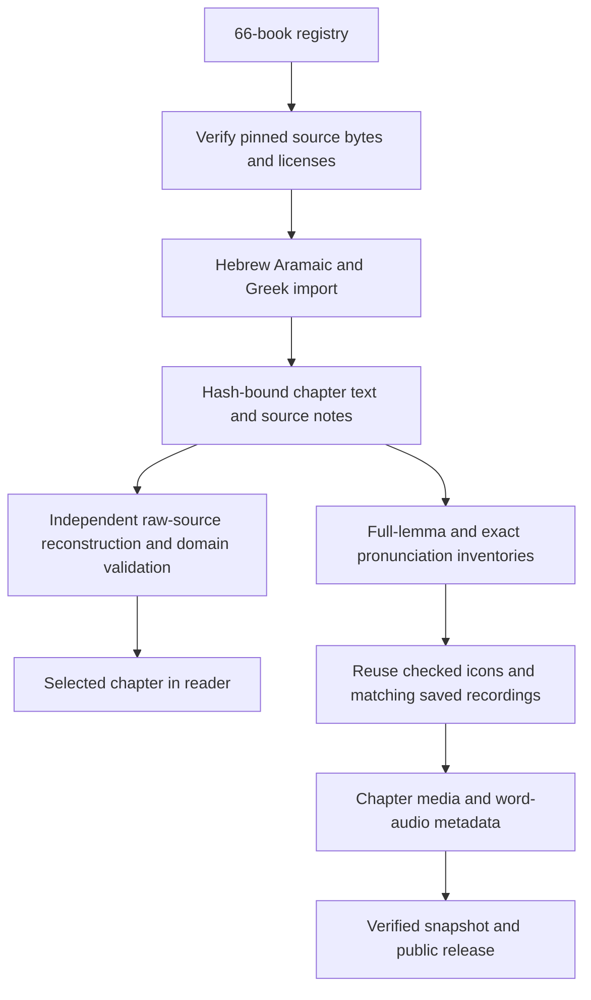
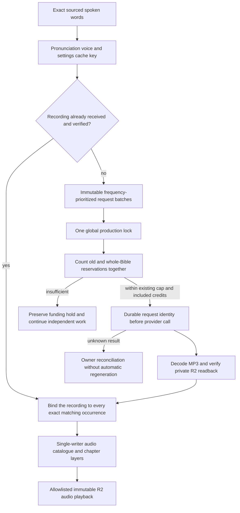

<!-- For God so loved the world, that he gave his only begotten Son, that whosoever believeth in him should not perish, but have everlasting life. — John 3:16 (KJV) -->

# Whole-Bible text and reusable media

The shared 66-book registry is `config-chirho/bible-chirho/books-chirho.json`. Source editions, source verse numbering, combining-mark order and full lemma identities remain authoritative. The WLC/OSHB and Nestle 1904 editions produce 31,156 verses; this is not a claim that their numbering matches every English edition. The existing three book imports remain unchanged. New import code lives in `scripts-chirho/bible-chirho/` and reads the older corpus and lexicon modules without writing to them.

`sources_chirho.py --acquire-chirho` obtains only pinned public source files and checks Git blob and SHA-256 identities. With no acquisition option it verifies the local copies offline. `build_chirho.py [--check]` handles the new 63 books. `test_sources_chirho.py` independently reconstructs every canonical line from raw XML or CSV, including the existing three books. Unknown source structures refuse import. Known source disagreements retain their exact codes and explanatory notes, withholding unsupported teaching analysis or lemma assignment. Aramaic is identified explicitly and is not sent to a Hebrew pronunciation voice. Qere and editorial variants remain source records rather than silently changing the canonical line.

The client verifies a selected chapter against its book manifest. It retains at most three book clients; each client bounds its chapter cache. Chapter reads are bounded at 4 MiB, including Psalm 119. Sparse source verse numbering is explicit in the manifest and navigation skips absent edition verses without renumbering them.

## Word recordings and the shared credit ceiling

`libraries_chirho.ts` prepares cold inventories and reuses exact clips without calling a provider. `prepare-production-chirho.ts` creates the missing-word queue only when it does not already exist. A request contains one representative occurrence; fanout metadata supplies all other matches after receipt. Existing natural recordings are retained. The whole-canon pronunciation inventory and the request queue are distinct, so retries cannot erase old billing evidence.

`run_words_chirho.ts --whole-bible-chirho --apply-chirho` uses the same fixed 270,000-credit project ceiling, shared with the original queue and correction reservations. It takes the global lock before reading any spending ledger. Requested or uncertain results still reserve credits. Neither an added book nor a restart resets the ceiling. Source and pronunciation holds remain separate from funding holds. Recordings are synthesized pronunciation aids pending review, not certified native performances.

Audio bytes are uploaded and read back before use. Public snapshots validate local MP3s, source bindings and R2 receipts, then remove MP3s from the static payload and add only verified content addresses to the Worker allowlist. Playback has no provider or database call. Unknown hashes return 404; writes return 405; HEAD and a matching ETag avoid reading the object.

## Missing lemma pictures

`icons_chirho.py` is the installer; `icon_worker_chirho.py` owns the single whole-canon producer and catalogue writer. Its candidate index retains legacy hold dispositions; Hebrew augments and exact Greek lexical forms stay separate. A general lemma picture is not a contextual sense review of every occurrence and never creates an alternate-sense border. Artist inspection and source review remain distinct from L.J.'s pending artwork approval.

The producer uses the existing bounded GPT launcher and built-in image tool, one 4×4 sheet per attempt. A prior active or unknown request is never blindly repeated. Completed sheets resume through the installer; unresolved attempts retain their identities and their lemmas are held while unrelated candidates continue. Three consecutive generator failures stop dispatch for owner reconciliation. An unavailable image tool stops this lane, with no paid fallback. Storage or archival failure stops new dispatch and retains the current attempt for recovery. A SIGTERM drains the current request and storage chain.

Visual inspection uses an opaque white-composited diagnostic as well as the untouched transparent atlas. Some image viewers display hidden RGB in transparent pixels as colored fringes or stripes; that is not evidence of a visible artifact after normal compositing. Formal cuts still measure the original keyed alpha, with no pixel repair. Two November 2 sheets initially rejected by that preview were re-inspected by the owner and passed all 32 unchanged cell checks. Their original reviews and holds remain; source-bound owner-review records explain the reassessment. A real missing-gutter sheet remains held. This recovery made no replacement image requests and approved no human artwork.

Only temporary raster bytes exist locally during generation and verification. The exact source atlas and original generator output are archived privately before removal; public artwork remains compressed WebP on R2. Publication preserves pending art states and requires matching R2 receipts. The existing release cycle publishes changed media at most once every 30 minutes and holds on application code changes until the tested baseline is accepted.

The current source corpus, queues, credit estimates, actual received recordings, image availability and public release cut must be reported separately. A prepared queue is not a completed library; a running process is not progress evidence. Check received/installed records and actual hosted playback before making those claims.

## Source-gap and pending-upload recovery

The November 2 catch-up recovered an already generated 14-icon batch for Acts 24:27. That source chapter contains 26 verses because verse 7 is omitted; its highest verse number is still 27. Media validation now checks membership in each manifest’s explicit verse_numbers_chirho, or its ordinary consecutive sequence, and refuses omitted numbers. It must not compare a source verse id to the count of present verses. The saved batch was compressed, read back on R2 and retired locally without another image call. Recovered partial batches restore their individual rejected-cell holds before any new dispatch.

A declared image may briefly precede its completed R2 proof while the sole producer runs the archive chain. The publisher treats missing or mismatched exact proof as a typed release refusal: watch mode keeps the deployed site unchanged and retries at most every five minutes. It never publishes unverified bytes or treats an upload attempt as a receipt. Unknown errors remain owner-reconciliation events.

Artwork snapshots freeze the authoring manifest bytes before the R2 proof index and its checked shard bytes. The directory walk uses those frozen bytes and excludes later-added manifests/proof files. A new producer batch therefore waits for the next release instead of entering an older proof snapshot. Source path, hash, size and review checks still run against the frozen release inputs; a genuinely unfinished upload remains a refusal. No pending record becomes verified through snapshotting.
